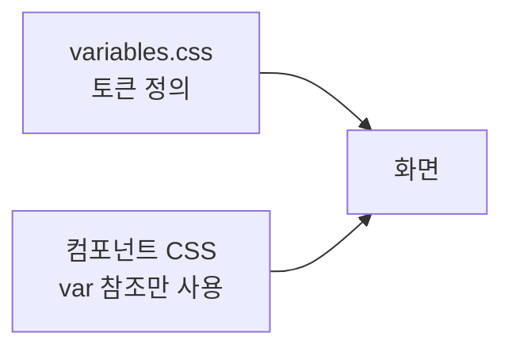
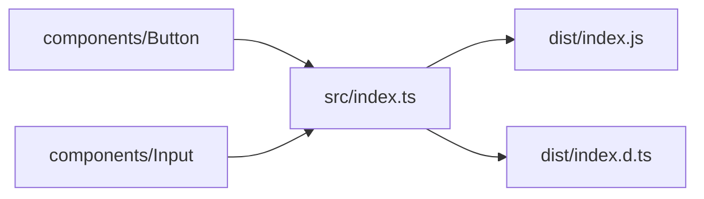
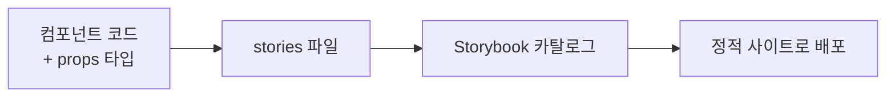

---
hide:
  - navigation
---

# React 컴포넌트 라이브러리 구축

[← 디자인 시스템으로 돌아가기](index.md)

[디자인 토큰 추출·발행](design-tokens.md)에서 만든 CSS 변수를 사용하는 React 컴포넌트를 만들고, 하나의 라이브러리로 묶어 문서화하는 흐름을 정리합니다. 프런트엔드 스택이 정해져 있지 않은 경우를 가정해 가장 널리 쓰이는 React를 기준으로 삼습니다. 직접 따라 해 보려면 [React 컴포넌트 라이브러리 구축 실습](practice/component-library.md)을 참고합니다.

| 구분 | 설명 |
|---|---|
| 컴포넌트 라이브러리 | 토큰을 적용한 UI 컴포넌트를 하나의 패키지로 묶어 여러 프로젝트에서 가져다 쓰는 구조 |
| 라이브러리 모드 빌드 | 앱이 아니라 다른 코드가 import할 결과물(JS, 타입, CSS)을 만드는 빌드 방식 |
| 컴포넌트 카탈로그 | 컴포넌트를 격리된 화면에서 상태별로 보여 주는 문서화 도구 |

!!! note "전제 조건"
    [디자인 토큰 추출·발행](design-tokens.md)의 산출물인 CSS 변수 파일(`variables.css`)을 입력으로 전제합니다. 토큰 이름이 바뀌면 컴포넌트 스타일이 함께 깨지므로, 토큰 이름은 컴포넌트가 의존하는 계약으로 다룹니다.

!!! warning "확인 필요"
    도구의 버전과 요구 사항은 바뀔 수 있습니다. 이 문서의 수치는 2026-11-15 기준 `npm view`로 확인한 값입니다. 사용 전에 [참고](#참고)의 공식 문서에서 다시 확인합니다.

    - 확인한 것: [참고](#참고)의 URL 5개가 열리는 것(HTTP 200), Storybook 설치 문서의 Node.js 20 이상 요구, 아래 폴더 구조의 Button 하나를 Vite 라이브러리 모드로 빌드해 다른 프로젝트에서 import한 것
    - 실습에서 추가로 확인한 것: Storybook 10.6.8의 실행과 카탈로그 정적 빌드, Button·Input 두 컴포넌트의 빌드와 다른 프로젝트에서의 타입 검사·빌드([실습](practice/component-library.md))
    - 확인하지 못한 것: 사용 측 앱을 브라우저에서 실행한 렌더링, CommonJS 출력

---

## 프로젝트 구성

### 도구 선정 (제안)

| 역할 | 제안 | 확인한 버전 | 선정 이유 |
|---|---|---|---|
| UI 라이브러리 | React | 19.3.1 | 가장 널리 쓰이는 선택지 |
| 언어 | TypeScript | 7.0.2 | props 타입이 곧 컴포넌트 사용 명세가 됨 |
| 빌드 도구 | Vite (라이브러리 모드) | 8.3.8 | 설정이 짧고 라이브러리 모드를 기본 제공 |
| 타입 선언 생성 | vite-plugin-dts | 5.1.2 | 빌드 시 `.d.ts`를 함께 출력 |
| 문서화 도구 | Storybook (`@storybook/react-vite`) | 10.6.7 | 컴포넌트 카탈로그의 사실상 표준이며 Vite와 같은 설정을 공유 |

!!! note "버전 요구 사항"
    Vite 8.3.8은 Node.js `^20.19.0 || >=22.12.0`을 요구합니다. Storybook 설치 문서는 Node.js 20 이상을 요구한다고 안내합니다. TypeScript의 최신 버전은 7.0.2이지만 7.0.2에서는 vite-plugin-dts가 JavaScript Compiler API를 찾지 못해 `vite build`가 실패했습니다. 이 문서의 빌드 검증은 6.0.3에서 했습니다.

이 선정은 제안이며 팀의 기존 스택이 있으면 그 스택을 우선합니다. 선정 기준은 두 가지입니다.

- 토큰 CSS 변수를 그대로 쓸 수 있을 것(특정 CSS-in-JS 런타임에 묶이지 않을 것)
- 빌드와 문서화 도구가 같은 설정을 공유해 이중 관리가 없을 것

### 초기 폴더 구조 (제안)

```text
my-ui/
├─ src/
│  ├─ tokens/
│  │  └─ variables.css      # 토큰 발행 단계의 산출물
│  ├─ components/
│  │  ├─ Button/
│  │  │  ├─ Button.tsx
│  │  │  ├─ Button.css
│  │  │  ├─ Button.stories.tsx
│  │  │  └─ index.ts
│  │  └─ Input/
│  │     └─ ...
│  └─ index.ts              # 라이브러리 진입점(공개 API)
├─ .storybook/              # 카탈로그 설정
├─ package.json
├─ tsconfig.json
└─ vite.config.ts
```

| 위치 | 역할 |
|---|---|
| `src/tokens/` | 토큰 CSS 변수. 직접 수정하지 않고 변환 결과를 복사하거나 동기화 |
| `src/components/<이름>/` | 컴포넌트 하나당 폴더 하나. 구현, 스타일, 카탈로그 문서를 함께 둠 |
| `src/index.ts` | 외부에 공개할 컴포넌트만 export하는 단일 진입점 |

### 토큰 CSS 변수를 불러오는 방식

토큰 변수는 `:root`에 정의되므로, 컴포넌트가 쓰이는 화면 어디에서든 한 번만 로드되면 됩니다. 선택지는 두 가지입니다.

| 방식 | 설명 | 장단점 |
|---|---|---|
| 라이브러리 CSS에 포함 | 진입점에서 `variables.css`를 import해 빌드 결과 CSS에 합침 | 사용자는 CSS 한 파일만 불러오면 됨. 토큰 교체가 어려움 |
| 별도 파일로 분리 제공 | 토큰 CSS를 독립 파일로 배포하고 사용 측이 먼저 불러옴 | 사용 측이 토큰을 덮어써 테마를 바꿀 수 있음. 불러올 파일이 하나 늘어남 |

**제안**: 별도 파일로 분리합니다. 컴포넌트 CSS는 토큰을 `var(--color-bg-primary)` 형태로 참조만 하고 값을 갖지 않으므로, 토큰 파일만 바꾸면 컴포넌트를 다시 빌드하지 않아도 테마가 바뀝니다.



---

## 기본 컴포넌트 구현

### 토큰 적용 원칙

- 컴포넌트 CSS에는 색상·간격·글자 크기 같은 값을 직접 쓰지 않고 토큰 변수만 참조합니다.
- 원시 토큰(`--color-blue-500`)이 아닌 의미 기반 토큰(`--color-bg-primary`)을 참조합니다. 테마가 바뀌면 의미 기반 토큰의 연결만 바뀌고 컴포넌트는 그대로이기 때문입니다.
- 필요한 토큰이 없으면 컴포넌트에서 임의 값을 만들지 않고 토큰 쪽에 추가를 요청합니다.

```css title="src/components/Button/Button.css"
.btn {
  background: var(--color-bg-primary);
  padding: var(--space-2) var(--space-4);
  border-radius: var(--radius-md);
}
```

!!! warning "확인 필요"
    위 변수 이름(`--space-2`, `--radius-md` 등)은 구조를 보이기 위한 예시입니다. 실제 이름은 발행된 `variables.css`와 대조해 맞춥니다.

### Figma variant·property와 props 대응 기준

Figma 컴포넌트의 속성은 종류에 따라 props 형태가 정해집니다.

| Figma 속성 | props 형태 | 예 |
|---|---|---|
| Variant (선택지가 정해진 속성) | 문자열 유니언 타입 | `variant: 'primary' \| 'secondary'` |
| Variant 중 크기 | 문자열 유니언 타입 | `size: 'sm' \| 'md' \| 'lg'` |
| Boolean property | boolean prop | `disabled`, `loading` |
| Text property | `children` 또는 문자열 prop | 버튼 라벨 → `children` |
| Instance swap property | `ReactNode` 타입 prop | `leadingIcon` |
| 상태(hover, pressed, focus) | prop이 아닌 CSS 의사 클래스 | `:hover`, `:active`, `:focus-visible` |

대응 원칙은 다음과 같습니다.

- Figma의 속성 이름과 값 이름을 props에 그대로 옮깁니다(소문자 kebab-case 값, camelCase prop 이름). 이름이 같아야 디자이너와 개발자가 같은 말로 대화할 수 있습니다.
- hover·pressed처럼 사용자 동작으로 바뀌는 상태는 prop으로 만들지 않고 CSS로 처리합니다. 단 `disabled`처럼 외부에서 지정해야 하는 상태는 prop으로 둡니다.
- 모든 prop에 기본값을 정하고, 기본값은 Figma 컴포넌트의 기본 variant와 일치시킵니다.
- Figma에 없는 prop은 임의로 추가하지 않습니다. 필요하면 먼저 Figma 쪽 명세에 반영합니다.

```tsx title="src/components/Button/Button.tsx"
export interface ButtonProps
  extends React.ButtonHTMLAttributes<HTMLButtonElement> {
  variant?: 'primary' | 'secondary';
  size?: 'sm' | 'md' | 'lg';
}
```

기본 HTML 속성(`onClick`, `type` 등)은 `ButtonHTMLAttributes`를 상속해 그대로 받습니다. 이렇게 하면 라이브러리가 모든 속성을 다시 정의하지 않아도 일반 `<button>`처럼 쓸 수 있습니다.

### Input 컴포넌트 기준

인풋은 Figma에서 상태(기본, 포커스, 오류, 비활성)가 variant로 정의되는 경우가 많습니다. 같은 기준으로 나눕니다.

| 상태 | 처리 |
|---|---|
| 기본, 포커스 | CSS(`:focus-visible`) |
| 비활성 | `disabled` prop |
| 오류 | `invalid` 같은 boolean prop(`aria-invalid`와 함께 지정) |

---

## 라이브러리 패키징

### export 구조

외부에 공개할 컴포넌트는 `src/index.ts` 한 곳에서만 export합니다. 이 파일이 라이브러리의 공개 API이며, 여기에 없는 파일은 내부 구현으로 취급합니다.



### 빌드 결과물

| 결과물 | 용도 |
|---|---|
| `dist/index.js` (ESM) | 컴포넌트 코드. 번들러가 트리 셰이킹할 수 있는 형식 |
| `dist/index.d.ts` | TypeScript 사용자를 위한 타입 선언 |
| `dist/style.css` | 컴포넌트 스타일 |
| 토큰 CSS(별도 파일) | 토큰 변수 정의. 위에서 제안한 대로 분리해 제공 |

빌드 설정에서 정해야 할 항목은 다음과 같습니다.

| 항목 | 기준 |
|---|---|
| 진입점 | `src/index.ts` |
| 외부 의존성(`external`) | `react`, `react-dom`은 번들에 넣지 않음 |
| 출력 형식 | ESM 우선. CommonJS가 필요한지는 사용 환경에 따라 결정 |
| 타입 선언 | 빌드 시 함께 생성 |

`react`와 `react-dom`은 `dependencies`가 아닌 `peerDependencies`에 선언합니다. 라이브러리가 자체 React를 번들에 넣으면 사용 앱의 React와 두 벌이 생겨 오류가 나기 때문입니다.

`package.json`의 `exports`, `types`, `files` 필드로 진입점과 배포 대상 파일을 지정합니다.

```json title="package.json (발췌)"
{
  "files": ["dist"],
  "exports": {
    ".": { "types": "./dist/index.d.ts", "import": "./dist/my-ui.js" },
    "./style.css": "./dist/my-ui.css"
  },
  "sideEffects": ["*.css"]
}
```

최소 프로젝트(Button 하나)를 이 구성으로 빌드해 다른 프로젝트에 설치한 결과는 다음과 같습니다.

- `import { Button } from 'my-ui'`가 동작하고, `my-ui/style.css`가 컴포넌트 CSS 파일로 해석됩니다.
- 빌드 결과 JS에는 `react/jsx-runtime`만 import로 남고 React 본체는 포함되지 않습니다.
- 토큰 `variables.css`는 빌드 결과(`dist`)에 자동으로 들어가지 않습니다. 별도 파일로 제공하려면 빌드 후 `dist`로 복사하고 `exports`에 경로를 추가해야 합니다.
- 컴포넌트에서 `import './Button.css'`를 쓰면 TypeScript 6에서 TS2882 오류가 났습니다. `tsconfig.json`의 `types`에 `vite/client`를 추가하면 사라집니다.

!!! warning "확인 필요"
    CommonJS 출력과 조건부 export의 추가 조건(`require`, `default`)은 검증하지 않았습니다. 사용 환경이 정해지면 그에 맞춰 확인합니다.

### 버전과 배포 방식 개요

| 항목 | 기준 (제안) |
|---|---|
| 버전 규칙 | 유의적 버전(MAJOR.MINOR.PATCH). props 제거·이름 변경은 MAJOR, 컴포넌트·prop 추가는 MINOR, 버그 수정은 PATCH |
| 토큰 변경 | 토큰 값만 바뀌면 PATCH 또는 MINOR, 토큰 이름 삭제·변경은 컴포넌트가 깨질 수 있으므로 MAJOR로 검토 |
| 배포 대상 | 사내 비공개 레지스트리 또는 npm. 조직 사정에 따라 결정 |
| 변경 이력 | CHANGELOG에 버전별 변경 내용을 기록 |

!!! warning "확인 필요"
    배포 레지스트리(npm, GitHub Packages 등)와 자동 배포 도구는 정하지 않았습니다. 선정 후 이 절에 반영합니다.

---

## 컴포넌트 문서화

### 컴포넌트 카탈로그의 역할

Storybook은 컴포넌트를 앱과 분리된 화면에서 렌더링하고, 상태별 모습(story)과 props 설명을 한곳에 모아 보여 줍니다. 개발자에게는 사용 예시, 디자이너에게는 Figma와의 대조 화면이 됩니다.



### story 작성 기준

- 컴포넌트 폴더 안에 `*.stories.tsx`를 함께 두고, 컴포넌트당 파일 하나를 기본으로 합니다.
- Figma의 variant 하나가 story 하나에 대응하도록 만듭니다(예: Primary, Secondary, Disabled). 그러면 카탈로그와 Figma를 나란히 놓고 대조할 수 있습니다.
- props 타입에 주석을 달아 두면 카탈로그가 이를 설명 표로 보여 줍니다.
- 토큰 CSS는 카탈로그 설정에서 전역으로 한 번 불러와, 실제 사용 환경과 같은 조건에서 렌더링되게 합니다.

### 카탈로그 배포

카탈로그는 정적 사이트로 빌드할 수 있어 별도 서버 없이 호스팅할 수 있습니다. 정적 호스팅 위치(GitHub Pages 등)는 조직 사정에 따라 정합니다.

---

## 정리 확인

- [ ] 컴포넌트 CSS에 토큰이 아닌 값이 직접 쓰이지 않는다.
- [ ] Figma의 variant·property 이름이 props 이름과 일치한다.
- [ ] 공개할 컴포넌트가 `src/index.ts` 한 곳에서만 export된다.
- [ ] `react`, `react-dom`이 peerDependencies에 있고 번들에 포함되지 않는다.
- [ ] 빌드 결과물을 다른 프로젝트에 설치해 import와 스타일 적용이 된다.
- [ ] 토큰 파일 값을 바꾸면 컴포넌트 재빌드 없이 화면이 바뀐다.
- [ ] Figma variant마다 대응하는 story가 있다.

---

## 참고

아래 중 버전은 2026-11-15 기준 `npm view`로 확인했습니다. URL은 직접 열어 확인하지 않았으므로 접속 후 내용과 버전을 대조합니다.

- [React](https://react.dev/)
- [Vite: Building for Production (Library Mode)](https://vite.dev/guide/build#library-mode)
- [vite-plugin-dts](https://github.com/qmhc/vite-plugin-dts)
- [Storybook for React & Vite](https://storybook.js.org/docs/get-started/frameworks/react-vite)
- [Semantic Versioning](https://semver.org/lang/ko/)
- `npm view`로 확인한 `react` 19.3.1, `vite` 8.3.8, `storybook`·`@storybook/react-vite` 10.6.7, `vite-plugin-dts` 5.1.2, `typescript` 7.0.2
