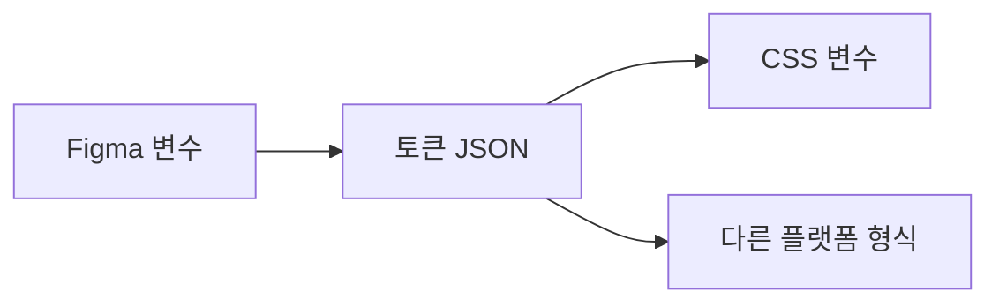
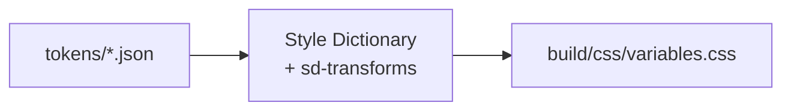

---
hide:
  - navigation
---

# 디자인 토큰 추출·발행

[← 디자인 시스템으로 돌아가기](index.md)

[Figma 디자인 시스템 정리](figma-organize.md)에서 정돈한 변수를 코드가 읽을 수 있는 디자인 토큰으로 바꾸고, 변경이 생길 때마다 다시 발행하는 흐름을 정리합니다.

| 구분 | 설명 |
|---|---|
| 디자인 토큰 | 디자인 값(색상, 간격 등)을 이름과 값으로 표현한 JSON 데이터 |
| 추출 | Figma 변수를 JSON 파일로 내보내는 단계 |
| 변환 | JSON 토큰을 CSS 변수 같은 코드용 형식으로 바꾸는 단계 |
| 발행 | 변환 결과를 코드에서 가져다 쓸 수 있게 반영하는 단계 |

!!! note "전제 조건"
    [Figma 디자인 시스템 정리](figma-organize.md)의 네이밍 규칙(슬래시 계층, 소문자 kebab-case)을 입력 조건으로 전제합니다. 이름이 규칙을 따르지 않으면 변환 결과의 이름과 계층이 어긋납니다.

!!! warning "확인 필요"
    도구의 버전, 지원 범위, 요금제 제약은 바뀔 수 있습니다. 이 문서의 수치는 2026-11-15 기준으로 확인한 값이며, 실제 사용 전에 [참고](#참고)의 공식 문서에서 다시 확인합니다.

---

## 디자인 토큰 개념

### 정의와 역할

디자인 토큰은 디자인 결정(색상, 간격, 글자 크기 등)을 이름이 붙은 값으로 저장한 것입니다. 디자이너는 Figma에서, 개발자는 코드에서 같은 이름으로 같은 값을 참조하므로 토큰이 디자인과 코드 사이의 단일 기준이 됩니다.



값을 바꿔야 할 때는 토큰 JSON만 수정하고 다시 변환하면 되므로, 코드 곳곳의 값을 직접 고치지 않아도 됩니다.

### JSON 토큰 형식

토큰 하나는 값(value)과 타입(type)으로 이루어지고, 이름의 계층은 JSON의 중첩으로 표현합니다. 의미 기반 토큰은 값을 직접 갖지 않고 `{경로}` 형태로 원시 토큰을 참조합니다.

```json title="tokens/color.json"
{
  "color": {
    "blue": {
      "500": { "$type": "color", "$value": "#3B82F6" }
    },
    "bg": {
      "primary": { "$type": "color", "$value": "{color.blue.500}" }
    }
  }
}
```

| 속성 | 의미 |
|---|---|
| `$type` | 값의 종류 (예: `color`, `dimension`) |
| `$value` | 실제 값 또는 다른 토큰에 대한 참조 |
| `{color.blue.500}` | 참조 표기. 원시 → 의미 기반 관계를 값이 아닌 이름으로 유지 |

`$value`, `$type`처럼 `$`를 붙이는 표기는 W3C Design Tokens Community Group(DTCG) 형식입니다. Tokens Studio는 `$` 없이 쓰는 레거시 형식과 DTCG 형식을 모두 지원하며 기본값은 레거시입니다.

!!! note "표준 적용 여부"
    이 문서는 DTCG 형식을 기준으로 설명합니다. Style Dictionary는 v4부터 DTCG를 정식 지원하지만, 최신 DTCG 규격(2025.10)은 v5에서도 작업 중이라고 공식 문서에 적혀 있습니다. 규격의 모든 기능이 동작한다고 가정하지 않습니다.

---

## Figma 변수 추출

변수를 JSON으로 꺼내는 방법은 두 가지입니다.

| 방법 | 방식 | 제약 |
|---|---|---|
| Figma REST API | `GET /v1/files/:file_key/variables/local` 호출로 변수를 JSON으로 조회 | Enterprise 조직의 정회원만 사용 가능. 개인 액세스 토큰에 `file_variables:read` 범위 필요 |
| Tokens Studio 플러그인 | 플러그인이 토큰을 JSON으로 관리하고 GitHub 같은 저장소와 동기화 | 폴더 단위 저장(토큰 세트별 파일)은 Pro 기능. 단일 파일 저장은 무료 플랜에서도 가능 |

### 선택 제안

- **제안**: Tokens Studio 플러그인 + 단일 JSON 파일.
- **이유**: REST API의 변수 조회는 Enterprise 요금제가 필요해 일반 요금제에서는 쓸 수 없습니다. 플러그인은 JSON 출력과 저장소 동기화를 함께 제공합니다.
- Enterprise 요금제라면 REST API로 변수를 직접 조회하는 방식도 선택할 수 있습니다. 다만 응답 JSON은 DTCG 형식이 아니므로 변환 스크립트가 추가로 필요합니다.

!!! warning "확인 필요"
    Figma 변수를 Tokens Studio로 가져오는(import) 기능의 범위와 요금제 제약은 이 문서 작성 시점에 공식 문서에서 확인하지 못했습니다. 플러그인에서 Figma 변수를 직접 가져올 수 있는지 먼저 확인하고, 불가능하면 토큰을 플러그인에서 새로 관리하는 방식으로 전환해야 합니다.

### 플러그인으로 GitHub에 동기화

플러그인의 GitHub 동기화 설정에는 아래 항목이 필요합니다.

| 항목 | 설명 |
|---|---|
| 개인 액세스 토큰 | 클래식 토큰은 `repo` 범위, 세분화 토큰은 Contents 읽기·쓰기 권한 |
| 저장소 | `owner/repo` 형식 |
| 브랜치 | 토큰을 푸시할 브랜치 |
| 저장 위치 | 단일 파일(`tokens.json`) 또는 폴더 |

동기화를 마치면 저장소에 토큰 JSON이 올라가며, 이 파일이 이후 변환 단계의 입력이 됩니다.

### 참조 관계 유지

원시 토큰과 의미 기반 토큰의 관계는 JSON에서 `{color.blue.500}` 같은 참조로 유지합니다. 추출 과정에서 참조가 값으로 풀려 버리면 테마를 바꿀 때 의미 기반 토큰을 일일이 고쳐야 하므로, 추출 결과에서 의미 기반 토큰이 참조로 남아 있는지 확인합니다.

---

## 코드용 포맷 변환

### 변환 도구

JSON 토큰을 CSS 변수로 바꾸는 도구로 [Style Dictionary](https://styledictionary.com/)를 사용합니다. Tokens Studio가 내보낸 JSON을 Style Dictionary에서 쓰려면 추가 패키지 `@tokens-studio/sd-transforms`가 필요합니다.

| 패키지 | 확인한 버전 | 요구 사항 |
|---|---|---|
| `style-dictionary` | 5.8.0 | Node.js 22 이상 |
| `@tokens-studio/sd-transforms` | 2.0.3 | Style Dictionary 5.x, Node.js 18 이상, ESM 전용 |

두 패키지는 버전 호환 관계가 있으므로 함께 설치합니다.

```bash
npm install style-dictionary @tokens-studio/sd-transforms
```

### 변환 흐름



### 설정과 출력 구조

```js title="build-tokens.js"
import { register } from '@tokens-studio/sd-transforms';
import StyleDictionary from 'style-dictionary';

register(StyleDictionary);

const sd = new StyleDictionary({
  source: ['tokens/**/*.json'],
  preprocessors: ['tokens-studio'],
  platforms: {
    css: {
      transformGroup: 'tokens-studio',
      buildPath: 'build/css/',
      files: [
        {
          destination: 'variables.css',
          format: 'css/variables',
          options: { outputReferences: true },
        },
      ],
    },
  },
});

await sd.cleanAllPlatforms();
await sd.buildAllPlatforms();
```

| 설정 | 역할 |
|---|---|
| `source` | 입력할 토큰 JSON 경로 |
| `preprocessors: ['tokens-studio']` | Tokens Studio 형식을 Style Dictionary가 읽도록 사전 처리. 명시해야 함 |
| `transformGroup: 'tokens-studio'` | 이름 변환(kebab-case)과 값 변환(색상, 크기 등)을 묶은 그룹 |
| `format: 'css/variables'` | `:root` 블록에 CSS 변수를 출력 |
| `outputReferences` | `true`이면 참조 관계를 `var(--...)` 형태로 출력에 유지 (기본값 `false`) |

출력은 `:root` 안에 토큰 경로를 `--color-blue-500`처럼 kebab-case로 이은 변수가 들어가는 형태입니다.

```css title="build/css/variables.css"
:root {
  --color-blue-500: #3b82f6;
  --color-bg-primary: var(--color-blue-500);
}
```

!!! warning "확인 필요"
    위 출력은 설정으로부터 예상한 구조입니다. 이 문서 작성 환경에서 실제 변환을 실행해 확인하지는 않았습니다. 색상 값의 표기(대소문자 등)와 변수 이름은 실제 실행 결과와 대조해 보완합니다.

---

## 발행과 반복 작업 자동화

### 재발행 절차

토큰이 바뀔 때마다 아래 순서를 반복합니다.

1. Figma(또는 Tokens Studio)에서 변수 값을 수정합니다.
2. 플러그인으로 토큰 JSON을 저장소에 푸시합니다.
3. 변환 스크립트를 실행해 CSS 변수를 다시 만듭니다.
4. 생성된 파일의 변경 내용을 확인하고 커밋합니다.
5. 코드에서 생성된 CSS 변수를 가져다 씁니다.

`package.json`에 변환 명령을 등록해 두면 3단계를 한 줄로 실행할 수 있습니다.

```bash
node build-tokens.js
```

### AI 자동화 도구로 줄일 수 있는 범위

반복 작업 중 규칙이 분명한 부분만 자동화 대상으로 둡니다.

| 대상 | 자동화 가능 여부 | 비고 |
|---|---|---|
| 토큰 JSON 변경 후 변환 실행, 결과 차이 확인 | 가능 | 명령 실행과 diff 확인은 규칙이 고정되어 있음 |
| 변환 설정 파일 작성·수정 | 가능 | 결과를 반드시 사람이 검토 |
| 네이밍 규칙 위반 점검 | 가능 | 규칙을 기준으로 이름 목록을 비교 |
| 토큰 값 자체의 결정(어떤 색을 쓸지) | 사람이 결정 | 디자인 판단이므로 자동화하지 않음 |
| 요금제·도구 지원 범위 확인 | 사람이 결정 | 공식 문서로 직접 확인 |

!!! warning "확인 필요"
    자동화에 사용할 AI 도구의 이름과 버전은 [개발환경 준비](setup.md)에서 확정되는 대로 이 절에 반영합니다.

---

## 정리 확인

- [ ] 변수 이름이 네이밍 규칙을 따른다.
- [ ] 토큰 JSON이 저장소에 올라가 있다.
- [ ] 의미 기반 토큰이 원시 토큰을 참조로 가리킨다.
- [ ] 변환 명령이 오류 없이 실행되어 CSS 변수 파일이 생성된다.
- [ ] 토큰 값을 바꾸고 다시 변환했을 때 해당 변수만 바뀐다.

---

## 참고

2026-11-15 기준으로 직접 열어 확인한 공식 문서와 패키지 정보입니다.

- [Figma REST API: Variables endpoints](https://developers.figma.com/docs/rest-api/variables-endpoints/)
- [Tokens Studio: Token Format](https://docs.tokens.studio/manage-settings/token-format)
- [Tokens Studio: Sync with GitHub](https://docs.tokens.studio/token-storage/remote/sync-git-github)
- [Tokens Studio: Style Dictionary](https://docs.tokens.studio/transform-tokens/style-dictionary)
- [Style Dictionary: Installation](https://styledictionary.com/getting-started/installation/)
- [Style Dictionary: DTCG](https://styledictionary.com/info/dtcg/)
- [Style Dictionary: Predefined formats](https://styledictionary.com/reference/hooks/formats/predefined/)
- [Style Dictionary: Predefined transform groups](https://styledictionary.com/reference/hooks/transform-groups/predefined/)
- [@tokens-studio/sd-transforms](https://github.com/tokens-studio/sd-transforms)
- `npm view`로 확인한 `style-dictionary` 5.8.0, `@tokens-studio/sd-transforms` 2.0.3
