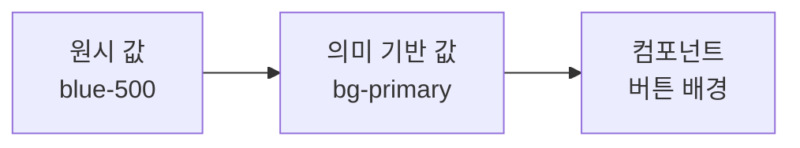

---
hide:
  - navigation
---

# Figma 디자인 시스템 정리

[← 디자인 시스템으로 돌아가기](index.md)

디자인 토큰 추출과 컴포넌트 자동화는 Figma 파일의 변수, 스타일, 컴포넌트가 일관된 규칙으로 정리되어 있어야 안정적으로 동작합니다. 이 문서에서는 정리 기준과 네이밍 규칙을 먼저 살펴봅니다.

| 구분 | 설명 |
|---|---|
| 변수(Variables) | 색상, 간격, 타이포그래피, 모서리 반경 등의 값을 이름으로 관리 |
| 스타일과 컴포넌트 | 변수로 표현하기 어려운 조합과 재사용 단위를 관리 |
| 네이밍 규칙 | 이후 자동 변환이 가능하도록 이름의 계층과 표기를 통일 |

!!! warning "확인 필요"
    Figma 변수 기능의 세부 명칭과 제약은 버전에 따라 달라질 수 있습니다. 이 문서의 내용은 정리 기준을 설명하는 것이며, 화면 구성과 한도는 실제 사용 중인 Figma 버전에서 확인합니다.

---

## 변수

### 변수 종류

Figma 변수는 값의 종류(타입)별로 만들 수 있습니다. 디자인 시스템에서는 보통 아래와 같이 나눕니다.

| 용도 | 변수 타입 | 예시 |
|---|---|---|
| 색상 | Color | 브랜드 색, 배경색, 글자색 |
| 간격 | Number | 여백, 요소 사이 간격 |
| 모서리 반경 | Number | 버튼, 카드의 둥글기 |
| 타이포그래피 | Number, String | 글자 크기, 줄 높이, 글꼴 이름 |

타이포그래피는 글자 크기·굵기·줄 높이를 한 묶음으로 다루는 경우가 많아 변수 하나로 표현하기 어렵습니다. 이 묶음은 스타일(텍스트 스타일)로 관리하고, 묶음을 이루는 개별 값만 변수로 둘지는 [스타일과 컴포넌트](#스타일과-컴포넌트)에서 정합니다.

### 컬렉션과 모드

- **컬렉션**: 관련 있는 변수를 묶는 단위입니다. 용도별로 `color`, `spacing`, `radius`처럼 나눕니다.
- **모드**: 같은 변수가 상황에 따라 다른 값을 갖게 하는 단위입니다. 라이트/다크 테마가 대표적인 예입니다.

모드는 같은 이름의 변수에 값만 바꿔 넣는 구조이므로, 모드가 필요한 변수(색상)와 필요 없는 변수(간격)는 컬렉션을 나누어 둡니다.

컬렉션당 만들 수 있는 모드 수는 플랜에 따라 다릅니다.

| 플랜 | 컬렉션당 모드 수 |
|---|---|
| Starter | 확인 필요 (공식 플랜 비교 문서에 수치 없음) |
| Professional | 최대 10개 |
| Organization | 최대 20개 |
| Enterprise | 제한 없음 (확장 컬렉션 사용) |

- 컬렉션 하나에 만들 수 있는 변수는 최대 5,000개입니다.
- 플랜별 컬렉션 개수 제한은 공식 문서에서 찾지 못했습니다.

### 원시 값과 의미 기반 값

변수는 두 계층으로 나누어 관리합니다.

| 계층 | 역할 | 예시 |
|---|---|---|
| 원시 값(primitive) | 실제 값을 가진 기본 팔레트 | `blue-500` = `#3B82F6` |
| 의미 기반 값(semantic) | 용도를 나타내며 원시 값을 참조 | `bg-primary` → `blue-500` |

- 컴포넌트는 원시 값이 아니라 **의미 기반 값만** 참조합니다.
- 다크 모드처럼 테마가 바뀌면 의미 기반 값이 가리키는 원시 값만 바꿉니다. 컴포넌트는 수정하지 않아도 됩니다.
- 원시 값은 모드에 따라 변하지 않습니다.

---

## 스타일과 컴포넌트

### 변수와 스타일의 역할 구분

| 구분 | 담당 | 예시 |
|---|---|---|
| 변수 | 하나의 값과 그 값의 모드별 전환 | 색상, 간격, 반경 |
| 스타일 | 여러 속성을 묶은 조합 | 텍스트 스타일, 이펙트(그림자) 스타일 |

기준은 "값 하나인가, 속성의 묶음인가"입니다. 값 하나이면 변수, 묶음이면 스타일로 둡니다.

### 컴포넌트 구조화 기준

- 반복해서 쓰이는 UI 단위는 컴포넌트로 만듭니다.
- 같은 컴포넌트의 변형은 **variant**로 묶습니다. 크기, 상태처럼 값의 종류가 정해진 것이 대상입니다.
- 변형의 축은 **property**로 정의합니다. 예를 들어 버튼은 `size`(sm/md/lg), `state`(default/hover/disabled) 같은 property를 가집니다.
- property 이름과 값도 아래 [네이밍 규칙](#네이밍-규칙)을 따릅니다.

### 하드코딩된 값을 변수로 치환하는 순서

기존 파일에 색상이나 간격이 직접 입력되어 있다면 아래 순서로 정리합니다.

1. 파일에서 쓰이는 하드코딩된 값을 모아 중복을 정리합니다.
2. 원시 값 변수를 먼저 만듭니다.
3. 용도에 맞는 의미 기반 변수를 만들고 원시 값을 참조하게 합니다.
4. 컴포넌트의 하드코딩된 값을 의미 기반 변수로 바꿉니다.
5. 변수가 적용되지 않은 값이 남아 있는지 확인합니다.

의미 기반 변수가 없는 채로 컴포넌트를 먼저 바꾸면 값이 원시 값에 직접 연결되므로 순서를 지킵니다.

---

## 네이밍 규칙

이후 단계에서 변수 이름을 코드용 토큰 이름으로 자동 변환하므로, 이름이 일정한 규칙을 따라야 합니다.

| 항목 | 규칙 |
|---|---|
| 계층 구분자 | 슬래시(`/`)로 통일 |
| 대소문자 | 소문자 kebab-case로 통일 |
| 구성 순서 | 큰 분류에서 작은 분류 순서 (카테고리 → 용도 → 상태) |
| 상태 표기 | 이름에 붙이지 않고 하위 계층으로 분리 (`primary/hover`) |
| 약어 | 관용 약어만 허용 (허용 목록: `bg`) |

!!! note "예시"
    아래 이름은 규칙을 적용한 예시입니다. 실제 이름은 프로젝트에 맞춰 정합니다.

| 계층 | 이름 예시 |
|---|---|
| 원시 값 | `color/blue/500` |
| 의미 기반 값 | `color/bg/primary/default` |
| 의미 기반 값(상태 포함) | `color/bg/primary/hover` |
| 간격 | `spacing/4` |

상태를 하위 계층으로 나누면 `primary`와 `primary/hover`의 관계가 이름에서 드러나고, 변환 단계에서 문자열을 쪼갤 필요가 없습니다. 대신 상태가 없는 기본 값에도 `default` 계층이 필요합니다.

슬래시로 구분한 이름은 Figma에서 그룹으로 묶여 보이고, 변환 단계에서 계층 구조로 바꾸기 쉽습니다.

---

## 정리 확인

- [ ] 변수가 종류별 컬렉션으로 나뉘어 있다.
- [ ] 색상 변수가 원시 값과 의미 기반 값으로 분리되어 있다.
- [ ] 컴포넌트가 원시 값이 아닌 의미 기반 값을 참조한다.
- [ ] 하드코딩된 색상·간격이 남아 있지 않다.
- [ ] 모든 이름이 같은 구분자와 대소문자 규칙을 따른다.

---

## 참고

2026-11-14 기준으로 직접 열어 확인한 Figma 공식 도움말입니다.

- [Guide to variables in Figma](https://help.figma.com/hc/en-us/articles/15339657135383-Guide-to-variables-in-Figma)
- [Overview of variables, collections, and modes](https://help.figma.com/hc/en-us/articles/14506821864087-Overview-of-variables-collections-and-modes)
- [Figma plans and features](https://help.figma.com/hc/en-us/articles/360040328273-Figma-plans-and-features)
