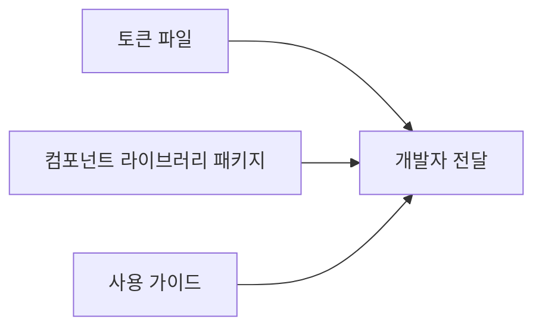
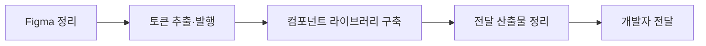

---
hide:
  - navigation
---

# 개발 전달 산출물 정리

[← 디자인 시스템으로 돌아가기](index.md)

앞선 세 단계의 결과물을 개발자가 바로 가져다 쓸 수 있는 형태로 묶어 넘기는 기준을 정리합니다. 무엇을 어떤 구성으로 넘기는지, 넘기기 전에 무엇을 확인하는지, 전체 흐름이 어떻게 이어지는지를 다룹니다. 직접 따라 해 보려면 [개발 전달 산출물 정리 실습](practice/handoff.md)을 참고합니다.

| 구분 | 설명 |
|---|---|
| 전달 산출물 | 토큰 파일, 컴포넌트 라이브러리 패키지, 사용 가이드 세 가지 묶음 |
| 전달 체크리스트 | 산출물 누락 여부와 버전·변경 이력 표기를 넘기기 전에 확인하는 항목 |
| 전체 흐름 | Figma 정리부터 전달까지 단계 순서와 각 단계의 입력·출력 |

!!! note "전제 조건"
    아래 세 문서의 산출물을 입력으로 전제합니다.

    - [Figma 디자인 시스템 정리](figma-organize.md): 규칙에 따라 정돈된 Figma 라이브러리
    - [디자인 토큰 추출·발행](design-tokens.md): 토큰 JSON과 CSS 변수 파일(`variables.css`)
    - [React 컴포넌트 라이브러리 구축](component-library.md): 빌드된 컴포넌트 패키지와 카탈로그

!!! warning "확인 필요"
    이 문서의 파일명, 폴더 구조, 버전 표기는 선행 문서의 제안 구성을 그대로 이어 받은 기준입니다. 배포 레지스트리, 카탈로그 호스팅 위치, 패키지 이름은 아직 정해지지 않았으므로 확정되는 대로 보완합니다.

---

## 전달 산출물 구성

개발자에게 넘기는 산출물은 세 묶음입니다. 각 묶음은 앞 단계의 결과물을 그대로 가져오며, 새로 만드는 것은 사용 가이드뿐입니다.



| 묶음 | 내용 | 출처 |
|---|---|---|
| 토큰 파일 | 토큰 JSON, CSS 변수 파일 | [디자인 토큰 추출·발행](design-tokens.md) |
| 컴포넌트 라이브러리 패키지 | 컴포넌트 코드, 타입 선언, 스타일 | [React 컴포넌트 라이브러리 구축](component-library.md) |
| 사용 가이드 | 설치, 사용법, 컴포넌트 목록 | 이 문서의 기준으로 작성 |

### 토큰 파일

| 파일 | 형식 | 용도 |
|---|---|---|
| `tokens/*.json` | JSON(DTCG 형식) | 토큰의 원본. 값을 바꾸거나 다른 플랫폼 형식으로 변환할 때의 입력 |
| `build/css/variables.css` | CSS 변수 | 화면에서 바로 불러다 쓰는 변환 결과 |

- JSON은 디자인 값의 원본이고 CSS 변수는 그 변환 결과입니다. 둘이 같은 시점의 값인지가 전달 시 확인할 핵심입니다.
- 컴포넌트 라이브러리에서는 같은 CSS 변수 파일을 `src/tokens/variables.css`로 두고 사용합니다. 변환 결과를 복사하거나 동기화하며 직접 수정하지 않습니다.
- 컴포넌트 라이브러리 문서의 제안대로 토큰 CSS를 별도 파일로 제공한다면, 사용 측이 이 파일을 먼저 불러와야 합니다. 이 사실은 사용 가이드에 반드시 적습니다.

### 컴포넌트 라이브러리 패키지

빌드 결과물과 패키지 설정이 전달 대상입니다.

| 결과물 | 설명 |
|---|---|
| `dist/index.js` (ESM) | 컴포넌트 코드 |
| `dist/index.d.ts` | TypeScript 타입 선언 |
| 컴포넌트 스타일 CSS | `exports`의 `./style.css`로 불러오는 파일 |
| 토큰 CSS(별도 파일) | 토큰 변수 정의. 빌드 후 `dist`로 복사하고 `exports`에 경로를 추가해야 포함됨 |
| `package.json` | `exports`, `types`, `files`, `peerDependencies`, 버전 |
| `CHANGELOG` | 버전별 변경 내용 |

!!! warning "확인 필요"
    컴포넌트 라이브러리 문서의 검증은 Button 하나를 빌드해 다른 프로젝트에서 import한 데까지입니다. [실습](practice/handoff.md)에서는 Button·Input 두 컴포넌트를 묶은 패키지(`README.md`, `CHANGELOG.md` 포함)를 `.tgz`로 만들어 다른 프로젝트에서 설치·타입 검사·빌드하는 데까지 확인했습니다. 컴포넌트가 더 늘어난 실제 패키지는 전달 전에 같은 방식으로 직접 확인해야 합니다.

### 사용 가이드

사용 가이드는 라이브러리를 처음 쓰는 개발자가 별도 설명 없이 설치부터 화면 적용까지 따라갈 수 있어야 합니다. 아래 세 부분으로 구성합니다.

| 부분 | 담을 내용 |
|---|---|
| 설치 | 패키지 설치 명령, 요구 환경(Node.js, React 버전), 토큰 CSS와 스타일 CSS를 불러오는 방법 |
| 사용법 | 컴포넌트를 import해 쓰는 최소 예시, props 규칙, 토큰 값을 바꿔 테마를 조정하는 방법 |
| 컴포넌트 목록 | 제공 컴포넌트 이름, 주요 props, 상태별 모습(카탈로그 링크) |

```text
사용 가이드 (README 또는 카탈로그 소개 페이지)
├─ 설치
│  ├─ 패키지 설치
│  ├─ 요구 환경
│  └─ CSS 불러오기 (토큰 → 컴포넌트 순서)
├─ 사용법
│  ├─ 컴포넌트 import
│  ├─ props 규칙 (Figma variant·property와 대응)
│  └─ 테마 조정
└─ 컴포넌트 목록
   └─ 컴포넌트별 설명 (카탈로그 링크)
```

- 컴포넌트 목록과 상태별 모습은 직접 쓰지 않고 [컴포넌트 카탈로그](component-library.md#컴포넌트-문서화)로 연결합니다. 목록을 두 곳에서 관리하면 어긋납니다.
- props 규칙은 Figma의 variant·property 이름이 props 이름과 같다는 대응 기준을 한 문단으로 요약해 적습니다.
- 가이드의 코드 예시는 실제 빌드된 패키지에서 동작하는 것만 적습니다.

!!! warning "확인 필요"
    사용 가이드를 어디에 두는지(패키지 README, 카탈로그 소개 페이지, 별도 문서 사이트)는 정하지 않았습니다. 위치가 정해지면 이 절에 반영합니다.

---

## 전달 체크리스트

### 산출물 누락 확인

넘기기 전에 아래 항목을 하나씩 확인합니다.

**토큰 파일**

- [ ] 토큰 JSON이 저장소에 있다.
- [ ] CSS 변수 파일이 현재 토큰 JSON을 변환한 결과다.
- [ ] 의미 기반 토큰이 원시 토큰을 참조로 가리킨다.

**컴포넌트 라이브러리 패키지**

- [ ] 공개할 컴포넌트가 모두 `src/index.ts`에서 export된다.
- [ ] 빌드가 오류 없이 끝나고 `dist`에 JS, 타입 선언, CSS가 있다.
- [ ] 토큰 CSS가 별도 파일로 `dist`에 포함되고 `exports`에서 가리킨다.
- [ ] `react`, `react-dom`이 `peerDependencies`에 있고 번들에 포함되지 않는다.
- [ ] 다른 프로젝트에 설치해 import와 스타일 적용이 된다.

**사용 가이드**

- [ ] 설치 방법이 현재 패키지 이름·버전과 일치한다.
- [ ] 토큰 CSS를 먼저 불러와야 한다는 안내가 있다.
- [ ] 컴포넌트 목록이 `src/index.ts`의 공개 목록과 일치한다.
- [ ] Figma variant마다 대응하는 story가 카탈로그에 있다.

**일관성**

- [ ] 토큰 이름이 Figma 변수 이름, 토큰 JSON, CSS 변수, 컴포넌트 CSS에서 같은 규칙으로 이어진다.
- [ ] 컴포넌트가 참조하는 토큰이 모두 발행된 CSS 변수 파일에 있다.

### 버전과 변경 이력 표기

버전 규칙은 [컴포넌트 라이브러리 문서의 제안](component-library.md#버전과-배포-방식-개요)을 따릅니다.

| 변경 | 버전 |
|---|---|
| props 제거·이름 변경, 토큰 이름 삭제·변경 | MAJOR |
| 컴포넌트·prop 추가 | MINOR |
| 버그 수정 | PATCH |
| 토큰 값만 변경 | PATCH 또는 MINOR |

- 패키지 버전 하나로 토큰 파일과 컴포넌트를 함께 표기합니다. 따로 버전을 매기면 어느 토큰 버전과 어느 컴포넌트 버전이 맞는지 추적하기 어렵습니다. (제안)
- `CHANGELOG`에는 버전마다 날짜와 변경 내용을 적고, 토큰 변경과 컴포넌트 변경을 구분해 표기합니다.
- 토큰 이름을 바꾸거나 지운 경우에는 영향을 받는 컴포넌트와 대체 토큰을 함께 적습니다.

```text
## 1.1.0 - 날짜
### 토큰
- 추가: 새로 생긴 토큰
### 컴포넌트
- 추가: 새로 생긴 컴포넌트 또는 prop
```

!!! warning "확인 필요"
    버전을 하나로 합쳐 표기하는 방식은 제안이며 실제 운영 방식은 정하지 않았습니다. 변경 이력을 수동으로 쓸지 도구로 생성할지도 정해지면 반영합니다.

---

## 전체 흐름 재현

### 단계 순서와 입출력



| 순서 | 단계 | 입력 | 출력 | 문서 |
|---|---|---|---|---|
| 1 | 개발환경 준비 | Figma 계정, 도구 선정 | 작업 가능한 환경 | [개발환경 준비](setup.md) |
| 2 | Figma 디자인 시스템 정리 | 흩어진 색상·타이포그래피·간격·컴포넌트 | 네이밍 규칙에 맞춘 변수·스타일·컴포넌트 | [Figma 디자인 시스템 정리](figma-organize.md) |
| 3 | 토큰 추출·발행 | 정돈된 Figma 변수 | 토큰 JSON, CSS 변수 파일 | [디자인 토큰 추출·발행](design-tokens.md) |
| 4 | 컴포넌트 라이브러리 구축 | CSS 변수 파일, Figma 컴포넌트 명세 | 빌드된 패키지, 카탈로그 | [React 컴포넌트 라이브러리 구축](component-library.md) |
| 5 | 전달 산출물 정리 | 토큰 파일, 패키지, 카탈로그 | 체크리스트를 통과한 전달 묶음, 사용 가이드 | 이 문서 |

각 단계의 출력이 다음 단계의 입력입니다. 앞 단계의 출력이 규칙을 어기면 뒤 단계에서 같은 문제가 반복되므로, 단계마다 해당 문서의 정리 확인 항목을 통과한 뒤 넘어갑니다.

### 변경이 생겼을 때의 되돌아가기

전달 후 Figma에서 값이 바뀌면 처음부터 다시 하지 않고, 영향을 받는 단계부터 다시 진행합니다.

| 변경 | 다시 진행할 단계 |
|---|---|
| 토큰 값 변경(색상 값 등) | 토큰 추출·발행 → 전달 산출물 정리 |
| 토큰 이름 변경·삭제 | 토큰 추출·발행 → 컴포넌트 CSS 수정 → 전달 산출물 정리 |
| 컴포넌트 variant·property 변경 | 컴포넌트 구현·story 수정 → 전달 산출물 정리 |
| 새 컴포넌트 추가 | Figma 정리 → 컴포넌트 구현 → 전달 산출물 정리 |

어느 경우든 마지막은 전달 체크리스트와 버전·변경 이력 갱신입니다.

---

## 정리 확인

- [ ] 토큰 파일, 컴포넌트 라이브러리 패키지, 사용 가이드가 모두 있다.
- [ ] 전달 체크리스트의 모든 항목을 확인했다.
- [ ] 패키지 버전과 `CHANGELOG`가 이번 변경을 반영한다.
- [ ] 사용 가이드만 보고 새 프로젝트에서 설치부터 화면 적용까지 할 수 있다.
- [ ] 선행 문서의 용어와 경로가 이 문서와 일치한다.

---

## 참고

이 문서는 저장소 안의 선행 문서를 근거로 작성했으며, 외부 도구의 새 수치나 URL은 추가하지 않았습니다. 도구 버전과 요구 사항은 각 문서의 참고 절을 확인합니다.

- [Figma 디자인 시스템 정리](figma-organize.md#참고)
- [디자인 토큰 추출·발행](design-tokens.md#참고)
- [React 컴포넌트 라이브러리 구축](component-library.md#참고)
