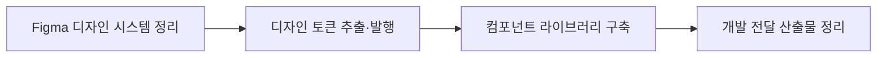

---
hide:
  - toc
  - navigation
---

# 디자인 시스템

Figma로 만든 디자인 시스템을 디자인 토큰과 컴포넌트 라이브러리로 옮기는 흐름을 정리합니다.

---

## 전체 흐름

| 단계 | 입력 | 산출물 |
|---|---|---|
| Figma 디자인 시스템 정리 | 흩어져 있는 색상·타이포그래피·간격·컴포넌트 | 일관된 규칙으로 정돈된 Figma 라이브러리 |
| 디자인 토큰 추출·발행 | 정돈된 Figma 라이브러리의 스타일과 변수 | 코드에서 읽을 수 있는 디자인 토큰 파일 |
| 컴포넌트 라이브러리 구축 | 디자인 토큰, Figma 컴포넌트 명세 | 토큰을 사용하는 코드 컴포넌트 |
| 개발 전달 산출물 정리 | 토큰 파일, 컴포넌트 라이브러리 | 개발자가 바로 쓸 수 있는 문서와 사용 가이드 |

각 단계의 산출물이 다음 단계의 입력이 됩니다. 앞 단계가 정리되지 않으면 뒤 단계에서 같은 값을 반복해서 고치게 되므로 순서대로 진행합니다.

---

## 문서 목록

위에서부터 순서대로 읽는 것을 권장합니다.

| # | 주제 | 설명 |
|---|------|------|
| 1 | [개발환경 준비](setup.md) | Figma, Node.js, 코드 에디터와 토큰 변환·AI 자동화 도구를 준비하는 방법 |
| 2 | [Figma 디자인 시스템 정리](figma-organize.md) | 색상·타이포그래피·간격·컴포넌트를 일관된 규칙으로 정돈하는 방법 |
| 3 | 디자인 토큰 추출·발행 | Figma의 스타일과 변수를 코드용 토큰 파일로 내보내는 방법 *(작성 예정)* |
| 4 | React 컴포넌트 라이브러리 구축 | 토큰을 사용하는 React 컴포넌트 라이브러리를 만드는 방법 *(작성 예정)* |
| 5 | 개발 전달 산출물 정리 | 개발자가 바로 쓸 수 있는 문서와 사용 가이드를 정리하는 방법 *(작성 예정)* |

!!! note "작성 예정"
    작성 예정 문서는 완성되는 대로 제목에 링크를 추가합니다.
