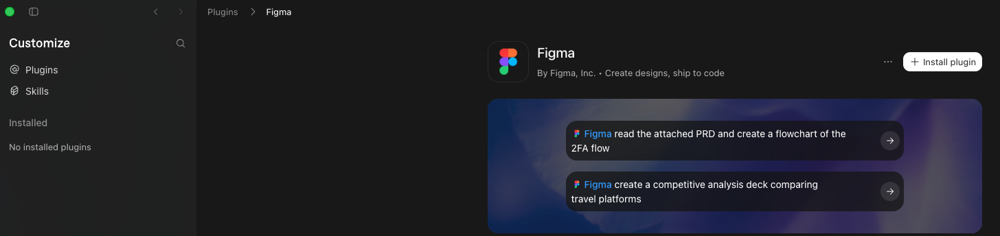
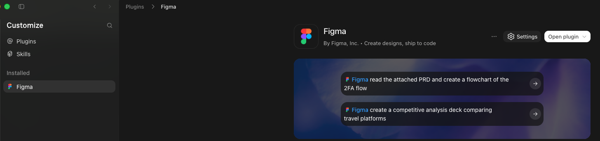
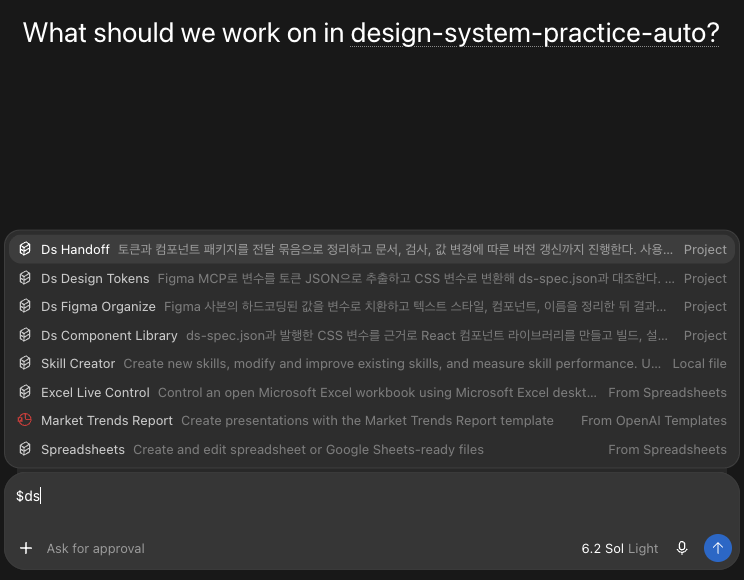
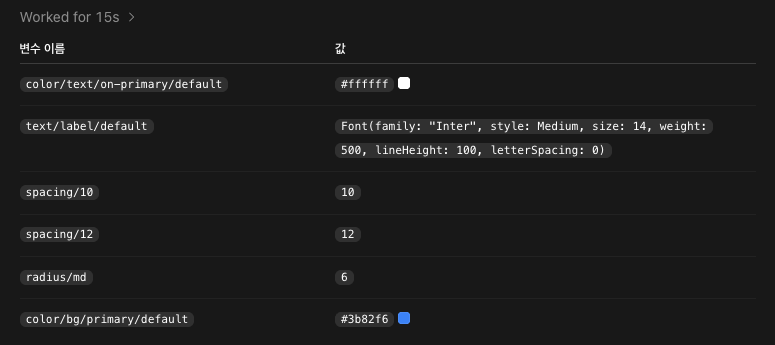

---
hide:
  - navigation
---

# Codex 자동화 실습 환경 구성

[← 디자인 시스템으로 돌아가기](../index.md)

[Codex 자동화 실습](codex-automation.md)에 필요한 환경을 준비합니다. [샘플 Figma 파일](sample-file.md)만 만든 상태에서 Codex를 Figma에 연결하고, 자동화에 쓸 폴더와 skill을 준비합니다. 선택 실습이므로 건너뛰어도 다른 실습에는 영향이 없습니다.

이 문서의 1~2단계는 자동화 실습의 [1-3](codex-automation.md#1-3-figma-플러그인-연결)·[1-4](codex-automation.md#1-4-작업-폴더와-skill-준비)를 화면과 함께 안내합니다. 여기서 마쳤으면 그 두 절은 건너뜁니다.

| 구분 | 내용 |
|---|---|
| 입력 | [샘플 파일](sample-file.md) 5-2단계까지 마친 Figma 파일, 디스코드에서 받은 `.agents` 압축 파일 |
| 산출물 | Figma 연결을 확인한 Codex, `.agents`가 있는 `design-system-practice-auto` 폴더 |
| 다음 단계 | [Codex 자동화 실습](codex-automation.md) |

---

## 실습 환경

2026년 11월 27일에 아래 환경에서 [3-2](#3-2-codex에서-호출)의 호출을 한 번 실행해 MCP 서버 연결을 확인했습니다. 같은 날 Codex 데스크톱 앱에서 [2-2](#2-2-skill-인식-확인)의 skill 4개 인식도 확인했습니다. [2-1](#2-1-작업-폴더에-agents-풀기)의 압축 풀기는 배포 파일로 실행하지 않았습니다.

| 항목 | 확인한 환경 |
|---|---|
| Codex | 데스크톱 앱(ChatGPT 앱 26.1120.50957, Codex 0.171.0-alpha.13.2) |
| ChatGPT 요금제 | Plus |
| Figma 연결 | 앱의 Figma 플러그인 |

- Figma MCP 서버의 읽기 도구에는 호출 제한이 있습니다. View·Collab 시트는 월 20회입니다. 전체 조건은 [Rate limits and access](https://developers.figma.com/docs/figma-mcp-server/rate-limits-access/)에서 확인합니다.

---

## 1. MCP 서버 연결 확인

### 1-1. 플러그인 설치 확인

1. **작업**: Plugins 화면에서 Figma를 열고 **Install plugin**을 선택한 뒤, [Figma MCP 서버 연결](../setup.md#figma-mcp-서버-연결)의 Codex 앱 방식에 따라 접근을 허용합니다.

    { width="100%" }

2. **기대 결과**: Figma가 **Installed** 목록에 표시됩니다.

    { width="100%" }

3. **확인 방법**: 설치 표시만으로는 Figma 파일을 읽을 수 있는지 알 수 없으므로, [1-2](#1-2-연결과-요금제-확인)의 호출이 성공하는지로 연결을 판정합니다.

### 1-2. 연결과 요금제 확인

1. **작업**: Codex의 새 대화에 아래 프롬프트를 보냅니다.

    ```text title="프롬프트"
    Figma MCP의 whoami를 호출해 요금제와 시트를 알려줘. 호출에 실패하면 추측 없이 오류 메시지를 그대로 알려줘.
    ```

2. **기대 결과**: 요금제와 시트가 나옵니다. 자동화 실습의 Figma 정리와 토큰 추출에 필요한 요금제는 [도구와 요금제 확인](codex-automation.md#1-1-도구와-요금제-확인)에서 확인합니다.
3. **확인 방법**: 응답 위의 **Worked for …** 를 펼쳐 Figma 도구를 호출했는지 확인합니다. 호출한 흔적이 없으면 응답을 결과로 인정하지 않습니다.

---

## 2. 자동화 작업 환경 준비

자동화에는 skill 4개가 담긴 `.agents` 폴더를 사용합니다. 학습자는 디스코드에서 압축 파일로 받습니다.

| skill | 하는 일 |
|---|---|
| `ds-figma-organize` | Figma 파일을 분석해 설계안을 만들고, 승인받아 정리한 뒤 `ds-spec.json`에 확정합니다. |
| `ds-design-tokens` | 변수를 토큰 JSON과 CSS 변수로 내보내고 `ds-spec.json`과 대조합니다. |
| `ds-component-library` | `ds-spec.json`과 Figma를 기준으로 컴포넌트 라이브러리를 만듭니다. |
| `ds-handoff` | 개발자에게 전달할 묶음을 만들고 문서와 검사를 정리합니다. |

### 2-1. 작업 폴더에 `.agents` 풀기

1. **작업**: 디스코드에서 압축 파일을 내려받습니다. 작업 폴더를 둘 위치에서 자동화용 폴더를 만들고 압축을 풉니다. `<받은 압축 파일 경로>`는 내려받은 파일의 경로로 바꿉니다.

    **실행 위치**: 작업 폴더를 둘 위치

    **명령어**

    ```bash
    mkdir design-system-practice-auto && unzip -q "<받은 압축 파일 경로>" -d design-system-practice-auto
    ```

    **출력 결과**: 없음(출력이 없으면 정상입니다).

2. **기대 결과**: `design-system-practice-auto/.agents/skills`에 skill 폴더 4개가 있습니다.
3. **확인 방법**: 아래 명령으로 폴더 이름을 확인합니다.

    **실행 위치**: 작업 폴더를 둘 위치

    **명령어**

    ```bash
    ls design-system-practice-auto/.agents/skills
    ```

    **출력 결과**

    ```text
    ds-component-library
    ds-design-tokens
    ds-figma-organize
    ds-handoff
    ```

- `.agents`는 숨김 폴더입니다. Finder에서는 **Command+Shift+.** 을 눌러야 보입니다.
- 압축 파일에 따라 `__MACOSX` 폴더가 함께 풀릴 수 있으며, 실습에는 쓰지 않습니다.
- 다른 파일과 폴더를 덮어쓰지 않도록 자동화는 이 폴더에서만 진행합니다.

### 2-2. skill 인식 확인

1. **작업**: Codex 앱에서 `design-system-practice-auto` 폴더를 작업 폴더로 열고, 새 대화의 입력창에 `$ds`를 입력합니다.
2. **기대 결과**: 위 표의 skill 4개가 `Project` 표시와 함께 목록에 나옵니다. 목록에는 `ds-handoff`가 `Ds Handoff`처럼 표시됩니다.

    { width="100%" }

3. **확인 방법**: 이름 4개를 표와 대조합니다. 확인한 뒤에는 입력한 `$ds`를 지웁니다.

- 목록의 순서는 다를 수 있고, `Project` 표시가 없는 다른 skill이 함께 나올 수 있습니다.

---

## 3. (선택) 수동 결과와 비교

[Figma 정리 실습](figma-organize.md)과 [토큰 실습](design-tokens.md)을 마친 경우에만 진행합니다. `Button` 컴포넌트의 변수를 Codex로 읽어 수동 결과와 비교합니다. 정리 전 파일의 `Button`에는 변수가 없으므로 샘플 파일만 만든 상태에서는 건너뜁니다.

### 3-1. 링크 복사

1. **작업**: Figma에서 `Components` 페이지의 `Button` 컴포넌트를 우클릭하고 **Copy/Paste as** → **Copy link to selection**을 선택합니다.
2. **기대 결과**: 클립보드에 `node-id`가 포함된 링크가 복사됩니다.
3. **확인 방법**: 링크를 붙여 넣었을 때 `?node-id=1-6`과 같은 부분이 있으면 정상입니다. 숫자는 파일마다 다릅니다.

- 브라우저 주소창의 링크는 `Button`이 아닌 다른 대상을 가리킬 수 있으므로 위 메뉴로 복사합니다.

### 3-2. Codex에서 호출

1. **작업**: Codex의 새 대화에 아래 프롬프트를 붙여 넣고 `<Button 링크>`를 복사한 링크로 바꿔 보냅니다.

    ```text title="프롬프트"
    Figma MCP의 get_variable_defs로 <Button 링크> 의 변수를 조회해 이름과 값만 표로 보여주고, 파일은 수정하지 말고, 호출에 실패하면 추측 없이 오류 메시지를 그대로 알려줘.
    ```

2. **기대 결과**: 아래 이름과 값 6개가 표로 나옵니다. 표의 모양과 행 순서는 실행할 때마다 다를 수 있습니다.

    { width="100%" }

3. **확인 방법**: 응답 위의 **Worked for …** 를 펼쳐 Figma 도구를 호출했는지 확인합니다. 호출한 흔적이 없으면 표의 값을 결과로 인정하지 않습니다.

- 호출이 성공하면 MCP 서버가 연결된 것입니다. [실습 환경](#실습-환경)의 앱 연결에서는 이 호출이 성공해 연결을 확인했습니다.

### 3-3. 수동 결과와 비교

1. **작업**: `design-system-practice` 폴더에서 [토큰 실습 3-3](design-tokens.md#3-3-정답-파일과-대조)의 정답 파일 중 `Button`에 해당하는 CSS 변수를 출력합니다. `build/css/variables.css`는 [개발 전달 실습 4단계](handoff.md#4-토큰-값-변경과-변경-이력-갱신)에서 색상 값이 바뀌므로 쓰지 않습니다.

    **실행 위치**: `design-system-practice`

    **명령어**

    ```bash
    grep -E -e '--(color-white|color-blue-500|spacing-10|spacing-12|radius-md|color-bg-primary-default|color-text-on-primary-default):' expected/variables.css
    ```

    **출력 결과**

    ```text
      --color-white: #ffffff;
      --color-blue-500: #3b82f6;
      --spacing-10: 10px;
      --spacing-12: 12px;
      --radius-md: 6px;
      --color-bg-primary-default: var(--color-blue-500);
      --color-text-on-primary-default: var(--color-white);
    ```

2. **기대 결과**: Codex의 변수 5개가 아래처럼 CSS 변수와 대응합니다.

    | Codex 결과 | CSS 변수 | 비교할 값 |
    |---|---|---|
    | `color/bg/primary/default` | `--color-bg-primary-default` | 참조를 따라간 값 `#3b82f6` |
    | `color/text/on-primary/default` | `--color-text-on-primary-default` | 참조를 따라간 값 `#ffffff` |
    | `spacing/10` | `--spacing-10` | `10`과 `10px` |
    | `spacing/12` | `--spacing-12` | `12`와 `12px` |
    | `radius/md` | `--radius-md` | `6`과 `6px` |

3. **확인 방법**: 이름은 `/`를 `-`로 바꿔 대조하고, 값은 `px` 단위를 빼고 대조합니다. 다섯 개가 모두 같으면 통과입니다.

- 값이 다르면 어느 한쪽을 바로 고치지 않고 Figma의 변수 값을 먼저 확인합니다.
- `text/label/default`는 변수가 아니라 텍스트 스타일이어서 `variables.css`에 없습니다. [텍스트 스타일 만들기](figma-organize.md#3-1-텍스트-스타일-만들기)의 표(`Inter`, Medium, `14`)와 대조합니다.

### 3-4. 결과의 한계

`get_variable_defs`의 결과에는 위 환경의 호출 기준으로 아래 한계가 있습니다.

| 한계 | 검토 방법 |
|---|---|
| 지정한 대상에 쓰인 변수와 스타일만 나옵니다. 파일의 변수 20개 전체가 아닙니다. | 전체 목록은 `tokens/tokens.json`을 기준으로 합니다. 결과에 없다는 이유로 변수가 없다고 판단하지 않습니다. |
| 의미 기반 변수가 HEX 값으로 나오고, 어떤 원시 변수를 가리키는지는 나오지 않습니다. | 참조 관계는 `tokens.json`의 `{...}` 값과 CSS의 `var(--...)`에서 확인합니다. 이 결과로 토큰 파일을 대신하지 않습니다. |
| 이름과 값만 나와 어느 속성에 연결됐는지 알 수 없습니다. | 연결 위치는 [Button 치환](figma-organize.md#2-1-button-치환)의 표와 Figma 화면에서 확인합니다. |
| 결과 표는 Codex가 다시 정리해 보여 주는 것입니다. | 도구를 호출했는지 확인한 뒤, 이름과 값을 수동 결과와 한 줄씩 대조합니다. |

---

## 막혔을 때

| 증상 | 확인 |
|---|---|
| 3단계에서 Codex가 `node-id`가 포함된 링크를 요청함 | 프롬프트의 `<Button 링크>`를 실제 링크로 바꿨는지 확인합니다. |
| 3단계 결과에 변수가 빠지거나 다른 변수가 나옴 | 링크가 `Button`을 가리키는지, [Button 치환](figma-organize.md#2-1-button-치환)을 마쳤는지 확인합니다. |
| 도구 호출이 실패함 | 오류 메시지, Figma 접근 허용 여부, 파일 접근 권한, 호출 제한을 확인합니다. |
| skill 목록에 `ds-` skill이 없음 | 작업 폴더가 `design-system-practice-auto`인지, [2-1](#2-1-작업-폴더에-agents-풀기)의 폴더 4개가 있는지 확인합니다. |
| 플러그인이나 계정 문제로 진행할 수 없음 | 선택 실습이므로 건너뜁니다. |

---

## 환경 구성 확인

- [ ] Codex가 Figma 도구를 호출해 요금제와 시트를 반환했다.
- [ ] `design-system-practice-auto/.agents/skills`에 skill 폴더 4개가 있다.
- [ ] Codex 앱에서 `design-system-practice-auto` 폴더를 열고 skill 4개를 확인했다.

3단계를 진행한 경우에는 아래 항목도 확인합니다.

- [ ] 변수 5개의 이름과 값이 `expected/variables.css`와 같다.
- [ ] `text/label/default`의 글꼴 속성이 Figma 정리 실습의 표와 같다.
- [ ] 이 결과가 `tokens.json`을 대신하지 못하는 이유를 설명할 수 있다.
