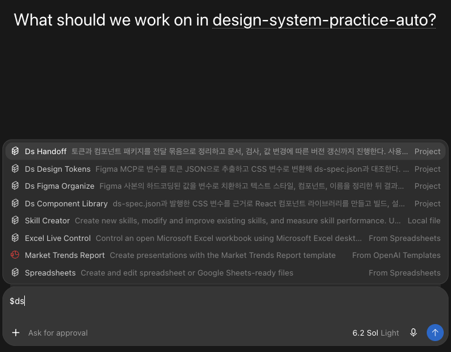

---
hide:
  - navigation
---

# Codex 자동화 실습

[← 디자인 시스템으로 돌아가기](../index.md)

[샘플 Figma 파일](sample-file.md)만 만든 상태에서 시작해, Figma 정리부터 개발 전달까지를 Codex의 skill 4개로 진행하면서 정해 둔 지점마다 사람이 승인합니다. 선택 실습입니다.

| 구분 | 내용 |
|---|---|
| 입력 | [샘플 파일](sample-file.md) 5-2단계까지 마친 Figma 파일, 디스코드에서 받은 `.agents` 압축 파일 |
| 산출물 | 정리한 Figma 사본, `design-system-practice-auto` 안의 `ds-spec.json`·토큰·컴포넌트 라이브러리·전달 묶음 |
| 선행 단계 | [샘플 Figma 파일](sample-file.md). 수동 실습의 결과는 쓰지 않습니다. |

---

## 시나리오

### 상황

샘플 파일은 색상·간격·모서리 반경·글자 속성을 직접 입력한 상태입니다. 변수, 스타일, 토큰 파일, 컴포넌트 코드는 하나도 없습니다. 실습자는 이 파일을 React 개발자에게 전달할 수 있는 상태로 만들어야 하며, 작업은 Codex에게 맡기고 자신은 검토자가 됩니다. 전달을 마친 뒤에는 사본의 색상 값 하나를 바꾸고, 전용 skill 없이 프롬프트로 요청해 새 버전을 다시 전달합니다.

### 시작 상태

[샘플 파일](sample-file.md) 절차를 그대로 따랐다면 파일에는 아래 값이 있습니다. 정리 전과 후를 비교하는 기준이므로 시작하기 전에 확인합니다.

| 대상 | 색상 | 간격·모서리 반경·크기 | 글자(Inter) |
|---|---|---|---|
| `Button` | 배경 `3B82F6`, 글자 `FFFFFF` | 패딩 세로 `10`·가로 `12`, 반경 `6`, 크기 `65 × 41` | Medium `14` |
| `Input` `default` | 배경 `FFFFFF`, 선 `D1D5DB`, 글자 `9CA3AF` | 패딩 세로 `10`·가로 `13`, 반경 `7`, 크기 `240 × 40`, 선 두께 `1` | Regular `14` |
| `Input` `focus` | 선 `3B82F6`, 나머지는 `default`와 같음 | `default`와 같음 | `default`와 같음 |
| `Input` `error` | 선 `EF4444`, 나머지는 `default`와 같음 | `default`와 같음 | `default`와 같음 |
| `Card` | 배경 `FFFFFF`, 선 `E5E7EB`, 글자는 기본 검정 `000000` | 패딩 `16`, 간격 `8`, 반경 `12`, 크기 `280 × 78`, 선 두께 `1` | 제목 Medium `16`, 본문 Regular `14` |

- `Examples` 페이지에는 세 컴포넌트의 인스턴스가 하나씩 있습니다.
- `Cover` 페이지의 텍스트 두 개(Medium `32`, Regular `16`)는 컴포넌트가 아닙니다.

### 목표 상태

| 산출물 | 완료 상태 |
|---|---|
| Figma 사본 | 컴포넌트의 색상·간격·반경이 변수에, 글자가 텍스트 스타일에 연결돼 있고, 승인한 변화 말고는 겉모습이 같습니다. |
| `ds-spec.json` | 승인한 설계가 담겨 있고 `status`가 `confirmed`입니다. |
| `tokens/tokens.json`, `build/css/variables.css` | 변수의 이름·값·참조가 `ds-spec.json`과 같습니다. |
| `my-ui`, `consumer` | 라이브러리가 빌드되고, 다른 프로젝트에 설치해 타입 검사와 빌드가 됩니다. |
| `handoff` | 토큰 파일과 `my-ui-0.1.1.tgz`가 있고, 바꾼 색상 값이 새 패키지에 반영돼 있습니다. |

### 진행 흐름

| 단계 | skill | Codex가 맡는 일 | 사람이 직접 하는 일 | 다음 단계로 넘기는 것 |
|---|---|---|---|---|
| [1. 환경 준비](#1-환경-준비) | 없음 | 연결 확인 호출 | 도구 설치, 폴더 준비 | 작업 폴더, 원본 파일과 사본 |
| [2. Figma 정리](#2-figma-정리) | `ds-figma-organize` | 분석, 설계안 제안, Figma 정리, `ds-spec.json` 확정 | 설계안 검토, 화면 확인 | `ds-spec.json`, 정리한 사본 |
| [3. 토큰 추출·변환](#3-토큰-추출변환) | `ds-design-tokens` | 변수 추출, 변환, 대조 | 대조 결과 확인 | `tokens.json`, `variables.css`, `build-tokens.js` |
| [4. 컴포넌트 라이브러리](#4-컴포넌트-라이브러리) | `ds-component-library` | 코드 설계와 작성, 빌드, 사용 확인 | 코드 설계 검토, 카탈로그 화면 확인 | `my-ui`, `consumer` |
| [5. 개발 전달과 색상 변경](#5-개발-전달과-색상-변경) | 전달은 `ds-handoff`, 색상 변경은 프롬프트 | 산출물 모으기, 문서 작성, 검사, 패키징, 변경 절차 구성과 반영 | 전달 내용 검토, Figma 색상 변경, 변경 계획 검토 | `handoff` |

### 판단 기준

- 컬렉션·변수·스타일·레이어의 구조와 이름은 정해진 답이 없습니다. 사용자의 요청, 파일에 이미 있는 규칙, Codex의 판단 순서로 정합니다. 샘플 파일에는 기존 변수와 스타일이 없으므로, 따로 요청하지 않으면 Codex가 근거를 붙여 제안합니다.
- 승인한 설계는 `ds-spec.json`에 저장되고, 3~5단계는 이 파일을 기준으로 진행합니다.
- 값은 Figma 파일에서 읽은 것을 씁니다. 5단계의 색상 변경도 사본을 먼저 바꾼 뒤 그 값을 읽습니다.
- 비교할 정답 파일이 없습니다. 값은 [시작 상태](#시작-상태)의 표와 원본 파일로, 형식과 참조는 검사 명령으로, 화면은 눈으로 확인합니다.
- 각 단계의 산출물이 다음 단계의 입력이 됩니다. 승인하지 않은 단계의 결과는 다음 단계로 넘기지 않습니다.
- 자동화 대상의 범위는 [AI 자동화 도구로 줄일 수 있는 범위](../design-tokens.md#ai-자동화-도구로-줄일-수-있는-범위)에서 다룹니다.

### 승인 방식

승인 규칙은 skill에 들어 있어 따로 보내지 않습니다. 주요 규칙은 아래와 같습니다.

- Codex는 시작하기 전에 할 일과 바뀔 대상을 보여주고 기다립니다.
- `승인`이라고 답하기 전에는 승인 지점을 넘어가지 않습니다. 한 번의 승인은 다음 승인 지점까지만 유효합니다.
- 승인 지점마다 바꾼 내용, 실행한 명령과 출력, 실패한 항목을 보여줍니다.
- 결과가 기준과 다르면 임의로 고치지 않고 차이를 알립니다.
- 직접 확인하지 못한 항목은 통과로 표시하지 않습니다.

승인 지점에서는 아래 셋 중 하나로 답합니다.

| 상황 | 답하는 방법 |
|---|---|
| 확인할 것이 모두 맞음 | `승인` |
| 바꾸고 싶은 것이 있음 | `승인`이라고 쓰지 않고, 바꿀 대상과 원하는 결과를 적습니다. 고친 제안을 다시 검토합니다. |
| 보여준 내용만으로 판단할 수 없음 | 승인하지 않고 근거를 묻습니다. 예: `이 값을 어느 레이어에서 읽었는지 보여줘.` |

---

## 1. 환경 준비

[환경 구성](codex-automation-setup.md)의 1~2단계를 이미 마쳤다면 1-3과 1-4는 건너뜁니다.

### 1-1. 도구와 요금제 확인

1. **작업**: 터미널에서 Node.js와 `npm`의 버전을 확인합니다. 설치 방법은 [개발환경 준비](../setup.md)에서 다룹니다.

    **실행 위치**: 임의의 폴더

    **명령어**

    ```bash
    node -v && npm -v
    ```

    **출력 결과**: 버전 두 줄이 나옵니다. 숫자는 환경마다 다릅니다.

2. **기대 결과**: Node.js가 `22.12.0` 이상입니다. skill의 기준 버전은 `22.22.2`입니다.
3. **확인 방법**: 첫 줄의 버전을 비교합니다.

Figma MCP 서버의 `use_figma` 도구는 Figma 파일을 수정할 수 있으며, 2단계와 3단계의 skill이 사용합니다. 아래 조건은 [Write to canvas](https://developers.figma.com/docs/figma-mcp-server/write-to-canvas/)를 기준으로 합니다.

- 원격 서버에 연결한 클라이언트에서 쓰며, Codex는 지원 클라이언트에 포함됩니다.
- 대상 요금제는 Professional, Education, Organization, Enterprise이고 파일 편집 권한이 필요합니다. Starter(무료) 요금제는 대상에 없으므로, 해당하면 이 선택 실습을 건너뜁니다.
- 베타 기능입니다. 베타 기간에는 무료이며, 이후 사용량 기반 유료 기능이 될 예정입니다.
- 읽기 도구에는 호출 제한이 있습니다. 조건은 [Rate limits and access](https://developers.figma.com/docs/figma-mcp-server/rate-limits-access/)에서 확인합니다.

### 1-2. 원본 보관과 사본 준비

1. **작업**: [샘플 파일](sample-file.md) 5-2단계까지 마친 파일을 Figma에서 복제하고, 사본의 이름에 `Codex`를 덧붙입니다. 사본의 파일 링크를 복사해 둡니다.
2. **기대 결과**: 수정하지 않을 원본과 Codex가 정리할 사본이 따로 있습니다.
3. **확인 방법**: 사본을 열어 `Cover`, `Components`, `Examples` 페이지와 [시작 상태](#시작-상태)의 값을 확인합니다.

- 원본은 2단계 이후 겉모습을 비교하는 기준이므로 편집하지 않습니다.
- 직접 만든 다른 Figma 파일의 사본도 쓸 수 있습니다. 다만 아래 제약을 벗어나면 Codex가 알리고 멈춥니다. [시작 상태](#시작-상태)의 표와 이 문서의 예상 내용은 샘플 파일에만 해당합니다.

| 제약 | 내용 |
|---|---|
| 변수 타입 | Color와 Number만 씁니다. Number는 px 길이에만 씁니다. |
| 모드와 색 | 컬렉션마다 모드는 하나이고, 색에 투명도를 쓰지 않습니다. |
| 이름 | 소문자·숫자·`-`로 쓰고 계층은 `/`로 나눕니다. 컬렉션이 달라도 겹치지 않아야 하며, 한 이름이 다른 이름의 상위 경로가 되면 안 됩니다. |
| 참조 | 같은 파일의 같은 타입 변수만 가리킵니다. |

### 1-3. Figma 플러그인 연결

1. **작업**: Codex 앱의 Plugins 화면에서 Figma를 설치하고, [Figma MCP 서버 연결](../setup.md#figma-mcp-서버-연결)의 Codex 앱 방식에 따라 접근을 허용합니다. 새 대화에 아래 프롬프트를 보냅니다.

    ```text title="프롬프트"
    Figma MCP의 whoami를 호출해 요금제와 시트를 알려줘. 호출에 실패하면 추측 없이 오류 메시지를 그대로 알려줘.
    ```

2. **기대 결과**: 요금제가 [1-1](#1-1-도구와-요금제-확인)의 대상에 해당합니다.
3. **확인 방법**: 응답 위의 **Worked for …** 를 펼쳐 Figma 도구를 호출했는지 확인합니다. 호출한 흔적이 없으면 응답을 결과로 인정하지 않습니다.

### 1-4. 작업 폴더와 skill 준비

1. **작업**: 디스코드에서 압축 파일을 내려받고, 작업 폴더를 둘 위치에서 아래 명령을 실행합니다. `<받은 압축 파일 경로>`는 내려받은 파일의 경로로 바꿉니다.

    **실행 위치**: 작업 폴더를 둘 위치

    **명령어**

    ```bash
    mkdir design-system-practice-auto && unzip -q "<받은 압축 파일 경로>" -d design-system-practice-auto && ls design-system-practice-auto/.agents/skills
    ```

    **출력 결과**

    ```text
    ds-component-library
    ds-design-tokens
    ds-figma-organize
    ds-handoff
    ```

2. **기대 결과**: Codex 앱에서 `design-system-practice-auto` 폴더를 열고 새 대화의 입력창에 `$ds`를 입력하면, skill 4개가 `Project` 표시와 함께 나옵니다. 목록에는 `ds-handoff`가 `Ds Handoff`처럼 표시됩니다.

    { width="100%" }

3. **확인 방법**: 이름 4개를 위 출력과 대조하고, 입력한 `$ds`는 지웁니다. 2~5단계의 프롬프트는 이 대화에서 이어 보냅니다.

- `.agents`는 숨김 폴더입니다. Finder에서는 **Command+Shift+.** 을 눌러야 보입니다.
- 압축 파일에 따라 `__MACOSX` 폴더가 함께 풀릴 수 있으며, 실습에는 쓰지 않습니다.
- 프롬프트의 `$` 뒤에 있는 이름이 실행할 skill입니다. 조건이 있으면 같은 프롬프트에 함께 적습니다. 요청한 조건은 Codex의 판단보다 우선합니다.

---

## 2. Figma 정리

`ds-figma-organize`는 시작 확인 → 분석 → 설계안 → 변수 만들기 → 값 치환 → 텍스트 스타일 → 컴포넌트와 이름 → 점검 순서로 진행합니다.

### 2-1. 정리 요청

1. **작업**: `<사본 링크>`를 [1-2](#1-2-원본-보관과-사본-준비)에서 복사한 링크로 바꿔 보냅니다.

    ```text title="프롬프트"
    $ds-figma-organize <사본 링크> 파일을 정리해줘.
    ```

2. **기대 결과**: Codex가 할 일과 바뀔 대상, 파일 이름과 링크를 보여주고 사본인지 확인을 요청합니다.
3. **확인 방법**: 파일 이름과 링크가 원본이 아닌 사본이면 `승인`이라고 답합니다.

### 2-2. 분석 승인

1. **작업**: Codex가 Figma를 읽기만 하고 보여주는 조사 결과를 [시작 상태](#시작-상태)와 대조합니다.
2. **기대 결과**: 아래 항목이 빠짐없이 나옵니다.

    | 항목 | 샘플 파일에서 맞는 내용 |
    |---|---|
    | 컴포넌트와 상태 | `Button`, `Input`(`State`: `default`·`focus`·`error`), `Card` |
    | 기존 변수·스타일 | 없음 |
    | 연결되지 않은 색상 | `3B82F6`, `FFFFFF`, `D1D5DB`, `9CA3AF`, `EF4444`, `E5E7EB`, `000000` |
    | 연결되지 않은 간격·반경 | 패딩 `10`·`12`·`13`·`16`, 간격 `8`, 반경 `6`·`7`·`12` |
    | 글자 속성 | Medium `14`, Regular `14`, Medium `16` |
    | 제외할 페이지 | 표지인 `Cover`는 제외해도 되는지 물을 것으로 예상합니다. |

3. **확인 방법**: 빠진 값이 없고 제외할 대상이 맞으면 `승인`이라고 답합니다. 빠진 것이 있으면 이름을 적어 다시 조사하게 합니다.

- 값이 하나뿐인 레이어(`Input`의 `focus` 선 색 등)는 빠지기 쉬우므로 variant별로 확인합니다.
- 표에 없는 값(`Button`의 `Gap`처럼 Auto layout이 자동으로 넣은 값)이 조사에 추가될 수 있습니다. 화면에 영향이 있는지 확인합니다.

### 2-3. 설계안 승인

1. **작업**: 설계안 표를 검토합니다. 이 승인이 이후 모든 단계의 기준이 됩니다.

    | 검토 항목 | 확인할 것 |
    |---|---|
    | 변수 값 | 모든 값이 [시작 상태](#시작-상태)에 있는 값인지, 파일에 없는 값이 새로 생기지 않았는지 |
    | 구조 | 원시 값과 의미 기반 값이 나뉘고, 컴포넌트의 색상이 의미 기반 변수를 가리키는지 |
    | 연결 위치 | 컴포넌트와 variant의 색상·간격·반경이 모두 연결 대상이거나 예외인지 |
    | 값 합치기 | 반경 `6`·`7`, 가로 패딩 `12`·`13`처럼 비슷한 값을 합치자는 제안이 있는지, 어디가 얼마에서 얼마로 바뀌는지 |
    | 텍스트 스타일 | 글꼴·굵기·크기가 시작 상태와 같은지 |
    | 이름 | 하나의 규칙을 따르고 [1-2](#1-2-원본-보관과-사본-준비)의 이름 제약을 지키는지 |
    | 예외 | 선 두께 `1`, 고정 너비 `240`·`280`처럼 연결하지 않는 곳에 이유가 있는지 |

2. **기대 결과**: 샘플 파일은 일부러 어중간한 값을 넣었으므로 값 합치기 제안이 나올 수 있습니다(예상). 합치면 겉모습이 바뀌므로 아래 중 하나를 정합니다.

    - 값을 그대로 두려면 이렇게 답합니다.

        ```text title="프롬프트"
        값을 합치지 말고 파일의 값을 그대로 변수로 만들어줘.
        ```

    - 합치기를 받아들이면, 바뀌는 위치와 전후 값을 적어 두고 `승인`이라고 답합니다. 이후 원본과의 비교에서 이 목록에 있는 차이만 허용합니다.

3. **확인 방법**: 승인하면 Codex가 `status`가 `draft`인 `ds-spec.json`을 저장하고 `check.mjs`를 실행합니다. 출력에 `ds-spec.json: PASS`가 있는지 확인합니다.

- 이름이나 구조를 원하는 방식으로 정하려면 이 시점에 요청합니다. 변수를 만든 뒤에 바꾸면 `ds-spec.json`의 변경을 먼저 승인해야 합니다.
- 샘플 파일 절차를 따른 레이어 이름은 대부분 정리돼 있어, 이름 변경 제안은 적을 수 있습니다.

### 2-4. Figma 변경 승인

1. **작업**: Codex가 멈출 때마다 사본의 Figma 화면을 직접 확인합니다.

    | 승인 지점 | Figma에서 확인할 것 | 통과 기준 |
    |---|---|---|
    | 변수 만들기 | **Variables** 창의 컬렉션과 변수 | 이름과 값이 `ds-spec.json`과 같고, 참조 변수에는 값이 직접 입력돼 있지 않습니다. |
    | 값 치환: 컴포넌트마다 | 선택한 레이어의 Fill, Stroke, 패딩, 간격, 반경 | 변수가 연결돼 있고, 원본과 크기·모습이 같습니다. |
    | 텍스트 스타일 | 텍스트 레이어의 Typography | 스타일이 연결돼 있고 글꼴·굵기·크기가 그대로입니다. |
    | 컴포넌트와 이름 | Layers와 variant 속성 | 승인한 변경만 적용돼 있습니다. |

2. **기대 결과**: `Examples` 페이지의 인스턴스는 직접 치환하지 않아도 컴포넌트의 변경이 반영됩니다.
3. **확인 방법**: 원본과 사본의 `Components`, `Examples` 페이지를 나란히 열어 비교합니다. 승인한 값 합치기 말고 다른 차이가 있으면 승인하지 않고 위치를 알립니다.

- 값 치환은 컴포넌트마다 승인합니다. 샘플 파일은 `Button`, `Input`, `Card` 세 번입니다.
- Codex가 도구로 할 수 없다고 알린 작업은 Figma에서 직접 한 뒤 알립니다.

### 2-5. 점검 승인과 확정

1. **작업**: Codex가 Figma를 다시 읽어 `ds-spec.json`과 비교한 결과를 확인합니다. 차이가 없고, 연결하지 않은 값이 모두 `exceptions`에 있으면 `승인`이라고 답합니다.
2. **기대 결과**: `ds-spec.json`의 `status`가 `confirmed`로 바뀌고, Codex가 완료 확인을 통과·실패·미확인으로 나눠 보여줍니다.
3. **확인 방법**: 터미널에서 직접 검사합니다.

    **실행 위치**: `design-system-practice-auto`

    **명령어**

    ```bash
    node .agents/skills/ds-design-tokens/assets/check.mjs ds-spec.json && grep '"status"' ds-spec.json
    ```

    **출력 결과**: `변수:` 줄의 컬렉션 이름과 수는 설계에 따라 다릅니다. 나머지는 아래와 같아야 합니다.

    ```text
    변수: <컬렉션별 변수 수> / 참조 <참조 수>
    ds-spec.json: PASS
      "status": "confirmed",
    ```

- 검사는 `ds-spec.json`의 형식과 참조만 확인합니다. 설계의 좋고 나쁨과 Figma와의 일치는 승인할 때 직접 검토합니다.

---

## 3. 토큰 추출·변환

`ds-design-tokens`는 시작 확인 → 토큰 추출 → 변환 → 검증 순서로 진행합니다. 이 단계에서는 Figma 파일과 `ds-spec.json`을 수정하지 않습니다.

### 3-1. 추출·변환 요청

1. **작업**: 아래 프롬프트를 보냅니다.

    ```text title="프롬프트"
    $ds-design-tokens 진행해줘.
    ```

2. **기대 결과**: Codex가 할 일과 바뀔 대상을 보여주고 승인을 기다립니다.
3. **확인 방법**: `tokens` 폴더가 아직 만들어지지 않았는지 확인하고 `승인`이라고 답합니다.

### 3-2. 추출 결과 승인

1. **작업**: 추출 대조 결과와 패키지 설치 계획을 확인합니다.
2. **기대 결과**: `tokens/tokens.json`이 생기고 `ds-spec.json`과 `tokens.json`이 `PASS`입니다. 설치할 패키지는 `style-dictionary@5.8.0`과 `@tokens-studio/sd-transforms@2.0.3`입니다.
3. **확인 방법**: 두 줄이 `PASS`이고 패키지와 버전이 같으면 `승인`이라고 답합니다.

- `FAIL`이면 Codex는 파일을 고치지 않고 Figma와 `ds-spec.json` 중 어느 쪽이 맞는지 묻습니다. [시작 상태](#시작-상태)와 승인한 설계를 기준으로 정합니다.
- Codex가 `get_variable_defs`의 결과나 직접 입력한 값으로 토큰 파일을 채우겠다고 하면 승인하지 않습니다. `get_variable_defs`는 선택한 대상에 쓰인 변수만 반환합니다.

### 3-3. 검증 결과 승인

1. **작업**: 변환 명령의 출력과 대조 결과를 확인하고 `승인`이라고 답합니다.
2. **기대 결과**: `build/css/variables.css`가 생깁니다. 의미 기반 변수는 HEX 값이 아니라 `var(--...)` 참조로 남아 있습니다.
3. **확인 방법**: 터미널에서 직접 검사합니다.

    **실행 위치**: `design-system-practice-auto`

    **명령어**

    ```bash
    node .agents/skills/ds-design-tokens/assets/check.mjs ds-spec.json tokens/tokens.json build/css/variables.css
    ```

    **출력 결과**: `변수:` 줄을 제외하고 아래와 같아야 합니다.

    ```text
    변수: <컬렉션별 변수 수> / 참조 <참조 수>
    ds-spec.json: PASS
    tokens.json: PASS
    variables.css: PASS
    ```

---

## 4. 컴포넌트 라이브러리

`ds-component-library`는 코드 설계 → 프로젝트 초기화 → 카탈로그 준비 → 컴포넌트 → 패키징과 빌드 → 다른 프로젝트에서 사용 → 카탈로그 정적 빌드 순서로 진행합니다. 승인 지점은 각 단계가 끝날 때와 `npm install` 직전, 그리고 컴포넌트마다입니다.

### 4-1. 구현 요청

1. **작업**: 아래 프롬프트를 보냅니다.

    ```text title="프롬프트"
    $ds-component-library 진행해줘.
    ```

2. **기대 결과**: Codex가 할 일과 바뀔 대상을 보여주고 승인을 기다립니다.
3. **확인 방법**: `my-ui` 폴더가 아직 만들어지지 않았는지 확인하고 `승인`이라고 답합니다.

### 4-2. 코드 설계 승인

1. **작업**: 만들 컴포넌트, HTML 요소, props의 이름·값·기본값, story 목록을 검토합니다.
2. **기대 결과**: 설계는 아래 규칙을 따릅니다.

    | 규칙 | 샘플 파일에서 확인할 것(예상) |
    |---|---|
    | 대응하는 HTML 요소의 속성을 확장합니다. | `Button`은 `button`, `Input`은 `input` 요소입니다. |
    | 켜고 끄는 상태는 불리언 prop입니다. | `Input`의 `error`는 불리언 prop입니다. |
    | 브라우저가 처리하는 상태는 CSS 선택자로 구현합니다. | `Input`의 `focus`는 prop이 아닙니다. |
    | Figma에 없는 variant와 상태는 추가하지 않습니다. | `Button`에 `secondary`나 `disabled`가 생기지 않습니다. |

3. **확인 방법**: 규칙을 지키면 `승인`이라고 답합니다. Codex는 승인한 내용을 `ds-spec.json`의 `code` 필드로만 추가합니다.

### 4-3. 초기화와 설치 승인

1. **작업**: `npm install` 직전마다 패키지 이름과 버전을 확인하고, 단계가 끝날 때 명령 출력을 확인한 뒤 `승인`이라고 답합니다.
2. **기대 결과**: 설치 전 승인은 프로젝트 초기화, 카탈로그 준비, 다른 프로젝트에서 사용의 세 곳에서 요청합니다.
3. **확인 방법**: 버전이 skill의 명령과 같은지 `.agents/skills/ds-component-library/SKILL.md`와 대조합니다. TypeScript는 `6.0.3`이어야 합니다.

- Codex가 `npm audit fix --force`를 실행하겠다고 하면 승인하지 않습니다.

### 4-4. 컴포넌트별 화면 승인

1. **작업**: Codex가 컴포넌트를 하나 만들 때마다 브라우저에서 `http://127.0.0.1:6006/`의 `Components → <이름>`을 열고, story마다 Figma 사본과 비교합니다.
2. **기대 결과**: 색상·간격·반경·글자가 Figma 사본과 같습니다.

    | 컴포넌트 | 직접 확인할 것 |
    |---|---|
    | `Button` | 배경색, 글자색, 패딩, 반경, Medium `14` 글자 |
    | `Input` | 기본과 오류의 선 색, placeholder 색. 입력창을 클릭했을 때의 `focus` 선 색 |
    | `Card` | 선 색, 반경, 패딩, 제목과 본문의 간격과 글자 |

3. **확인 방법**: 같으면 `승인`이라고 답합니다. 다르면 story 이름, 속성, Figma의 값, 화면의 값을 적어 보냅니다.

- 화면 확인은 사람이 확인했다고 답한 항목만 통과로 처리합니다. 열어 보지 않은 story는 승인하지 않습니다.
- 토큰이 아닌 값(고정 너비, 테두리 두께 등)의 목록이 Figma에서 읽은 값인지 확인합니다.

### 4-5. 빌드와 사용 확인 승인

1. **작업**: 남은 단계의 출력을 확인하고 단계마다 `승인`이라고 답합니다.

    | 단계 | 통과 기준 |
    |---|---|
    | 패키징과 빌드 | `my-ui/dist`에 `index.d.ts`, `my-ui.css`, `my-ui.js`, `variables.css`가 있고, `my-ui.js`의 첫 줄은 `react/jsx-runtime`만 import합니다. |
    | 다른 프로젝트에서 사용 | `consumer`의 타입 검사와 빌드가 성공합니다. 허용하지 않는 prop 값을 넣으면 `TS2322` 오류가 나고, 되돌리면 사라집니다. |
    | 카탈로그 정적 빌드 | `Storybook build completed successfully`로 끝납니다. |

2. **기대 결과**: Codex의 완료 확인에 실패와 미확인 항목이 없습니다.
3. **확인 방법**: 터미널에서 빌드를 한 번 직접 실행합니다.

    **실행 위치**: `design-system-practice-auto`

    **명령어**

    ```bash
    (cd my-ui && npm run build) && (cd consumer && npx tsc && npx vite build)
    ```

    **출력 결과**: 빌드 로그가 나오고 오류 없이 끝납니다. 로그의 파일 크기와 시간은 실행할 때마다 다릅니다.

- 컴포넌트 코드는 Codex가 `ds-spec.json`과 Figma를 근거로 작성하므로 실행할 때마다 다를 수 있습니다.

---

## 5. 개발 전달과 색상 변경

`ds-handoff`는 산출물 모으기 → 사용 가이드와 패키지 → 체크리스트 순서로 `0.1.0`을 전달합니다. 승인 지점은 각 단계가 끝날 때와 삭제하기 전입니다. 색상 변경은 전달을 마친 뒤 [5-3](#5-3-색상-변경-요청)에서 프롬프트로 요청합니다.

### 5-1. 전달 요청

1. **작업**: 아래 프롬프트를 보냅니다. 레지스트리 배포와 외부 전송은 하지 않습니다.

    ```text title="프롬프트"
    $ds-handoff 진행해줘.
    ```

2. **기대 결과**: Codex가 할 일과 바뀔 대상을 보여주고 승인을 기다립니다.
3. **확인 방법**: `handoff` 폴더가 아직 만들어지지 않았는지 확인하고 `승인`이라고 답합니다.

### 5-2. 첫 전달 승인

1. **작업**: Codex가 멈출 때마다 아래 항목을 확인하고 `승인`이라고 답합니다.

    | 승인 지점 | 확인할 것 |
    |---|---|
    | 산출물 모으기 | `handoff/tokens`에 `tokens.json`과 `variables.css`가 있는지 |
    | 사용 가이드와 패키지 | `my-ui/README.md`에 `<...>`가 남지 않았고 패키지 이름·props·컴포넌트 목록이 실제 코드와 같은지, `handoff/my-ui-0.1.0.tgz`가 생겼는지 |
    | 삭제 전 | 삭제 대상이 `consumer/dist`와 `consumer/node_modules/my-ui`뿐인지 |
    | 체크리스트 | `check.mjs` 세 항목이 `PASS`인지, `SAME`이 두 번인지, 정의되지 않은 CSS 변수와 직접 입력한 색상 값의 검색 결과가 없는지, 새 패키지로 `consumer`가 빌드되는지 |

2. **기대 결과**: `0.1.0` 전달 묶음이 검사를 통과합니다.
3. **확인 방법**: 검사 명령은 Codex의 요약이 아니라 출력으로 확인합니다. 색상 값 검색은 결과가 없으면 종료 코드 1이 나오며 정상입니다.

### 5-3. 색상 변경 요청

디자이너가 `3B82F6`인 파란색을 더 진한 `2563EB`로 바꾼 상황입니다. 이 색은 `Button` 배경과 `Input`의 `focus` 선에 쓰이므로 두 컴포넌트에서 변경을 확인할 수 있습니다. 변경은 매번 내용이 다르므로 skill로 만들지 않고, 요청을 프롬프트에 적어 Codex가 skill 4개를 참고해 절차를 만들게 합니다.

1. **작업**: Figma 사본에서 값이 `3B82F6`인 원시 색상 변수를 `2563EB`로 직접 바꾼 뒤, 아래 프롬프트를 보냅니다.

    ```text title="프롬프트"
    Figma 사본의 #3B82F6 색상 변수를 #2563EB로 바꿨어. .agents skill 규칙대로 전달 묶음까지 0.1.1로 반영하되, 계획부터 보여줘.
    ```

2. **기대 결과**: Codex가 계획을 보여주고 승인을 기다립니다. 계획은 실행할 때마다 다를 수 있습니다.
3. **확인 방법**: 아래 항목이 계획에 모두 있으면 `승인`이라고 답합니다. 프롬프트가 짧아 빠질 수 있으므로, 빠진 항목은 적어 보냅니다.

    | 확인할 것 | 기준 |
    |---|---|
    | 순서 | Figma의 값 확인 → `ds-spec.json` → 토큰과 CSS 변수 → `my-ui` → `handoff` → `consumer` |
    | 승인 지점 | 단계가 끝날 때, 파일이나 폴더를 삭제하기 전에 멈춥니다. |
    | 검사 | `check.mjs`와 `ds-handoff`의 체크리스트를 다시 실행합니다. |
    | 수정 범위 | `ds-spec.json`에서는 바꾼 변수의 값만 바뀌고, 컴포넌트 코드와 `.agents`는 바뀌지 않습니다. |
    | 기록 | 버전은 `0.1.1`이고 `CHANGELOG.md`에 이전 값과 새 값을 남깁니다. 배포와 외부 전송은 하지 않습니다. |

- 2-3에서 두 위치를 서로 다른 원시 변수에 연결했다면 바뀌는 위치가 다를 수 있습니다.

### 5-4. 새 버전 승인

1. **작업**: Codex가 멈출 때마다 명령 출력을 확인하고 `승인`이라고 답합니다. CSS 변수가 갱신된 단계에서는 CSS 차이도 확인합니다.
2. **기대 결과**: 아래 항목이 모두 맞습니다.

    | 항목 | 통과 기준 |
    |---|---|
    | CSS 차이 | 이전 `handoff/tokens/variables.css`와 비교해 바꾼 변수 한 줄만 다릅니다. `diff`의 종료 코드 1은 정상입니다. |
    | 검사 | `check.mjs` 세 항목이 `PASS`입니다. |
    | 버전과 변경 이력 | 버전이 `0.1.1`이고, `CHANGELOG.md`의 이전 값과 새 값이 실제 차이와 같습니다. |
    | 패키지 | `consumer`에 `0.1.1`을 설치해 타입 검사와 빌드가 되고, 빌드한 CSS의 해당 변수에는 새 값만 있습니다. |
    | 전달 폴더 | `handoff/tokens`의 파일이 새 값으로 갱신돼 있습니다. |

3. **확인 방법**: 터미널에서 전달 폴더를 직접 확인합니다.

    **실행 위치**: `design-system-practice-auto`

    **명령어**

    ```bash
    ls handoff handoff/tokens && grep -i '2563eb' handoff/tokens/variables.css
    ```

    **출력 결과**: `handoff`에 `my-ui-0.1.1.tgz`와 `tokens`가, `handoff/tokens`에 `tokens.json`과 `variables.css`가 있습니다. `0.1.0` 패키지도 함께 남아 있을 수 있습니다. 마지막에는 새 값이 있는 CSS 변수 한 줄이 나옵니다. 변수 이름은 설계에 따라 다릅니다.

---

## 6. 결과 검토

### 6-1. 검사 기준 확인

1. **작업**: 작업 폴더의 `.agents`를 디스코드에서 받은 원본과 비교합니다. `<받은 압축 파일 경로>`는 내려받은 파일의 경로로 바꿉니다.

    **실행 위치**: `design-system-practice-auto`

    **명령어**

    ```bash
    mkdir ../agents-original && unzip -q "<받은 압축 파일 경로>" -d ../agents-original && diff -r -x .DS_Store ../agents-original/.agents .agents
    ```

    **출력 결과**: 없음(출력이 없으면 정상입니다).

2. **기대 결과**: 두 `.agents` 폴더가 같습니다.
3. **확인 방법**: 차이가 출력되면 검사 파일이나 절차가 바뀐 것이므로, 해당 단계의 검사 결과는 인정하지 않습니다.

- 비교가 끝나면 `agents-original` 폴더는 지워도 됩니다.

### 6-2. 원본과 최종 결과 비교

1. **작업**: Figma 원본, 정리한 사본, `my-ui`의 카탈로그를 나란히 비교합니다. 카탈로그는 아래 명령으로 열고, 확인한 뒤 **Ctrl+C**로 종료합니다.

    **실행 위치**: `design-system-practice-auto/my-ui`

    **명령어**

    ```bash
    npm run storybook
    ```

    **출력 결과**: 카탈로그 주소가 포함된 실행 로그가 나옵니다.

2. **기대 결과**: 원본과 사본의 차이는 [2-3](#2-3-설계안-승인)에서 승인한 것과 [5-3](#5-3-색상-변경-요청)에서 바꾼 색뿐입니다. 카탈로그는 사본과 같습니다.
3. **확인 방법**: 그 밖의 차이가 있으면 어느 단계에서 생겼는지 `ds-spec.json`, `variables.css`, 컴포넌트 CSS 순서로 확인합니다.

### 6-3. 한계와 검토 방법

| 한계 | 검토 방법 |
|---|---|
| Codex의 완료 보고만으로는 통과 여부를 알 수 없습니다. | 검사 명령은 출력까지 확인합니다. |
| 승인 규칙을 지키지 않고 다음 작업을 실행할 수 있습니다. | 원본이 아닌 Figma 사본과 자동화 폴더에서만 실행하고, 승인 없이 진행하면 중단합니다. |
| 검사는 `ds-spec.json`과 같은지만 확인합니다. `ds-spec.json`이 틀리면 이후 검사도 통과합니다. | 설계안과 `ds-spec.json`을 승인할 때 원본 파일의 값·연결 위치와 직접 비교합니다. |
| 결과가 실행할 때마다 다를 수 있습니다. | 이름이 아니라 값과 겉모습을 원본과 비교합니다. |
| 화면 모양은 명령 결과로 판정할 수 없습니다. | Figma와 Storybook 화면을 사람이 확인합니다. |

---

## 막혔을 때

| 증상 | 확인 |
|---|---|
| `use_figma`가 없거나 권한 오류가 남 | 요금제, 파일 편집 권한, 원격 서버 연결을 확인하고, 해결되지 않으면 실습을 건너뜁니다. |
| skill 목록에 `ds-` skill이 없음 | 작업 폴더가 `design-system-practice-auto`인지, [1-4](#1-4-작업-폴더와-skill-준비)의 폴더 4개가 있는지 확인합니다. |
| `ds-spec.json`, `my-ui`, `consumer`, `handoff`가 이미 있어 멈춤 | 이전 실행의 결과입니다. 이어서 쓸지 확인하고, 처음부터 하려면 새 작업 폴더와 새 Figma 사본을 만듭니다. |
| 다음 skill이 시작하지 않고 앞 단계의 skill을 안내함 | 앞 단계의 산출물이 있는지, `ds-spec.json`의 `status`가 `confirmed`인지 확인합니다. |
| 검사 결과가 `FAIL`임 | 출력의 `없음:`, `다름·추가:` 줄을 보고 Figma와 `ds-spec.json` 중 어느 쪽이 맞는지 정한 뒤 Codex에 알립니다. |
| Codex가 승인 없이 다음 작업을 실행함 | 중단하고 바뀐 내용을 확인합니다. Figma가 의도와 다르게 바뀌었으면 원본에서 새 사본을 만들어 다시 시작합니다. |
| 대화가 끊겨 새 대화를 시작함 | 작업 폴더를 다시 열고, 진행하던 skill의 이름과 마지막으로 승인한 지점을 적어 보냅니다. 산출물을 확인하게 한 뒤 이어 갑니다. |
| Figma 도구 호출이 실패함 | 오류 메시지, Figma 접근 허용 여부, 파일 접근 권한, 호출 제한을 확인합니다. |

---

## 실습 완료 확인

- [ ] 원본 파일을 편집하지 않고 사본에서만 작업했다.
- [ ] `ds-spec.json`의 `status`가 `confirmed`이고, 설계를 직접 검토한 뒤 승인했다.
- [ ] 값을 바꾸기 전의 검사 3개가 `PASS`였다.
- [ ] 카탈로그의 story와 `Input`의 `focus` 상태를 Figma와 직접 비교했다.
- [ ] `handoff`에 `0.1.1` 패키지와 토큰 파일이 있다.
- [ ] 작업 폴더의 `.agents`가 받은 원본과 같다.
- [ ] 건너뛴 단계, 미확인 항목, 직접 한 작업을 구분해 설명할 수 있다.
