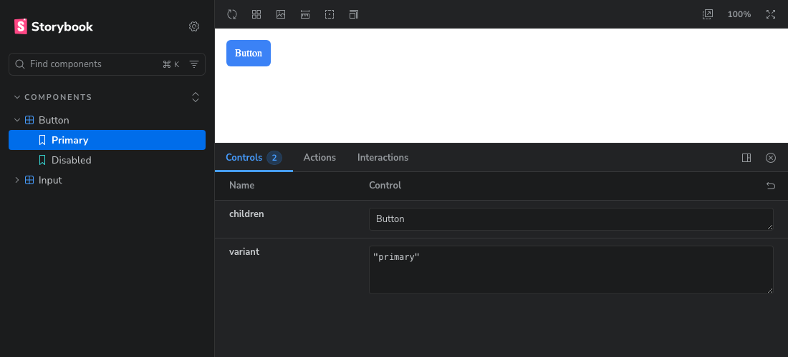
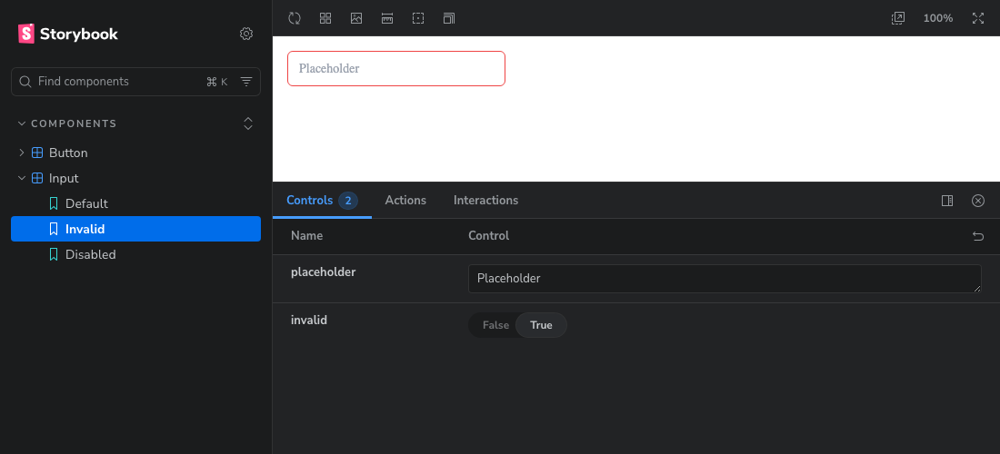

---
hide:
  - navigation
---

# React 컴포넌트 라이브러리 구축 실습

[← 실습편으로 돌아가기](index.md)

[디자인 토큰 추출·발행 실습](design-tokens.md)에서 만든 `variables.css`를 사용하는 Button, Input 컴포넌트를 만들고, 라이브러리로 빌드한 뒤 Storybook 카탈로그에서 확인합니다. 개념 설명은 [React 컴포넌트 라이브러리 구축](../component-library.md)에 있으므로 이 문서에서는 반복하지 않고 작업 순서와 확인 방법만 둡니다.

| 구분 | 내용 |
|---|---|
| 입력 | [디자인 토큰 추출·발행 실습](design-tokens.md)의 `build/css/variables.css` |
| 산출물 | `my-ui` 프로젝트(Button, Input 컴포넌트, 빌드 결과 `dist`, Storybook 카탈로그) |
| 다음 단계 | 컴포넌트와 토큰이 개발 전달 산출물 정리 실습의 입력이 됩니다. |

!!! warning "제안임을 밝힙니다"
    도구 조합(React, TypeScript, Vite, vite-plugin-dts, Storybook)과 폴더 구조는 개념 문서의 [도구 선정 (제안)](../component-library.md#도구-선정-제안)을 그대로 따른 제안입니다. 팀의 기존 스택이 있으면 그 스택을 우선하고, 이 실습은 흐름을 익히는 용도로 씁니다.

---

## 실습 범위와 환경

### 범위

모든 컴포넌트를 만들지 않고 [샘플 Figma 파일](sample-file.md)에 있는 Button, Input 두 개로 제한합니다. 샘플 파일에 없는 속성은 만들지 않는다는 [대응 기준](../component-library.md#figma-variantproperty와-props-대응-기준)에 따라 아래와 같이 정합니다.

| 컴포넌트 | Figma 명세 | 이 실습의 props |
|---|---|---|
| Button | variant 없음(기본 스타일 하나) | `variant?: 'primary'`. 값이 하나뿐이지만 샘플 Figma에 variant가 추가될 때 값만 늘리도록 prop은 둡니다. |
| Input | `State` variant: `default`, `focus`, `error` | `default`, `focus`는 CSS(`:focus-visible`), `error`는 `invalid` prop |

- **시작 코드**: 1단계를 마친 상태(프로젝트 폴더, 설정 파일, 토큰 파일)입니다. 2단계 이후가 막히면 1단계 결과로 돌아와 다시 진행합니다.
- **완성 코드**: 각 단계에 실린 코드 전체입니다. [막혔을 때](#막혔을-때)의 [완성 폴더 구조](#완성-폴더-구조)와 대조합니다.
- **카탈로그 배포**: 이 실습의 범위에 넣지 않습니다. 7단계에서 정적 파일로 빌드하는 데까지만 합니다. 배포 위치는 [카탈로그 배포](../component-library.md#카탈로그-배포)를 따라 조직 사정에 맞춰 정합니다.

### 환경

변환 결과와 명령어 출력은 아래 버전으로 직접 실행해 확인한 값입니다.

| 도구 | 버전 | 비고 |
|---|---|---|
| Node.js | 22.22.2 | Vite 8.3.8은 `^20.19.0 \|\| >=22.12.0` 필요 |
| `react`, `react-dom` | 19.3.1 | |
| `typescript` | 6.0.3 | 7.0.2는 쓰지 않음(아래 경고 참고) |
| `vite` | 8.3.8 | |
| `@vitejs/plugin-react` | 6.3.0 | |
| `vite-plugin-dts` | 5.1.2 | |
| `storybook`, `@storybook/react-vite` | 10.6.8 | |

!!! warning "TypeScript 7은 이 조합에서 빌드되지 않습니다"
    TypeScript 7.0.2를 설치하면 `vite build`가 `The installed "typescript" package does not provide the JavaScript Compiler API` 오류로 멈춥니다. `vite-plugin-dts`가 TypeScript의 JavaScript API를 쓰기 때문입니다. 이 실습은 6.0.3으로 고정합니다.

설치 시간은 이 환경에서 패키지 설치(`npm install`)가 각각 5초 안팎이었고 Storybook 카탈로그 빌드가 3초 안팎이었습니다. 네트워크 속도에 따라 달라지므로 수업 시간에는 설치 단계를 미리 끝내 두는 것을 권장합니다.

---

## 1. 프로젝트 초기화

### 1-1. 폴더와 패키지 만들기

1. **작업**: [토큰 실습](design-tokens.md)을 마친 `design-system-practice` 폴더 안에 `my-ui` 폴더를 만들고, 그 폴더에서 터미널을 열어 아래 명령을 한 줄씩 실행합니다.

    **명령어**

    ```bash
    mkdir my-ui && cd my-ui
    npm init -y
    npm pkg set type=module
    ```

    **출력 결과**: `npm init -y`가 `Wrote to .../my-ui/package.json:` 뒤에 `package.json` 내용을 출력합니다. `npm pkg set`은 출력이 없으면 정상입니다.

    **명령어**

    ```bash
    npm install --save-dev react@19.3.1 react-dom@19.3.1 typescript@6.0.3 vite@8.3.8 vite-plugin-dts@5.1.2 @vitejs/plugin-react@6.3.0 @types/react@19.3.0 @types/react-dom@19.3.0
    ```

    **출력 결과**

    ```text
    added 63 packages, and audited 64 packages in 5s

    10 packages are looking for funding
      run `npm fund` for details

    found 0 vulnerabilities
    ```

    - 패키지 수, 소요 시간은 환경에 따라 다를 수 있습니다.
    - `npm warn ERESOLVE overriding peer dependency` 경고가 먼저 나올 수 있으나 실습에는 영향이 없습니다.

2. **기대 결과**: `my-ui` 폴더에 `package.json`과 `node_modules`가 생기고, `package.json`에 `"type": "module"`이 들어 있습니다.
3. **확인 방법**: 아래 명령의 버전이 [환경](#환경)의 표와 같으면 정상입니다.

    **명령어**

    ```bash
    npm ls --depth=0
    ```

    **출력 결과**

    ```text
    my-ui@1.0.0 /Users/<사용자>/programming/design-system-practice/my-ui
    ├── @types/react-dom@19.3.0
    ├── @types/react@19.3.0
    ├── @vitejs/plugin-react@6.3.0
    ├── react-dom@19.3.1
    ├── react@19.3.1
    ├── typescript@6.0.3
    ├── vite-plugin-dts@5.1.2
    └── vite@8.3.8
    ```

    경로의 사용자 이름은 환경에 따라 다릅니다. 출력 줄 앞의 기호(`├──`, `+--`)는 npm 버전에 따라 다를 수 있습니다.

### 1-2. 폴더 구조와 토큰 파일 준비

1. **작업**: 아래 명령으로 폴더를 만들고, 토큰 실습의 산출물을 복사합니다.

    **명령어**

    ```bash
    mkdir -p src/tokens src/components/Button src/components/Input
    cp ../build/css/variables.css src/tokens/variables.css
    ```

    **출력 결과**: 없음(출력이 없으면 정상입니다). `cp`에서 `No such file or directory`가 나오면 `../build/css/variables.css`가 없는 것이므로 [토큰 실습의 3단계](design-tokens.md#3-코드용-포맷-변환)를 먼저 마칩니다.

2. `tsconfig.json`을 만들고 아래 내용을 저장합니다.

    ```json title="tsconfig.json"
    {
      "compilerOptions": {
        "target": "ES2022",
        "module": "ESNext",
        "moduleResolution": "bundler",
        "jsx": "react-jsx",
        "strict": true,
        "skipLibCheck": true,
        "noEmit": true,
        "types": ["vite/client"]
      },
      "include": ["src"]
    }
    ```

    `types`의 `vite/client`는 컴포넌트에서 `import './Button.css'`를 쓸 때 나는 TS2882 오류를 막습니다.

3. **기대 결과**: 아래 구조가 만들어져 있습니다. 이 상태가 **시작 코드**입니다.

    ```text
    my-ui/
    ├─ src/
    │  ├─ tokens/
    │  │  └─ variables.css
    │  └─ components/
    │     ├─ Button/
    │     └─ Input/
    ├─ package.json
    └─ tsconfig.json
    ```

4. **확인 방법**: `src/tokens/variables.css`를 열어 `--color-bg-primary-default: var(--color-blue-500);`처럼 20개 변수가 보이면 정상입니다. 이 파일은 직접 수정하지 않습니다.

!!! note "변수 이름은 `-default`로 끝납니다"
    개념 문서의 예시는 `var(--color-bg-primary)`처럼 짧게 썼지만, [토큰 실습](design-tokens.md#3-3-정답-파일과-대조)에서 발행한 실제 이름은 `--color-bg-primary-default`입니다. 컴포넌트는 반드시 발행된 이름을 씁니다.

---

## 2. Button 구현

### 2-1. 토큰을 참조하는 스타일

[토큰 적용 원칙](../component-library.md#토큰-적용-원칙)에 따라 색상·간격·반경은 의미 기반 토큰(`--color-bg-primary-default`)만 참조합니다. 원시 토큰(`--color-blue-500`)은 쓰지 않습니다.

1. **작업**: `src/components/Button/Button.css`를 만들고 아래 내용을 저장합니다.

    ```css title="src/components/Button/Button.css"
    .btn {
      background: var(--color-bg-primary-default);
      color: var(--color-text-on-primary-default);
      padding: var(--spacing-10) var(--spacing-12);
      border: 0;
      border-radius: var(--radius-md);
      font: inherit;
      font-size: 14px;
      font-weight: 500;
      cursor: pointer;
    }
    ```

2. **기대 결과**: 파일이 저장됩니다. 화면 확인은 3단계의 카탈로그에서 합니다.
3. **확인 방법**: 색상·간격·반경이 모두 `var(--...)`로만 쓰였는지 확인합니다.

!!! note "토큰이 아닌 값 예외"
    `font-size: 14px`, `font-weight: 500`은 토큰이 아닌 값입니다. 샘플 Figma의 글자 크기·굵기(Inter Medium 14)는 텍스트 스타일이고 [토큰 실습](design-tokens.md)의 발행 대상(변수 20개)에 없기 때문입니다. 원칙대로라면 토큰 쪽에 추가를 요청할 항목이며, 이 실습에서는 예외로 두고 직접 씁니다. `cursor: pointer`처럼 토큰화 대상이 아닌 값도 같습니다.

### 2-2. 컴포넌트와 props

[Figma 속성과 props의 대응 기준](../component-library.md#figma-variantproperty와-props-대응-기준)에 따라 Button은 variant 하나(`primary`)와 기본 HTML 속성을 받습니다.

1. **작업**: 아래 두 파일을 만듭니다.

    ```tsx title="src/components/Button/Button.tsx"
    import './Button.css';

    export interface ButtonProps
      extends React.ButtonHTMLAttributes<HTMLButtonElement> {
      /** 버튼 스타일. 샘플 Figma 파일에는 primary 하나만 있다. */
      variant?: 'primary';
    }

    export function Button({ variant = 'primary', className, ...rest }: ButtonProps) {
      const classes = ['btn', `btn--${variant}`, className].filter(Boolean).join(' ');
      return <button className={classes} {...rest} />;
    }
    ```

    ```ts title="src/components/Button/index.ts"
    export { Button } from './Button';
    export type { ButtonProps } from './Button';
    ```

2. **기대 결과**: 타입 검사가 오류 없이 끝납니다.
3. **확인 방법**: 아래 명령을 실행해 아무것도 출력되지 않으면 정상입니다.

    **명령어**

    ```bash
    npx tsc --noEmit
    ```

    **출력 결과**: 없음(출력이 없으면 정상입니다). 이 시점에 `src/index.ts`가 없어도 `include`가 `src` 폴더 전체를 보므로 오류가 나지 않습니다.

---

## 3. 카탈로그 설정과 Button story

### 3-1. Storybook 설치와 설정

1. **작업**: 아래 명령으로 Storybook을 설치합니다.

    **명령어**

    ```bash
    npm install --save-dev storybook@10.6.8 @storybook/react-vite@10.6.8
    npm pkg set scripts.storybook="storybook dev -p 6006" scripts.build-storybook="storybook build"
    ```

    **출력 결과**

    ```text
    added 137 packages, and audited 201 packages in 5s

    46 packages are looking for funding
      run `npm fund` for details

    4 moderate severity vulnerabilities

    To address all issues (including breaking changes), run:
      npm audit fix --force

    Run `npm audit` for details.
    ```

    - 패키지 수, 소요 시간, 취약점 개수는 환경에 따라 다를 수 있습니다.
    - `npm audit fix --force`는 실행하지 않습니다. 버전이 바뀌어 이후 단계의 결과가 달라질 수 있습니다.
    - `npm pkg set`은 출력이 없으면 정상입니다.

2. `.storybook` 폴더를 만들고 설정 파일 두 개를 저장합니다.

    ```ts title=".storybook/main.ts"
    import type { StorybookConfig } from '@storybook/react-vite';

    const config: StorybookConfig = {
      stories: ['../src/**/*.stories.tsx'],
      framework: '@storybook/react-vite',
      viteFinal(config) {
        // 라이브러리 빌드용 설정(lib, dts)이 카탈로그 빌드에 섞이지 않게 제거
        config.build = { ...config.build, lib: false };
        config.plugins = (config.plugins ?? []).flat().filter(
          (p) => !(p && 'name' in p && String(p.name).includes('dts')),
        );
        return config;
      },
    };

    export default config;
    ```

    ```ts title=".storybook/preview.ts"
    import '../src/tokens/variables.css';
    ```

    | 설정 | 역할 |
    |---|---|
    | `stories` | `src` 아래 모든 `*.stories.tsx`를 카탈로그에 등록 |
    | `viteFinal` | Storybook은 프로젝트의 `vite.config.ts`를 그대로 읽습니다. 5단계에서 추가할 라이브러리 빌드 설정(`build.lib`)과 `dts` 플러그인이 카탈로그 빌드에 섞이지 않도록 제거합니다. 제거하지 않으면 카탈로그 출력 폴더에 `.d.ts` 파일이 함께 생깁니다. |
    | `preview.ts`의 import | 토큰 CSS를 카탈로그 전체에 한 번만 불러와 실제 사용 환경과 같은 조건에서 렌더링 |

### 3-2. Button story 작성과 화면 확인

1. **작업**: `src/components/Button/Button.stories.tsx`를 만듭니다. Figma variant 하나가 story 하나에 대응하므로 Button은 `Primary` 하나입니다.

    ```tsx title="src/components/Button/Button.stories.tsx"
    import type { Meta, StoryObj } from '@storybook/react-vite';
    import { Button } from './Button';

    const meta = {
      title: 'Components/Button',
      component: Button,
      args: { children: 'Button' },
    } satisfies Meta<typeof Button>;

    export default meta;
    type Story = StoryObj<typeof meta>;

    export const Primary: Story = { args: { variant: 'primary' } };
    ```

2. 카탈로그를 실행합니다.

    **명령어**

    ```bash
    npm run storybook -- --no-open
    ```

    **출력 결과**

    ```text
    > my-ui@1.0.0 storybook
    > storybook dev -p 6006 --no-open

    ┌  storybook v10.6.8
    │
    ●  Starting...
    │ ╭────────────────────────────────────────────────────────────────────────────╮
    │ │   Storybook ready!                                                         │
    │ │                                                                            │
    │ │   - Local:                http://127.0.0.1:6006/                           │
    │ ╰────────────────────────────────────────────────────────────────────────────╯
    ```

    박스 안의 `On your network` 줄 등 부가 줄은 생략했고, 시작 직후 Storybook 텔레메트리 안내가 함께 나올 수 있습니다. `Change detection unavailable: not a git repository` 안내가 나와도 실습에는 영향이 없습니다. 브라우저에서 `http://127.0.0.1:6006/`을 엽니다.

3. **기대 결과**: 왼쪽 목록에 `Components → Button → Primary`가 보이고, 가운데에 파란색(`#3b82f6`) 배경에 흰 글자 `Button`이 있는 버튼이 표시됩니다.

    { width="100%" }

4. **확인 방법**: 버튼 위에서 개발자 도구를 열어 `background-color`가 `rgb(59, 130, 246)`이면 `--color-bg-primary-default`를 거쳐 `--color-blue-500` 값이 적용된 것입니다. 파란색이 보이지 않고 배경이 회색이면 `.storybook/preview.ts`의 토큰 import가 빠진 것입니다. 개발 서버는 `Ctrl + C`로 종료합니다.

---

## 4. Input 구현

### 4-1. 스타일과 컴포넌트

[Input 컴포넌트 기준](../component-library.md#input-컴포넌트-기준)에 따라 기본·포커스는 CSS, 오류는 `invalid` prop으로 처리합니다. 대응 관계는 아래와 같습니다.

| Figma | 코드 | 처리 |
|---|---|---|
| `State=default` | `.input` | 기본 스타일 |
| `State=focus` | `.input:focus-visible` | CSS 의사 클래스. prop 없음 |
| `State=error` | `invalid` prop → `.input--invalid` | boolean prop. `aria-invalid`도 함께 지정 |
| Placeholder 텍스트 | `placeholder` 속성 | 기본 HTML 속성 |

1. **작업**: 아래 세 파일을 만듭니다.

    ```css title="src/components/Input/Input.css"
    .input {
      box-sizing: border-box;
      width: 240px;
      background: var(--color-bg-surface-default);
      padding: var(--spacing-10) var(--spacing-12);
      border: 1px solid var(--color-border-input-default);
      border-radius: var(--radius-md);
      font: inherit;
      font-size: 14px;
      outline: none;
    }

    .input::placeholder {
      color: var(--color-text-placeholder-default);
    }

    .input:focus-visible {
      border-color: var(--color-border-input-focus);
    }

    .input--invalid {
      border-color: var(--color-border-input-error);
    }
    ```

    ```tsx title="src/components/Input/Input.tsx"
    import './Input.css';

    export interface InputProps
      extends React.InputHTMLAttributes<HTMLInputElement> {
      /** 오류 상태. Figma의 State=error에 대응한다. */
      invalid?: boolean;
    }

    export function Input({ invalid = false, className, ...rest }: InputProps) {
      const classes = ['input', invalid && 'input--invalid', className]
        .filter(Boolean)
        .join(' ');
      return <input className={classes} aria-invalid={invalid || undefined} {...rest} />;
    }
    ```

    ```ts title="src/components/Input/index.ts"
    export { Input } from './Input';
    export type { InputProps } from './Input';
    ```

    - `width: 240px`은 샘플 Figma의 Input 너비로, 토큰이 아닌 값입니다. [Button의 예외](#2-1-토큰을-참조하는-스타일)와 같은 이유로 직접 씁니다.
    - `outline: none`을 쓰므로 포커스 표시는 `:focus-visible`의 테두리 색 변경이 대신합니다. 이 규칙을 지우면 포커스가 보이지 않게 됩니다.

2. **기대 결과**: 타입 검사가 오류 없이 끝납니다.
3. **확인 방법**: `npx tsc --noEmit`을 실행해 출력이 없으면 정상입니다.

### 4-2. Input story와 화면 확인

1. **작업**: `src/components/Input/Input.stories.tsx`를 만듭니다. Figma의 `default`, `error`가 story 하나씩에 대응하고, `focus`는 CSS이므로 story를 만들지 않고 직접 클릭해 확인합니다.

    ```tsx title="src/components/Input/Input.stories.tsx"
    import type { Meta, StoryObj } from '@storybook/react-vite';
    import { Input } from './Input';

    const meta = {
      title: 'Components/Input',
      component: Input,
      args: { placeholder: 'Placeholder' },
    } satisfies Meta<typeof Input>;

    export default meta;
    type Story = StoryObj<typeof meta>;

    export const Default: Story = {};
    export const Invalid: Story = { args: { invalid: true } };
    ```

2. `npm run storybook -- --no-open`을 다시 실행하고(이미 실행 중이면 저장만 하면 목록이 갱신됩니다) 브라우저에서 확인합니다.
3. **기대 결과**: 왼쪽 목록에 `Input → Default, Invalid`가 추가됩니다. `Default`는 회색 테두리, `Invalid`는 빨간색(`#ef4444`) 테두리의 입력창이고 둘 다 옅은 회색 `Placeholder` 글자가 보입니다.

    { width="100%" }

4. **확인 방법**: `Default`의 입력창을 클릭하면 테두리가 파란색으로 바뀌어야 합니다(Figma `focus`). 다른 곳을 클릭하면 회색으로 돌아옵니다. 하단 Controls 탭의 `invalid`를 `True`로 바꾸면 빨간 테두리가 됩니다.

---

## 5. 패키징과 빌드

### 5-1. 빌드 설정

1. **작업**: 프로젝트 루트에 `src/index.ts`와 `vite.config.ts`를 만듭니다. `src/index.ts`가 라이브러리의 공개 API이며, 여기에 없는 파일은 내부 구현입니다.

    ```ts title="src/index.ts"
    export { Button } from './components/Button';
    export type { ButtonProps } from './components/Button';
    export { Input } from './components/Input';
    export type { InputProps } from './components/Input';
    ```

    ```ts title="vite.config.ts"
    import { defineConfig } from 'vite';
    import react from '@vitejs/plugin-react';
    import dts from 'vite-plugin-dts';

    export default defineConfig({
      plugins: [react(), dts()],
      build: {
        lib: {
          entry: 'src/index.ts',
          formats: ['es'],
          fileName: 'my-ui',
        },
        rollupOptions: {
          external: ['react', 'react-dom', 'react/jsx-runtime'],
        },
      },
    });
    ```

    | 설정 | 역할 |
    |---|---|
    | `lib.entry` | 진입점. 공개 API 파일 |
    | `lib.formats` | ESM만 출력. CommonJS는 이 실습에서 다루지 않음 |
    | `rollupOptions.external` | React를 번들에 넣지 않음 |
    | `dts()` | 빌드 시 `.d.ts` 타입 선언을 함께 출력 |

2. `package.json`에 배포 관련 필드를 추가합니다. 아래 명령으로 한 번에 지정합니다.

    **명령어**

    ```bash
    npm pkg set version=0.1.0 types=./dist/index.d.ts
    npm pkg set --json files='["dist"]' sideEffects='["*.css"]'
    npm pkg set --json exports='{".":{"types":"./dist/index.d.ts","import":"./dist/my-ui.js"},"./style.css":"./dist/my-ui.css","./tokens.css":"./dist/variables.css"}'
    npm pkg set peerDependencies.react='^19.0.0' peerDependencies.react-dom='^19.0.0'
    npm pkg set scripts.build='tsc --noEmit && vite build && cp src/tokens/variables.css dist/variables.css'
    ```

    **출력 결과**: 없음(출력이 없으면 정상입니다).

3. **기대 결과**: `package.json`의 해당 필드가 아래와 같아집니다.

    ```json title="package.json (발췌)"
    {
      "version": "0.1.0",
      "scripts": {
        "build": "tsc --noEmit && vite build && cp src/tokens/variables.css dist/variables.css"
      },
      "files": ["dist"],
      "types": "./dist/index.d.ts",
      "exports": {
        ".": { "types": "./dist/index.d.ts", "import": "./dist/my-ui.js" },
        "./style.css": "./dist/my-ui.css",
        "./tokens.css": "./dist/variables.css"
      },
      "sideEffects": ["*.css"],
      "peerDependencies": { "react": "^19.0.0", "react-dom": "^19.0.0" }
    }
    ```

4. **확인 방법**: `package.json`을 열어 위 발췌와 같은지 확인합니다. 다르면 에디터로 직접 고칩니다. `peerDependencies`의 `react`, `react-dom`은 앞서 `devDependencies`에도 있어도 되며, 라이브러리 번들에는 들어가지 않습니다.

!!! note "토큰 CSS는 별도 파일로 제공합니다"
    개념 문서의 [제안](../component-library.md#토큰-css-변수를-불러오는-방식)대로 토큰 CSS는 컴포넌트 CSS에 합치지 않고 별도 파일(`dist/variables.css`)로 복사합니다. Vite는 이 파일을 자동으로 `dist`에 넣지 않으므로 `build` 스크립트의 `cp`가 그 역할을 합니다.

### 5-2. 빌드 실행

1. **작업**: 아래 명령을 실행합니다.

    **명령어**

    ```bash
    npm run build
    ```

    **출력 결과**

    ```text
    > my-ui@0.1.0 build
    > tsc --noEmit && vite build && cp src/tokens/variables.css dist/variables.css

    vite v8.3.8 building client environment for production...
    transforming...
    ✓ 8 modules transformed.
    rendering chunks...

    [unplugin:dts] Start generate declaration files...
    [unplugin:dts] Declaration files built in 281ms.

    computing gzip size...
    dist/my-ui.css  0.77 kB │ gzip: 0.32 kB
    dist/my-ui.js   0.58 kB │ gzip: 0.32 kB

    ✓ built in 337ms
    ```

    소요 시간(ms)은 환경에 따라 다를 수 있습니다.

2. **기대 결과**: `dist` 폴더에 `index.d.ts`, `my-ui.css`, `my-ui.js`, `variables.css`, `components/`(타입 선언)가 생깁니다.
3. **확인 방법**: `dist/my-ui.js`를 열어 `react/jsx-runtime`만 import되고 React 본체가 들어 있지 않은지 확인합니다.

    **명령어**

    ```bash
    head -n 1 dist/my-ui.js
    ```

    **출력 결과**

    ```text
    import { jsx as e } from "react/jsx-runtime";
    ```

---

## 6. 다른 프로젝트에서 사용 확인

[정리 확인](../component-library.md#정리-확인)의 "빌드 결과물을 다른 프로젝트에 설치해 import와 스타일 적용이 된다"를 확인합니다. 사용 측 프로젝트는 `design-system-practice` 안에 `consumer` 폴더로 만듭니다.

### 6-1. 설치와 타입 확인

1. **작업**: 먼저 `my-ui` 폴더에서 패키지 파일을 만들고, `consumer` 폴더에서 설치합니다.

    **명령어**

    ```bash
    npm pack
    cd ..
    mkdir consumer && cd consumer
    npm init -y
    npm pkg set type=module
    npm install react@19.3.1 react-dom@19.3.1 ../my-ui/my-ui-0.1.0.tgz typescript@6.0.3 @types/react@19.3.0 vite@8.3.8
    ```

    **출력 결과**: `npm pack`이 포함 파일 목록 끝에 `total files: 9`와 `my-ui-0.1.0.tgz`를 출력하고, 마지막 `npm install`이 `found 0 vulnerabilities`로 끝납니다. 파일 크기, 패키지 수는 환경에 따라 다를 수 있습니다.

2. `consumer` 폴더에 `tsconfig.json`과 `main.tsx`를 만듭니다.

    ```json title="consumer/tsconfig.json"
    {
      "compilerOptions": {
        "jsx": "react-jsx",
        "module": "ESNext",
        "moduleResolution": "bundler",
        "strict": true,
        "noEmit": true,
        "skipLibCheck": true,
        "types": ["vite/client"]
      },
      "include": ["main.tsx"]
    }
    ```

    ```tsx title="consumer/main.tsx"
    import { Button, Input } from 'my-ui';
    import 'my-ui/tokens.css';
    import 'my-ui/style.css';

    export const App = () => (
      <>
        <Button>저장</Button>
        <Input placeholder="이름" invalid />
      </>
    );
    ```

3. **기대 결과**: 타입 검사가 오류 없이 끝납니다. `import`가 `my-ui`, `my-ui/tokens.css`, `my-ui/style.css` 세 경로 모두 해석됩니다.
4. **확인 방법**: `npx tsc`를 실행해 출력이 없으면 정상입니다. 이어서 `Button`에 정의하지 않은 값을 넣어 타입 선언이 동작하는지 확인합니다. `main.tsx`의 `<Button>`을 `<Button variant="secondary">`로 바꾸고 `npx tsc`를 실행하면 오류가 나야 하며, 확인 후 되돌립니다.

    **출력 결과**

    ```text
    main.tsx(7,13): error TS2322: Type '"secondary"' is not assignable to type '"primary"'.
    ```

    줄·열 번호는 코드 배치에 따라 다를 수 있습니다.

### 6-2. 빌드 확인

1. **작업**: `consumer` 폴더에 `index.html`과 `entry.tsx`를 만들고 빌드합니다.

    ```html title="consumer/index.html"
    <div id="root"></div>
    <script type="module" src="/entry.tsx"></script>
    ```

    ```tsx title="consumer/entry.tsx"
    import { createRoot } from 'react-dom/client';
    import { App } from './main';

    createRoot(document.getElementById('root')!).render(<App />);
    ```

    **명령어**

    ```bash
    npx vite build
    ```

    **출력 결과**

    ```text
    vite v8.3.8 building client environment for production...
    transforming...
    ✓ 18 modules transformed.
    rendering chunks...
    computing gzip size...
    dist/index.html                   0.16 kB │ gzip:  0.14 kB
    dist/assets/index-Dm4kphko.css    1.41 kB │ gzip:  0.46 kB
    dist/assets/index-BQ0bzdGU.js   219.94 kB │ gzip: 68.79 kB

    ✓ built in 391ms
    ```

    파일 이름의 해시와 크기, 소요 시간은 환경에 따라 다를 수 있습니다.

2. **기대 결과**: 빌드가 오류 없이 끝나고 `dist/assets`에 CSS 파일 하나가 생깁니다.
3. **확인 방법**: 생성된 CSS 파일을 열어 `.btn`, `.input`과 토큰 변수(`--color-blue-500` 등)가 함께 들어 있으면 컴포넌트 CSS와 토큰 CSS가 모두 적용된 것입니다.

!!! warning "확인하지 못한 항목"
    - 사용 측 앱을 브라우저에서 실행해 렌더링을 눈으로 확인하지는 않았습니다. 화면 확인은 Storybook(3·4단계)에서 했습니다.
    - 토큰 파일의 값을 바꿨을 때 컴포넌트를 다시 빌드하지 않아도 화면이 바뀌는지는 확인하지 않았습니다.
    - CommonJS 출력과 `require` 조건부 export는 검증하지 않았습니다.

---

## 7. 카탈로그 정적 빌드

배포는 하지 않고 정적 파일로 빌드되는지까지만 확인합니다.

1. **작업**: `my-ui` 폴더에서 아래 명령을 실행합니다.

    **명령어**

    ```bash
    npm run build-storybook
    ```

    **출력 결과**: Vite의 파일별 크기 목록과 500 kB 초과 청크 경고가 길게 나온 뒤 마지막 줄에 아래 문장이 나옵니다. 경고는 실습에 영향이 없습니다.

    ```text
    └  Storybook build completed successfully
    ```

2. **기대 결과**: `storybook-static` 폴더가 생기고 `index.html`, `iframe.html`이 들어 있습니다.
3. **확인 방법**: `storybook-static`에 `.d.ts` 파일이나 `components` 폴더가 없어야 합니다. 있다면 [3-1의 `viteFinal`](#3-1-storybook-설치와-설정)이 적용되지 않은 것입니다.

---

## 막혔을 때

| 증상 | 확인 |
|---|---|
| `vite build`가 `does not provide the JavaScript Compiler API`로 멈춤 | `npm ls typescript`로 버전이 6.0.3인지 확인합니다. 7.x이면 `npm install --save-dev typescript@6.0.3`으로 되돌립니다. |
| 컴포넌트에서 `import './Button.css'`에 TS2882 오류 | `tsconfig.json`의 `types`에 `vite/client`가 있는지 확인합니다. |
| 카탈로그에서 색이 모두 빠지고 회색·검정으로만 보임 | `.storybook/preview.ts`의 토큰 import 경로를 확인합니다. |
| `cp: ../build/css/variables.css: No such file or directory` | [토큰 실습 3단계](design-tokens.md#3-코드용-포맷-변환)가 끝나지 않은 것입니다. 급하면 [3-3의 정답 CSS](design-tokens.md#3-3-정답-파일과-대조)를 `src/tokens/variables.css`로 저장합니다. |
| `Cannot find module 'my-ui'` | `consumer`에서 `npm install ../my-ui/my-ui-0.1.0.tgz`를 다시 실행합니다. `npm pack`이 빌드 전에 실행되어 `dist`가 비어 있었다면 `npm run build` 후 `npm pack`을 다시 합니다. |
| 단계 코드가 어긋나 원인을 못 찾음 | 시작 코드 상태(1단계 끝)로 돌아가 단계 코드를 처음부터 다시 붙여 넣습니다. 완성 폴더 구조와 파일 이름을 대조합니다. |

### 완성 폴더 구조

```text
my-ui/
├─ .storybook/
│  ├─ main.ts
│  └─ preview.ts
├─ src/
│  ├─ tokens/
│  │  └─ variables.css
│  ├─ components/
│  │  ├─ Button/
│  │  │  ├─ Button.tsx
│  │  │  ├─ Button.css
│  │  │  ├─ Button.stories.tsx
│  │  │  └─ index.ts
│  │  └─ Input/
│  │     ├─ Input.tsx
│  │     ├─ Input.css
│  │     ├─ Input.stories.tsx
│  │     └─ index.ts
│  └─ index.ts
├─ package.json
├─ tsconfig.json
└─ vite.config.ts
```

---

## 실습 완료 확인

- [ ] 컴포넌트 CSS의 색상·간격·반경이 모두 `var(--...)`로만 쓰였다(예외는 [2-1](#2-1-토큰을-참조하는-스타일)에 적은 글자 크기·굵기·`width`뿐).
- [ ] Button의 `variant`, Input의 `invalid` prop이 Figma 명세와 같은 이름·값이다.
- [ ] `npm run build`가 오류 없이 끝나고 `dist`에 `my-ui.js`, `my-ui.css`, `index.d.ts`, `variables.css`가 있다.
- [ ] `dist/my-ui.js`에 React 본체가 들어 있지 않다.
- [ ] `consumer`에서 `import { Button, Input } from 'my-ui'`의 타입 검사와 빌드가 된다.
- [ ] 카탈로그에 `Button → Primary`, `Input → Default, Invalid`가 보이고 색이 Figma와 같다.
- [ ] `npm run build-storybook`가 `Storybook build completed successfully`로 끝난다.

완료한 `my-ui` 프로젝트와 토큰은 다음 실습(개발 전달 산출물 정리)의 입력입니다.
