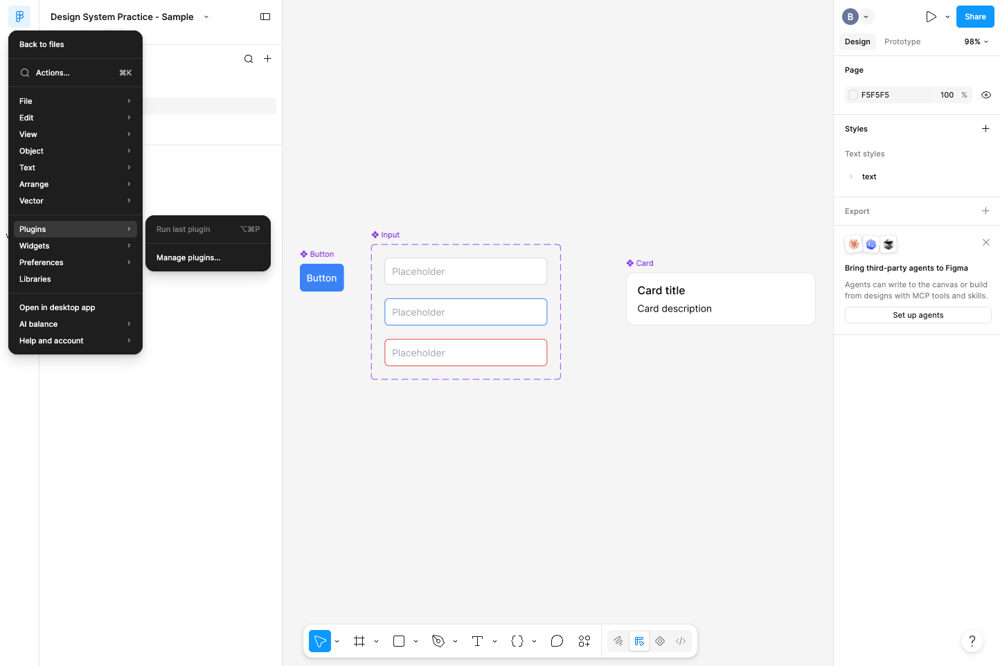
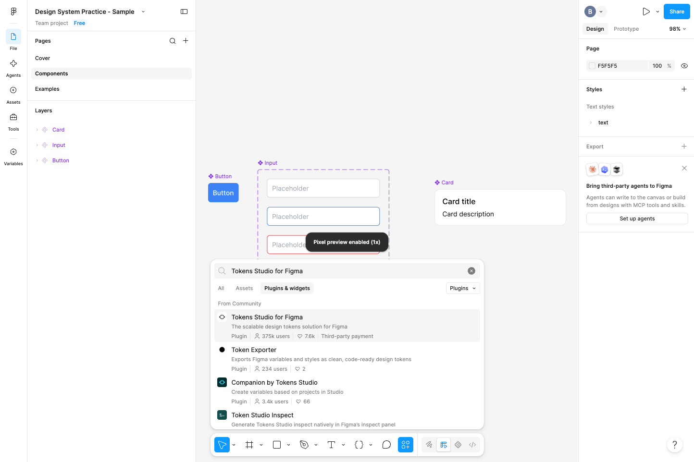
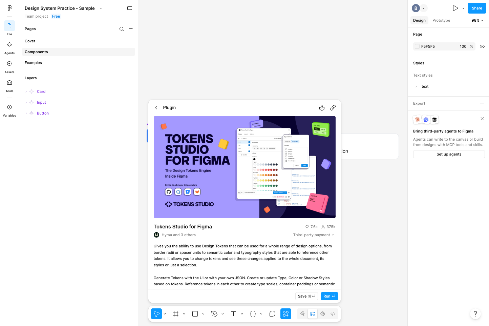
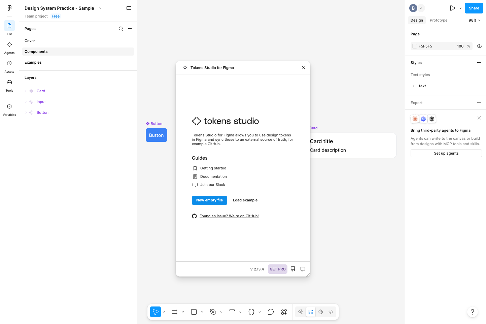
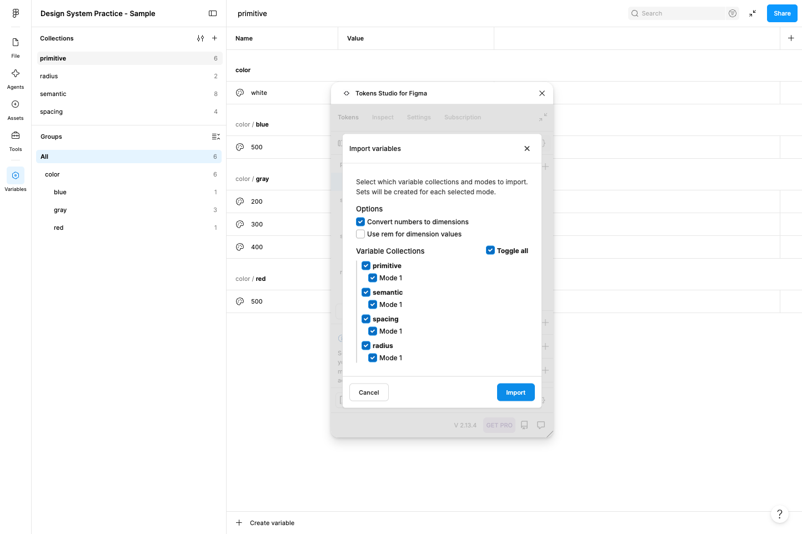
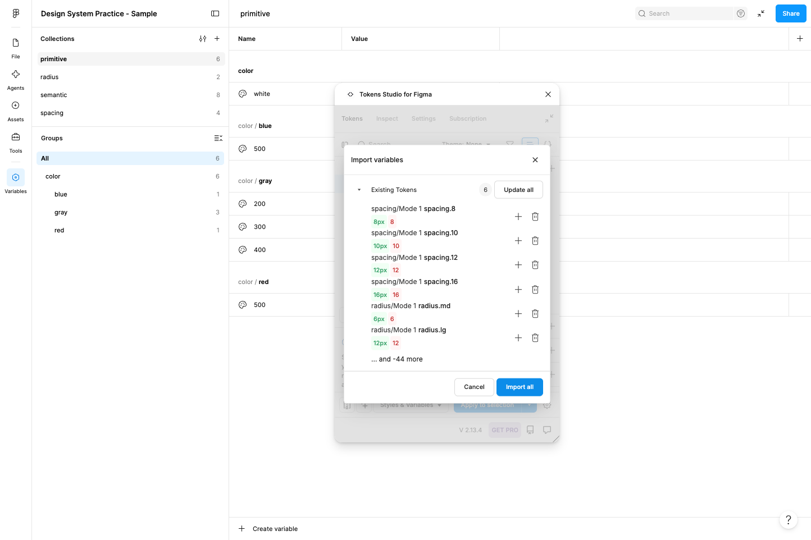
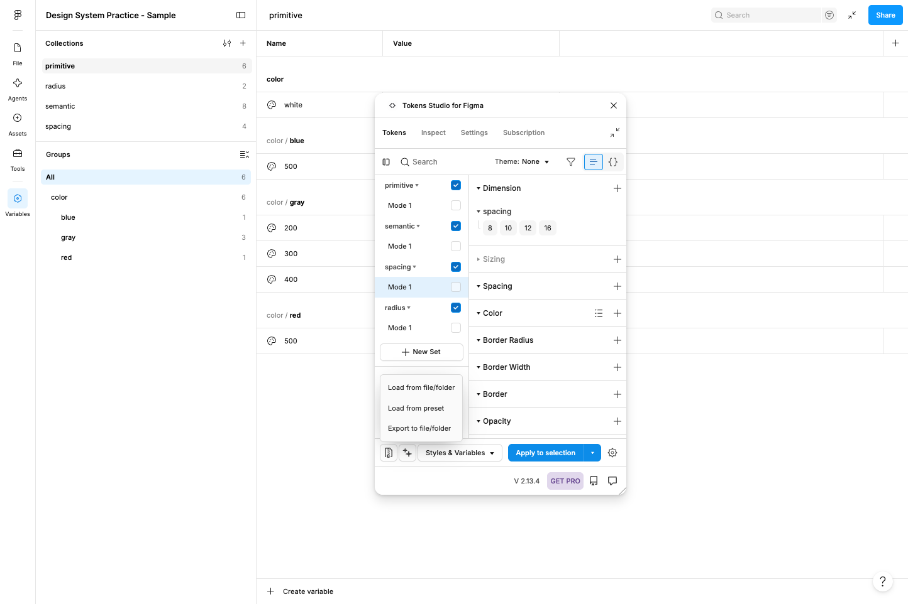
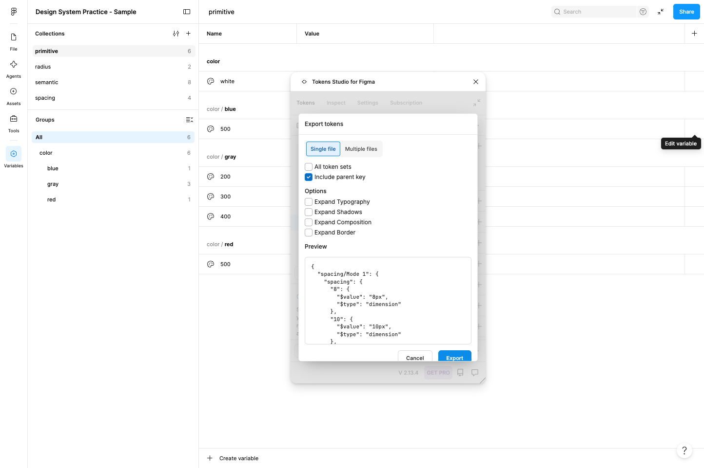

---
hide:
  - navigation
---

# 디자인 토큰 추출·발행 실습

[← 실습편으로 돌아가기](index.md)

[Figma 디자인 시스템 정리 실습](figma-organize.md)에서 정돈한 변수를 토큰 JSON으로 내보내고, CSS 변수로 변환합니다. 개념 설명은 [디자인 토큰 추출·발행](../design-tokens.md)에 있으므로 이 문서에서는 반복하지 않고 작업 순서와 확인 방법만 둡니다.

| 구분 | 내용 |
|---|---|
| 입력 | [Figma 디자인 시스템 정리 실습](figma-organize.md)을 마친 파일 |
| 산출물 | `tokens/tokens.json`, `build/css/variables.css` |
| 다음 단계 | CSS 변수 파일이 컴포넌트 라이브러리 실습의 입력이 됩니다. |

---

## 실습 환경

변환 도구의 버전에 따라 명령어와 출력이 달라질 수 있으므로 아래 버전으로 맞춥니다. 이 문서의 변환 결과는 이 버전으로 직접 실행해 확인한 값입니다.

| 도구 | 버전 | 비고 |
|---|---|---|
| Node.js | 22.22.2 | Style Dictionary 5.x는 Node.js 22 이상 필요 |
| `style-dictionary` | 5.8.0 | |
| `@tokens-studio/sd-transforms` | 2.0.3 | ESM 전용 |

---

## 1. 작업 폴더 준비

### 1-1. 프로젝트 만들기

1. **작업**: [환경 체크리스트](environment.md)에서 만든 `design-system-practice` 폴더에서 터미널을 열고 아래 명령을 한 줄씩 실행합니다.

    **실행 위치**: `design-system-practice`

    **명령어**

    ```bash
    npm init -y
    ```

    **출력 결과**

    ```text
    Wrote to /Users/<사용자>/programming/design-system-practice/package.json:

    {
      "name": "design-system-practice",
      "version": "1.0.0",
      "description": "",
      "main": "index.js",
      "scripts": {
        "test": "echo \"Error: no test specified\" && exit 1"
      },
      "keywords": [],
      "author": "",
      "license": "ISC"
    }
    ```

    **실행 위치**: `design-system-practice`

    **명령어**

    ```bash
    npm pkg set type=module
    ```

    **출력 결과**: 없음(출력이 없으면 정상입니다).

    **실행 위치**: `design-system-practice`

    **명령어**

    ```bash
    npm install style-dictionary@5.8.0 @tokens-studio/sd-transforms@2.0.3
    ```

    **출력 결과**

    ```text
    added 113 packages, and audited 114 packages in 4s

    63 packages are looking for funding
      run `npm fund` for details

    5 moderate severity vulnerabilities

    To address all issues (including breaking changes), run:
      npm audit fix --force

    Run `npm audit` for details.
    ```

    - 경로의 사용자 이름, `name` 값(폴더 이름), 패키지 수, 소요 시간, 취약점 개수는 환경에 따라 다를 수 있습니다.
    - `npm audit fix --force`는 실행하지 않습니다. 버전이 바뀌어 이후 단계의 결과가 달라질 수 있습니다.

2. **기대 결과**: 폴더에 `package.json`과 `node_modules`가 생깁니다. `package.json`에 `"type": "module"`이 들어 있습니다.
3. **확인 방법**: 아래 명령으로 두 패키지의 버전이 표와 같으면 정상입니다.

    **실행 위치**: `design-system-practice`

    **명령어**

    ```bash
    npm ls --depth=0
    ```

    **출력 결과**

    ```text
    ├── @tokens-studio/sd-transforms@2.0.3
    └── style-dictionary@5.8.0
    ```

    `npm install` 중 `npm audit` 관련 안내가 나와도 실습에는 영향이 없습니다. 폴더 이름에 따라 첫 줄의 프로젝트 이름은 다르게 보입니다.

---

## 2. Figma 변수 → 토큰 JSON

### 2-1. 토큰 내보내기

수동 방식을 먼저 진행합니다. 추출 방식은 개념 문서의 [선택 제안](../design-tokens.md#선택-제안)을 따라 Tokens Studio 플러그인과 단일 JSON 파일을 씁니다.

1. **작업**:
    1. [Figma 디자인 시스템 정리 실습](figma-organize.md)을 마친 파일을 엽니다. Variables 화면에 `primitive` 6, `radius` 2, `semantic` 8, `spacing` 4 컬렉션이 있어야 합니다.
    2. 왼쪽 위 Figma 메뉴에서 **Plugins → Manage plugins...** 를 열고, 하단 검색창에 `Tokens Studio for Figma`를 입력해 같은 이름의 플러그인을 선택합니다.

        { width="100%" }

        { width="100%" }

    3. 상세 화면 오른쪽 아래의 **Run**을 누릅니다. 별도의 Install 버튼은 없으며, **Run**이 내 계정에 추가하면서 실행합니다.

        { width="100%" }

    4. 시작 화면에서 **New empty file**을 누릅니다. **Load example**은 샘플 세트(`core`, `light`, `dark`, `theme`)가 들어와 내보낸 JSON에 섞이므로 쓰지 않습니다.

        { width="100%" }

    5. 하단의 **Styles & Variables**를 눌러 Figma 변수를 가져오는 항목(**Import variables**)을 고릅니다.
    6. 아래처럼 지정하고 **Import**를 누릅니다.
        - **Convert numbers to dimensions**: 체크합니다. 간격·반경 값이 `dimension` 타입이 됩니다.
        - **Use rem for dimension values**: 체크하지 않습니다.
        - **Variable Collections**: `primitive`, `semantic`, `spacing`, `radius`와 각 `Mode 1`을 모두 체크합니다.

        { width="100%" }

    7. 다음 창에서 **Import all**을 눌러 토큰 20개를 가져옵니다. 이미 가져온 토큰이 있으면 갱신 대상으로 표시됩니다.

        { width="100%" }

    8. 하단 왼쪽 첫 번째 아이콘(문서 모양)에서 **Export to file/folder**를 고릅니다.

        { width="100%" }

    9. **Single file**을 선택하고 **All token sets**를 체크합니다. **Include parent key**는 체크된 그대로 두고, **Expand ...** 항목은 모두 끈 채로 **Export**를 누릅니다.

        { width="100%" }

    10. 내보낸 `tokens.json`은 먼저 다운로드 폴더(`~/Downloads`)에 저장됩니다. 작업 폴더에서 아래 명령으로 `tokens/tokens.json`으로 옮깁니다.

        **실행 위치**: `design-system-practice`

        **명령어**

        ```bash
        mkdir -p tokens
        ```

        **출력 결과**: 없음(출력이 없으면 정상입니다).

        **실행 위치**: `design-system-practice`

        **명령어**

        ```bash
        mv ~/Downloads/tokens.json tokens/tokens.json
        ```

        **출력 결과**: 없음(출력이 없으면 정상입니다). 같은 이름의 파일이 이미 있으면 `tokens.json (1)`처럼 이름이 달라질 수 있으니 파일 이름을 확인합니다.
2. **기대 결과**: `tokens/tokens.json`이 생기고, 최상위 키로 네 세트(`primitive/Mode 1`, `semantic/Mode 1`, `spacing/Mode 1`, `radius/Mode 1`)가 보입니다.
3. **확인 방법**: [2-2의 정답 JSON](#2-2-기대-결과-json)과 이름·참조·개수를 비교합니다. 아래 표의 세 가지 차이는 정상입니다.

| 차이 | 내보낸 파일 | 정답 JSON | 영향 |
|---|---|---|---|
| 세트 이름 | `primitive/Mode 1`처럼 모드 이름이 붙음 | `primitive` | 없음. 3단계의 `excludeParentKeys: true`가 세트 이름을 경로에서 제외 |
| 간격·반경 값 | `"8px"`처럼 단위가 붙음 | `"8"` | 없음. 3단계 결과가 같음 |
| HEX 대소문자 | `#ffffff` 소문자 | `#FFFFFF` 대문자 | 없음. 3단계에서 소문자로 바뀜 |

!!! note "직접 확인한 범위"
    위 절차와 차이 표는 Free 플랜 파일에서 Tokens Studio v2.13.4로 직접 실행해 확인했습니다. 이 방식으로 내보낸 파일을 3단계의 `build-tokens.js`로 변환해 [3-3의 정답 CSS](#3-3-정답-파일과-대조)와 같은 결과가 나오는 것까지 확인했습니다.

### 2-2. 기대 결과 JSON

아래 JSON이 이 실습의 정답입니다. 작업 폴더에 `expected` 폴더를 만들고 `expected/tokens.json`으로 저장한 뒤, 내보낸 `tokens/tokens.json`과 눈으로 비교합니다. 내보낸 파일은 [2-1의 차이 표](#2-1-토큰-내보내기)에 적은 세 가지(세트 이름, 단위, HEX 대소문자) 외에 이름과 값이 같아야 합니다. 들여쓰기 형식도 달라 `diff`로는 비교하지 않습니다.

```json title="expected/tokens.json"
{
  "primitive": {
    "color": {
      "white": { "$type": "color", "$value": "#FFFFFF" },
      "blue": { "500": { "$type": "color", "$value": "#3B82F6" } },
      "gray": {
        "200": { "$type": "color", "$value": "#E5E7EB" },
        "300": { "$type": "color", "$value": "#D1D5DB" },
        "400": { "$type": "color", "$value": "#9CA3AF" }
      },
      "red": { "500": { "$type": "color", "$value": "#EF4444" } }
    }
  },
  "semantic": {
    "color": {
      "bg": {
        "primary": { "default": { "$type": "color", "$value": "{color.blue.500}" } },
        "surface": { "default": { "$type": "color", "$value": "{color.white}" } }
      },
      "text": {
        "on-primary": { "default": { "$type": "color", "$value": "{color.white}" } },
        "placeholder": { "default": { "$type": "color", "$value": "{color.gray.400}" } }
      },
      "border": {
        "input": {
          "default": { "$type": "color", "$value": "{color.gray.300}" },
          "focus": { "$type": "color", "$value": "{color.blue.500}" },
          "error": { "$type": "color", "$value": "{color.red.500}" }
        },
        "card": { "default": { "$type": "color", "$value": "{color.gray.200}" } }
      }
    }
  },
  "spacing": {
    "spacing": {
      "8": { "$type": "dimension", "$value": "8" },
      "10": { "$type": "dimension", "$value": "10" },
      "12": { "$type": "dimension", "$value": "12" },
      "16": { "$type": "dimension", "$value": "16" }
    }
  },
  "radius": {
    "radius": {
      "md": { "$type": "dimension", "$value": "6" },
      "lg": { "$type": "dimension", "$value": "12" }
    }
  },
  "$themes": [],
  "$metadata": { "tokenSetOrder": ["primitive", "semantic", "spacing", "radius"] }
}
```

| 용어 | 설명 |
|---|---|
| 토큰 세트 | 최상위 키(`primitive`, `semantic`, `spacing`, `radius`). Figma 컬렉션과 같은 이름 |
| `{color.blue.500}` | 원시 토큰을 가리키는 참조. 세트 이름(`primitive`)은 경로에 쓰지 않음 |
| `$themes`, `$metadata` | Tokens Studio가 단일 파일에 함께 저장하는 관리용 항목. 토큰이 아님 |

- 변수 개수는 `primitive` 6, `semantic` 8, `spacing` 4, `radius` 2입니다. Figma 컬렉션의 개수와 같아야 합니다.
- 의미 기반 토큰 8개는 모두 값이 `{...}` 참조로 남아 있어야 합니다. HEX 값으로 풀려 있으면 [참조 관계 유지](../design-tokens.md#참조-관계-유지)를 다시 확인합니다.

---

## 3. 코드용 포맷 변환

### 3-1. 변환 스크립트 작성

1. **작업**: 작업 폴더에 `build-tokens.js`를 만들고 아래 내용을 저장합니다.

    ```js title="build-tokens.js"
    import { register } from '@tokens-studio/sd-transforms';
    import StyleDictionary from 'style-dictionary';

    register(StyleDictionary, { excludeParentKeys: true });

    StyleDictionary.registerTransformGroup({
      name: 'css-kebab',
      transforms: [
        ...StyleDictionary.hooks.transformGroups['tokens-studio'].filter((t) => t !== 'name/camel'),
        'name/kebab',
      ],
    });

    const sd = new StyleDictionary({
      source: ['tokens/tokens.json'],
      preprocessors: ['tokens-studio'],
      platforms: {
        css: {
          transformGroup: 'css-kebab',
          buildPath: 'build/css/',
          files: [
            {
              destination: 'variables.css',
              format: 'css/variables',
              options: { outputReferences: true },
            },
          ],
        },
      },
    });

    await sd.cleanAllPlatforms();
    await sd.buildAllPlatforms();
    ```

2. **기대 결과**: 작업 폴더에 `build-tokens.js`가 생깁니다.
3. **확인 방법**: 파일을 저장한 뒤 에디터에 구문 오류 표시가 없으면 정상입니다.

| 설정 | 역할 |
|---|---|
| `excludeParentKeys: true` | 단일 파일의 최상위 키(세트 이름)를 토큰 경로에서 제외. 없으면 `{color.blue.500}` 참조를 찾지 못함 |
| `registerTransformGroup` | `tokens-studio` 그룹의 이름 변환을 `name/camel`에서 `name/kebab`으로 교체한 그룹을 등록 |
| `transformGroup: 'css-kebab'` | 위에서 등록한 그룹을 사용. 기본 `tokens-studio` 그룹은 `--colorBlue500`처럼 camelCase 이름을 만듦 |
| `outputReferences` | `true`이면 참조 관계를 `var(--...)`로 유지 |

### 3-2. 변환 실행

1. **작업**: 작업 폴더에서 아래 명령을 실행합니다.

    **실행 위치**: `design-system-practice`

    **명령어**

    ```bash
    node build-tokens.js
    ```

    **출력 결과**

    ```text
    css
    ! build/css/variables.css, does not exist

    css
    ✔︎ build/css/variables.css
    ```

    `! ... does not exist`는 처음 실행할 때 지울 파일이 없다는 안내입니다. 두 번째 실행부터는 이전 결과를 지우는 줄이 먼저 나옵니다.

    ```text
    css
    - build/css/variables.css
    - build/css
    - build

    css
    ✔︎ build/css/variables.css
    ```

2. **기대 결과**: `build/css/variables.css`가 생깁니다.
3. **확인 방법**: `build/css/variables.css`를 엽니다. 파일 내용은 [3-3](#3-3-정답-파일과-대조)과 비교합니다.

### 3-3. 정답 파일과 대조

```css title="build/css/variables.css"
/**
 * Do not edit directly, this file was auto-generated.
 */

:root {
  --color-white: #ffffff;
  --color-blue-500: #3b82f6;
  --color-gray-200: #e5e7eb;
  --color-gray-300: #d1d5db;
  --color-gray-400: #9ca3af;
  --color-red-500: #ef4444;
  --spacing-8: 8px;
  --spacing-10: 10px;
  --spacing-12: 12px;
  --spacing-16: 16px;
  --radius-md: 6px;
  --radius-lg: 12px;
  --color-bg-primary-default: var(--color-blue-500);
  --color-bg-surface-default: var(--color-white);
  --color-text-on-primary-default: var(--color-white);
  --color-text-placeholder-default: var(--color-gray-400);
  --color-border-input-default: var(--color-gray-300);
  --color-border-input-focus: var(--color-blue-500);
  --color-border-input-error: var(--color-red-500);
  --color-border-card-default: var(--color-gray-200);
}
```

1. **작업**: 위 내용을 `expected/variables.css`로 저장한 뒤 아래 명령으로 생성 결과와 비교합니다.

    **실행 위치**: `design-system-practice`

    **명령어**

    ```bash
    diff expected/variables.css build/css/variables.css
    ```

    **출력 결과**: 없음(출력이 없으면 정상입니다).

2. **기대 결과**: 두 파일이 같아 `diff`가 아무것도 출력하지 않습니다.
3. **확인 방법**: 차이가 나오면 아래 표에서 원인을 찾습니다.

| 현상 | 원인 |
|---|---|
| 변수 이름이 `--colorBlue500`처럼 camelCase | `transformGroup`이 `css-kebab`이 아닌 `tokens-studio`로 지정됨 |
| `Reference Errors` 오류로 실행이 멈춤 | `register`에 `excludeParentKeys: true`가 빠짐 |
| 변수 순서가 다름 | 정상일 수 있음. 출력은 세트 순서(`primitive`, `spacing`, `radius`, `semantic`)로 나오며 `tokenSetOrder`의 순서와 달라도 됨. 이름과 값만 같으면 통과 |
| 값이 `8` 처럼 단위 없이 나옴 | `$type`이 `dimension`이 아님 |

- [2-1](#2-1-토큰-내보내기)에서 Tokens Studio로 직접 내보낸 `tokens.json`(세트 이름 `primitive/Mode 1` 등, 값 `"8px"`)으로 실행해도 위 결과와 같습니다. `excludeParentKeys: true`가 세트 이름을 제외하기 때문입니다.
- 색상 값은 변환 과정에서 소문자 HEX로 바뀌고, `dimension` 값에는 `px`가 붙습니다.
- 의미 기반 변수는 HEX가 아니라 `var(--color-blue-500)` 같은 참조로 출력됩니다.

---

## 막혔을 때

| 증상 | 확인 |
|---|---|
| Tokens Studio에서 Figma 변수를 가져오지 못함 | [2-2](#2-2-기대-결과-json)의 `expected/tokens.json`을 `tokens/tokens.json`으로 복사한 뒤(`mkdir -p tokens && cp expected/tokens.json tokens/tokens.json`) 3단계부터 진행합니다. |
| 플러그인 설치나 실행이 막힘 | 위와 같습니다. 변환 실습은 플러그인 없이 진행할 수 있습니다. |
| `node build-tokens.js` 실행 시 `MODULE_TYPELESS_PACKAGE_JSON` 경고가 나옴 | `package.json`에 `"type": "module"`을 추가합니다(`npm pkg set type=module`). Node.js 22.22.2에서는 경고만 나오고 실행은 됩니다. |
| 설치 시 Node.js 버전 관련 경고가 나옴 | `node -v`가 22 이상인지 확인합니다. 이 실습은 22.22.2에서 확인했습니다. |
| 변환 결과가 정답 파일과 다름 | [3-3의 원인 표](#3-3-정답-파일과-대조)에서 현상을 찾습니다. |

---

## 실습 완료 확인

- [ ] `tokens/tokens.json`의 세트와 변수 개수가 정답 파일과 같다(6 / 8 / 4 / 2).
- [ ] 의미 기반 토큰이 모두 `{...}` 참조로 남아 있다.
- [ ] `node build-tokens.js`가 오류 없이 실행된다.
- [ ] `build/css/variables.css`가 정답 파일과 `diff` 결과 차이가 없다.

완료한 `build/css/variables.css`는 다음 실습(React 컴포넌트 라이브러리 구축)에서 컴포넌트가 가져다 쓰는 입력입니다.
