---
hide:
  - navigation
---

# Figma 디자인 시스템 정리 실습

[← 실습편으로 돌아가기](index.md)

[샘플 Figma 파일](sample-file.md)에서 하드코딩된 값을 변수로 치환하고, 스타일과 컴포넌트를 정리하고, 이름을 점검합니다. 개념 설명은 [Figma 디자인 시스템 정리](../figma-organize.md)에 있으므로 이 문서에서는 반복하지 않고 작업 순서와 확인 방법만 둡니다.

| 구분 | 내용 |
|---|---|
| 입력 | [샘플 Figma 파일](sample-file.md) 20단계까지 마친 정리 전 파일 |
| 산출물 | 변수·스타일·컴포넌트·이름이 정돈된 Figma 파일 |
| 다음 단계 | 이 산출물이 디자인 토큰 추출 실습의 입력이 됩니다. |

!!! warning "확인 필요"
    - 아래 컬렉션 구성과 변수 개수는 이 실습용으로 정한 값입니다. 공통 준비 이슈에서 확정되는 샘플 파일 기준과 다르면 맞춰 고칩니다.
    - Figma UI 개편에 따라 메뉴 이름과 위치가 달라질 수 있습니다. 화면이 다르면 같은 기능의 메뉴를 찾아 진행합니다.
    - 단계별 기대 결과 스크린샷은 아직 준비하지 않았습니다. 준비되면 각 단계의 기대 결과에 추가합니다.

---

## 정리 대상

샘플 파일에서 하드코딩된 값을 모두 모으면 아래와 같습니다. 같은 의미인데 값이 조금씩 다른 항목은 하나로 합칩니다.

| 구분 | 현재 값 | 정리 방향 |
|---|---|---|
| 채우기 색 | `3B82F6`, `FFFFFF` | 원시 값 → 의미 기반 값 |
| 선 색 | `D1D5DB`, `3B82F6`, `EF4444`, `E5E7EB` | 원시 값 → 의미 기반 값 |
| 글자 색 | `FFFFFF`, `9CA3AF` | 원시 값 → 의미 기반 값 |
| 모서리 반경 | `6`, `7`, `12` | `6`과 `7`을 `6`으로 통일 |
| 패딩·간격 | `10`, `12`, `13`, `16`, Gap `8` | `12`와 `13`을 `12`로 통일 |
| 텍스트 | Medium 14, Regular 14, Medium 16 | 텍스트 스타일 3개 |

---

## 1. 변수 만들기

### 1-1. 컬렉션 만들기

1. **작업**:
    1. 왼쪽 사이드바 맨 아래의 **Variables**(육각형 아이콘)를 눌러 변수 화면을 엽니다.
    2. 왼쪽 **Collections** 제목 오른쪽의 `+` 버튼을 눌러 컬렉션을 만들고 이름을 `primitive`로 지정합니다.
    3. 같은 `+` 버튼으로 컬렉션을 추가해 `semantic`, `spacing`, `radius`로 이름을 지정합니다.
2. **기대 결과**: 컬렉션 `primitive`, `semantic`, `spacing`, `radius`가 보입니다. 목록은 이름순으로 정렬되어 `primitive`, `radius`, `semantic`, `spacing` 순서로 보이며, 변수가 없어 개수는 모두 `0`입니다.

    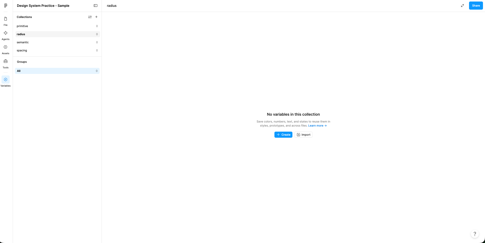{ width="100%" }

3. **확인 방법**: 왼쪽 컬렉션 목록에 네 개가 모두 있으면 정상입니다.

### 1-2. 원시 값 변수 만들기

1. **작업**:
    1. 왼쪽 컬렉션 목록에서 `primitive`를 선택합니다.
    2. 화면 아래의 `+ Create variable`을 눌러 **Color** 변수를 만듭니다.
    3. 이름 칸에 `color/white`처럼 슬래시(`/`)까지 입력합니다. 슬래시 앞부분이 그룹으로 묶입니다.
    4. 값 칸의 색상 스와치를 눌러 Hex 값(`FFFFFF`)을 입력합니다.
    5. 아래 표의 변수를 같은 방법으로 모두 만듭니다.

    | 변수 이름 | 값 |
    |---|---|
    | `color/white` | `FFFFFF` |
    | `color/blue/500` | `3B82F6` |
    | `color/gray/200` | `E5E7EB` |
    | `color/gray/300` | `D1D5DB` |
    | `color/gray/400` | `9CA3AF` |
    | `color/red/500` | `EF4444` |

2. **기대 결과**: `primitive` 컬렉션 개수가 `6`이 되고, 변수가 `color` 그룹 아래 `white`와 `blue`, `gray`, `red` 하위 그룹으로 묶여 보입니다. `white`는 `color` 바로 아래에 있고, 나머지는 `color / blue`, `color / gray`, `color / red` 그룹에 있습니다.

    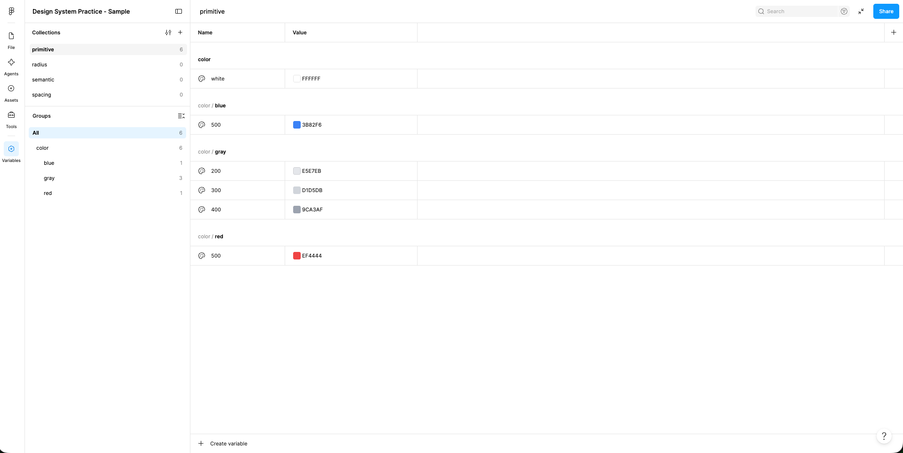{ width="100%" }

3. **확인 방법**: 각 변수의 값이 표와 같고, 모두 Color 타입이면 정상입니다.

### 1-3. 의미 기반 변수 만들기

1. **작업**:
    1. 왼쪽 컬렉션 목록에서 `semantic`을 선택합니다.
    2. 화면 아래의 `+ Create variable`을 눌러 **Color** 변수를 만들고, 이름을 `color/bg/primary/default`처럼 입력합니다.
    3. 값 칸을 눌러 색상 선택 창을 열고, **Variables** 탭에서 `primitive` 컬렉션의 변수를 고릅니다. HEX를 직접 입력하지 않습니다.
    4. 아래 표의 변수를 같은 방법으로 모두 만듭니다.

    | 변수 이름 | 참조하는 원시 값 |
    |---|---|
    | `color/bg/primary/default` | `color/blue/500` |
    | `color/bg/surface/default` | `color/white` |
    | `color/text/on-primary/default` | `color/white` |
    | `color/text/placeholder/default` | `color/gray/400` |
    | `color/border/input/default` | `color/gray/300` |
    | `color/border/input/focus` | `color/blue/500` |
    | `color/border/input/error` | `color/red/500` |
    | `color/border/card/default` | `color/gray/200` |

2. **기대 결과**: `semantic` 컬렉션 개수가 `8`이 됩니다. 마지막 이름(`default`, `focus`, `error`)이 변수 이름이고, 앞부분은 `color / bg / primary`처럼 그룹 제목으로 보입니다. 값 칸에는 HEX가 아니라 `color/blue/500` 같은 원시 값 변수 이름이 표시됩니다.

    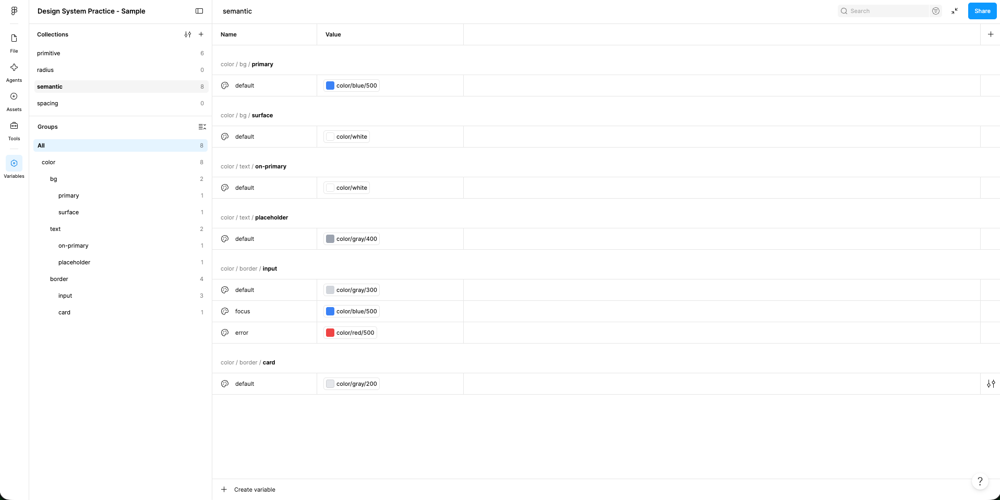{ width="100%" }

3. **확인 방법**: 값 칸의 이름이 표와 같으면 정상입니다. HEX가 직접 입력된 변수가 있으면 참조로 바꿉니다.

### 1-4. 간격과 모서리 반경 변수 만들기

1. **작업**:
    1. 왼쪽 컬렉션 목록에서 `spacing`을 선택합니다.
    2. 화면 아래의 `+ Create variable`을 눌러 **Number** 변수를 만들고, 이름과 값을 아래 표대로 입력합니다.
    3. `radius` 컬렉션도 같은 방법으로 만듭니다.

    | 컬렉션 | 변수 이름 | 값 |
    |---|---|---|
    | `spacing` | `spacing/8` | `8` |
    | `spacing` | `spacing/10` | `10` |
    | `spacing` | `spacing/12` | `12` |
    | `spacing` | `spacing/16` | `16` |
    | `radius` | `radius/md` | `6` |
    | `radius` | `radius/lg` | `12` |

2. **기대 결과**: `spacing` 컬렉션 개수가 `4`, `radius` 컬렉션 개수가 `2`가 됩니다. 슬래시 앞부분(`spacing`, `radius`)은 그룹 제목으로 보이고, 변수 이름에는 `8`, `md`처럼 마지막 이름만 표시됩니다.

    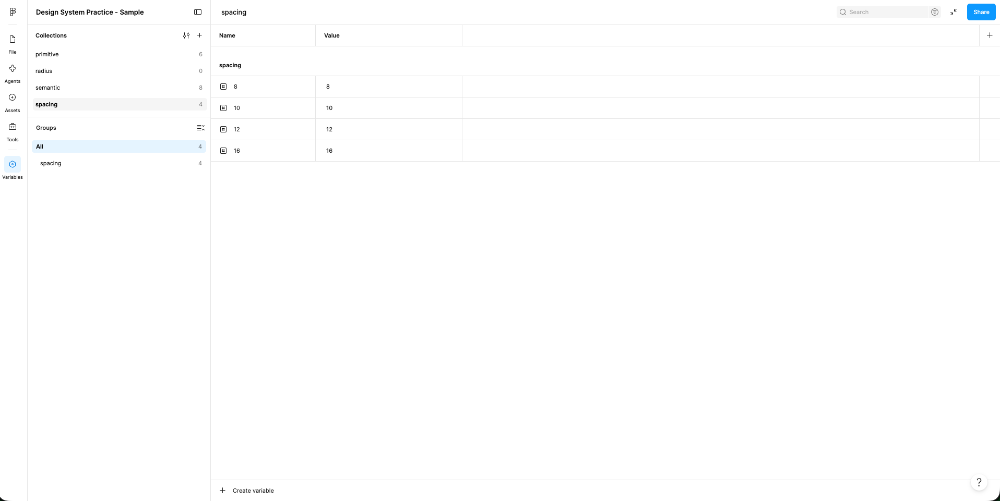{ width="100%" }

    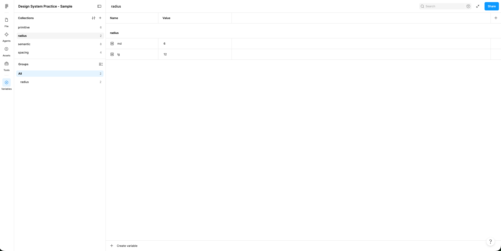{ width="100%" }

3. **확인 방법**: 값이 표와 같고 `7`, `13`에 해당하는 변수가 없으면 정상입니다. 어중간한 값은 `6`, `12`로 합쳤기 때문입니다.

!!! note "모드"
    이 실습의 변수는 모든 컬렉션이 모드를 하나만 씁니다. 모드가 하나면 값 열 이름이 `Value`로 표시됩니다. 라이트/다크 같은 모드 추가는 이 실습의 범위가 아닙니다.

---

## 2. 하드코딩된 값 치환

[개념 문서의 치환 순서](../figma-organize.md#하드코딩된-값을-변수로-치환하는-순서)대로 1단계(값 수집)와 2~3단계(원시·의미 변수)는 위에서 끝났습니다. 아래는 4~5단계에 해당합니다. 컴포넌트에는 **의미 기반 변수만** 연결합니다.

### 2-1. Button 치환

1. **작업**:
    1. `Components` 페이지에서 `Button` 컴포넌트를 선택합니다.
    2. 오른쪽 Design 패널의 **Fill** 줄에서 점 4개 아이콘(**Apply styles and variables**)을 누르고, **Variables** 탭에서 변수를 선택합니다.
    3. **Corner radius**, **Padding** 칸은 마우스를 올리면 나타나는 변수 아이콘을 눌러 변수를 선택합니다.
    4. 왼쪽 레이어에서 안쪽 텍스트(`T` 아이콘)를 따로 선택하고, 글자색 Fill도 같은 방법으로 연결합니다.

    | 위치 | 항목 | 연결할 변수 |
    |---|---|---|
    | 프레임 | Fill | `color/bg/primary/default` |
    | 프레임 | Corner radius | `radius/md` |
    | 프레임 | Padding 세로 | `spacing/10` |
    | 프레임 | Padding 가로 | `spacing/12` |
    | 텍스트 | Fill | `color/text/on-primary/default` |

2. **기대 결과**: 겉모습이 치환 전과 같고, 연결한 칸이 변수 표시로 바뀝니다. Fill에는 변수 이름이 나오고, Corner radius와 Padding의 숫자는 네모로 감싸져 표시됩니다.

    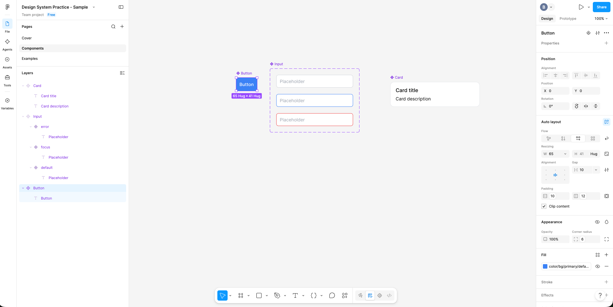{ width="100%" }

3. **확인 방법**: 네모로 감싸진 칸을 눌렀을 때 선택 창에서 해당 변수(`radius/md`, `spacing/10`, `spacing/12`)가 선택돼 있으면 정상입니다. 숫자 칸은 변수의 마지막 이름(`10`, `12`)이나 값이 보일 수 있습니다.

### 2-2. Input 치환

1. **작업**:
    1. 왼쪽 레이어에서 `Input` 안의 `default` Variant를 선택합니다(컴포넌트 세트가 아니라 Variant를 각각 선택).
    2. 2-1과 같은 방법으로 **Fill**, **Stroke**는 점 4개 아이콘(**Apply styles and variables**)의 **Variables** 탭에서, **Corner radius**, **Padding**은 칸에 마우스를 올리면 나타나는 변수 아이콘으로 연결합니다.
    3. 안쪽 `Placeholder` 텍스트 레이어를 따로 선택해 글자색 Fill을 연결합니다.
    4. `focus`, `error` Variant도 같은 방법으로 반복합니다.

    | 위치 | 항목 | 연결할 변수 |
    |---|---|---|
    | 세 Variant 공통 | Fill | `color/bg/surface/default` |
    | 세 Variant 공통 | Corner radius | `radius/md` (`7`이 `6`으로 바뀜) |
    | 세 Variant 공통 | Padding 세로 | `spacing/10` |
    | 세 Variant 공통 | Padding 가로 | `spacing/12` (`13`이 `12`로 바뀜) |
    | `default` | Stroke | `color/border/input/default` |
    | `focus` | Stroke | `color/border/input/focus` |
    | `error` | Stroke | `color/border/input/error` |
    | 텍스트 | Fill | `color/text/placeholder/default` |

2. **기대 결과**: 모서리가 `6`, 가로 패딩이 `12`로 바뀌어 크기가 `240 × 40`으로 유지되는지 확인합니다. 세 Variant의 테두리 색은 그대로 회색, 파란색, 빨간색입니다.

    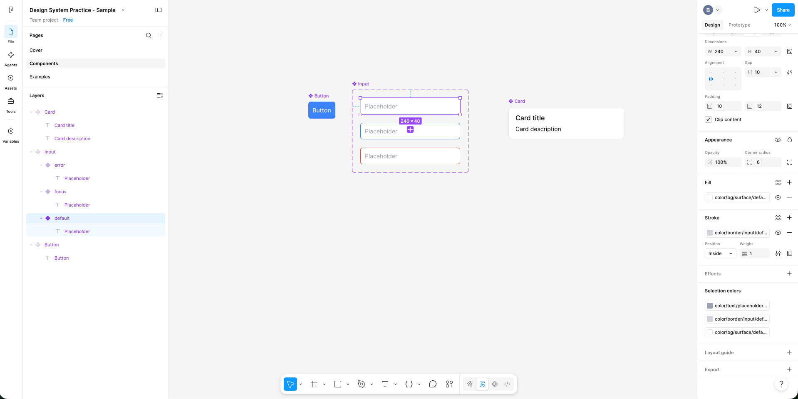{ width="100%" }

    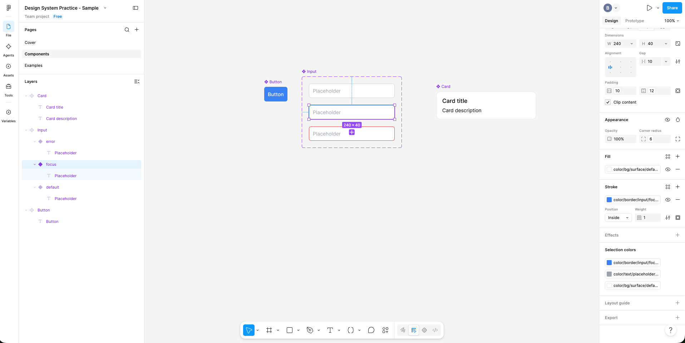{ width="100%" }

    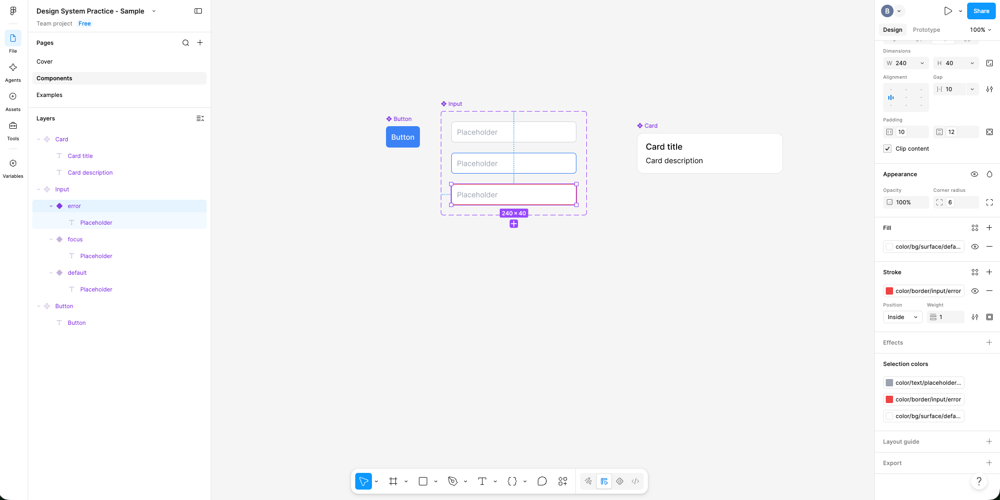{ width="100%" }

3. **확인 방법**: 세 Variant를 차례로 선택했을 때 Stroke에 각각 `color/border/input/default`, `focus`, `error` 변수가 연결되어 있으면 정상입니다. 오른쪽 패널 아래 **Selection colors**에 `color/text/placeholder...`, `color/border/input/...`, `color/bg/surface/...` 세 개가 보이면 색 연결이 모두 된 것입니다.

### 2-3. Card 치환

1. **작업**:
    1. `Components` 페이지의 레이어에서 `Card`를 선택합니다.
    2. Fill과 Stroke는 네 개의 점 모양 **Apply styles and variables** 아이콘 → **Variables** 탭에서, Corner radius와 Padding, Gap은 값 칸에 마우스를 올리면 나타나는 변수 아이콘으로 아래 변수를 연결합니다.

        | 항목 | 연결할 변수 |
        |---|---|
        | Fill | `color/bg/surface/default` |
        | Stroke | `color/border/card/default` |
        | Corner radius | `radius/lg` |
        | Padding (가로·세로) | `spacing/16` |
        | Gap | `spacing/8` |

2. **기대 결과**: 겉모습이 치환 전과 같습니다. 연결된 숫자 값은 박스로 감싸져 표시됩니다.

    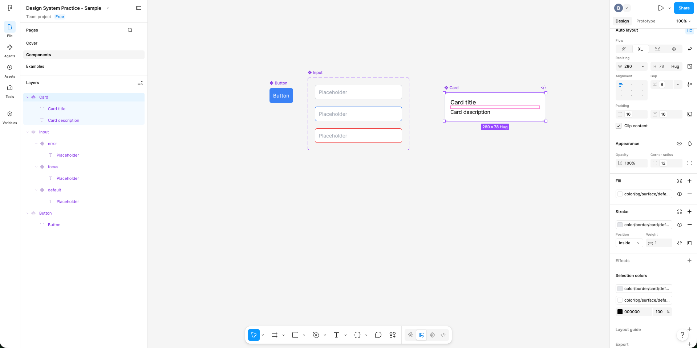{ width="100%" }

3. **확인 방법**: 크기가 `280 × 78 Hug` 그대로이고, 위 항목마다 변수 이름이 표시되면 정상입니다. Selection colors에 `color/border/card/...`, `color/bg/surface/...`가 보이면 색상이 연결된 것입니다. 남는 `000000`은 텍스트 색이며 2-4에서 확인합니다.

### 2-4. 남은 하드코딩 확인

1. **작업**:
    1. `Components` 페이지에서 캔버스 전체를 선택합니다(**Cmd + A**).
    2. 오른쪽 패널에서 변수가 연결되지 않은 Fill, Stroke, Corner radius, Padding, Gap이 남았는지 확인합니다. 텍스트 색은 텍스트 레이어를 하나씩 확인합니다.
    3. `Examples` 페이지의 인스턴스도 같은 방법으로 확인합니다.
2. **기대 결과**: 변수가 연결되지 않은 색상·간격·반경 값이 없습니다.
3. **확인 방법**: `Examples`의 인스턴스는 컴포넌트에서 값을 가져오므로 따로 치환할 항목이 없어야 합니다. 남은 값이 있으면 해당 단계로 돌아가 연결합니다.

---

## 3. 스타일과 컴포넌트 정리

### 3-1. 텍스트 스타일 만들기

[변수와 스타일의 역할 구분](../figma-organize.md#변수와-스타일의-역할-구분)에 따라 글자 속성의 묶음은 스타일로 만듭니다.

1. **작업**:
    1. 텍스트 레이어를 선택하고 오른쪽 패널 Typography 항목의 **Styles** 아이콘(점 네 개)을 누른 뒤 **+** 로 스타일을 만듭니다.
    2. **Create new text style** 창에서 **Name**에 스타일 이름을, **Description**에 용도 설명을 입력하고 **Create style**을 누릅니다.
    3. 아래 세 개를 만들고, 해당하는 텍스트 레이어에 연결합니다.

        | 스타일 이름 | 설명 | 글꼴 | 굵기 | 크기 | 연결할 레이어 |
        |---|---|---|---|---|---|
        | `text/body/default` | 본문 텍스트 | `Inter` | Regular | `14` | `Placeholder`, `Card description` |
        | `text/label/default` | 버튼 등 라벨 텍스트 | `Inter` | Medium | `14` | `Button` 텍스트 |
        | `text/heading/default` | 카드 제목 텍스트 | `Inter` | Medium | `16` | `Card title` |

2. **기대 결과**: 세 텍스트 스타일이 `text` 그룹 아래 `body`, `label`, `heading`으로 묶여 보입니다.
3. **확인 방법**: 텍스트 레이어를 선택했을 때 Typography에 스타일 이름이 표시되면 정상입니다.

    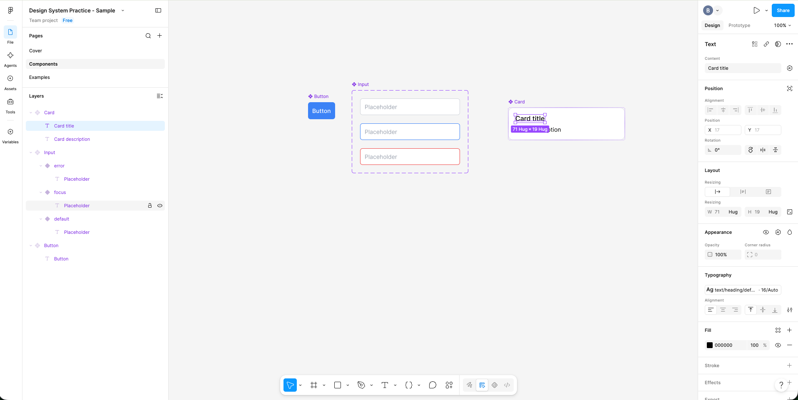{ width="100%" }

!!! note "Cover 페이지 텍스트"
    `Cover` 페이지의 제목(Medium 32)과 설명(Regular 16)은 컴포넌트가 아니라 파일 안내용 텍스트이므로 스타일을 만들지 않습니다.

### 3-2. 컴포넌트 구조 점검

1. **작업**: [컴포넌트 구조화 기준](../figma-organize.md#컴포넌트-구조화-기준)에 맞는지 아래 항목을 확인합니다.

    | 점검 항목 | 기준 |
    |---|---|
    | Button | 컴포넌트이고, 안에 텍스트 레이어만 있다. |
    | Input | `State` property에 `default`, `focus`, `error` 값이 있는 컴포넌트 세트이다. |
    | Card | 컴포넌트이고, 안에 `Card title`, `Card description`이 있다. |
    | Examples 페이지 | 세 컴포넌트가 모두 인스턴스(◇)이다. |

2. **기대 결과**: 모든 항목이 기준을 만족합니다.
3. **확인 방법**: Layers에서 아이콘을 확인합니다. 기준과 다르면 [샘플 파일](sample-file.md)의 해당 단계를 다시 확인합니다.

### 3-3. 변수와 스타일 역할 점검

1. **작업**: 아래 표와 실제 파일이 일치하는지 확인합니다.

    | 대상 | 관리 수단 |
    |---|---|
    | 색상, 간격, 모서리 반경 | 변수 |
    | 글꼴·굵기·크기 조합 | 텍스트 스타일 |

2. **기대 결과**: 텍스트 속성이 변수가 아니라 스타일로만 관리됩니다.
3. **확인 방법**: `primitive`, `semantic`, `spacing`, `radius` 컬렉션에 글자 크기나 굵기 변수가 없으면 정상입니다.

---

## 4. 네이밍 점검

### 4-1. 레이어와 컴포넌트 이름 정리

1. **작업**: Layers를 펼쳐 `Frame 12`, `button copy`처럼 기본 이름이나 일관되지 않은 이름이 남아 있으면 규칙에 맞게 바꿉니다. 컴포넌트와 property 이름은 [3-2](#3-2-컴포넌트-구조-점검)의 표를 기준으로 합니다.
2. **기대 결과**: Layers에 기본 이름(`Frame N`, `Rectangle N`)이 남아 있지 않습니다.
3. **확인 방법**: 왼쪽 패널 **Pages** 줄 오른쪽의 돋보기 아이콘을 눌러 `Frame`을 입력하고, 결과가 없으면 정상입니다.

### 4-2. 네이밍 체크리스트

변수와 스타일 이름이 [네이밍 규칙](../figma-organize.md#네이밍-규칙)을 따르는지 확인합니다.

- [ ] 모든 변수·스타일 이름의 계층 구분자가 슬래시(`/`)이다.
- [ ] 모든 이름이 소문자 kebab-case이다(`on-primary`, `bg`).
- [ ] 이름이 큰 분류에서 작은 분류 순서이다(카테고리 → 용도 → 상태).
- [ ] 상태(`default`, `focus`, `error`)가 이름 끝 하위 계층으로 분리되어 있다.
- [ ] 상태가 없는 의미 기반 변수에도 `default` 계층이 있다.
- [ ] 허용 약어(`bg`) 외에 줄임말을 쓰지 않았다.
- [ ] 같은 의미의 변수가 이름만 달리 중복되어 있지 않다.

---

## 정리 완료 확인

아래 항목을 모두 만족하면 이 실습을 마친 것입니다. 개념 문서의 [정리 확인](../figma-organize.md#정리-확인)과 같은 기준입니다.

- [ ] 변수가 `primitive`, `semantic`, `spacing`, `radius` 컬렉션으로 나뉘어 있다.
- [ ] 색상 변수가 원시 값과 의미 기반 값으로 분리되어 있다.
- [ ] 컴포넌트가 원시 값이 아닌 의미 기반 값만 참조한다.
- [ ] 하드코딩된 색상·간격·반경이 남아 있지 않다.
- [ ] 모든 이름이 같은 구분자와 대소문자 규칙을 따른다.

정리가 끝난 파일은 다음 실습(디자인 토큰 추출·발행)의 입력입니다. 이름을 이 문서와 동일하게 유지해야 다음 단계에서 변환 결과가 어긋나지 않습니다.
