---
hide:
  - navigation
---

# 샘플 Figma 파일

[← 실습편으로 돌아가기](index.md)

모든 실습은 같은 샘플 Figma 파일에서 시작합니다. 샘플 파일 이 문서의 절차를 따라 직접 만듭니다. 정리 전 상태를 재현하려고 일부러 규칙 없이 만든 파일입니다. 실제 업무 파일이나 개인정보는 들어 있지 않습니다.

---

## 파일 구성

### 정리 전 상태

| 구분 | 의도한 문제 |
|---|---|
| 색상 | 변수 없이 HEX 값을 직접 입력한 채우기·선 |
| 타이포그래피 | 텍스트 스타일 없이 글자 크기·굵기를 개별 지정 |
| 간격·모서리 반경 | 같은 의미인데 값이 조금씩 다른 수치 |
| 이름 | 레이어·컴포넌트 이름이 `Frame 12`, `button copy`처럼 일관되지 않음 |

이 문제들을 [Figma 디자인 시스템 정리](../figma-organize.md) 기준으로 정돈하는 것이 실습 2의 목표입니다.

### 페이지

| 페이지 | 내용 |
|---|---|
| Cover | 파일 설명과 실습 안내 |
| Components | 실습에 쓰는 컴포넌트 모음 |
| Examples | 컴포넌트를 조합한 예시 화면 |

### 컴포넌트

| 컴포넌트 | 용도 |
|---|---|
| Button | 색상·간격·모서리 반경·텍스트가 모두 쓰이는 대표 컴포넌트 |
| Input | 상태(기본, 포커스, 오류)가 있는 컴포넌트 |
| Card | 컴포넌트를 조합하는 예시 |

---

## 샘플 파일 만들기

아래 절차를 순서대로 따라 샘플 파일을 직접 만듭니다. Free 플랜에서도 진행할 수 있습니다.

- 단축키는 Mac 기준입니다. Windows에서는 **Cmd**를 **Ctrl**, **Option**을 **Alt**로 바꿔 누릅니다.
- 잘못 입력했거나 실수했을 때는 **Cmd + Z**로 직전 작업을 되돌립니다.
- "오른쪽 패널"은 화면 오른쪽의 Design 탭입니다. 아래 단계는 이 패널의 영역 이름(Position, Layout, Appearance, Fill, Stroke, Typography, Auto layout, Properties)으로 위치를 안내합니다.
- 레이어·페이지 이름은 대상 이름을 더블클릭해 바꿉니다.

### 1. 새 Design 파일 만들기

1. **작업**:
    1. 브라우저나 Figma 데스크톱 앱에서 Figma에 로그인한 상태로 홈(Recents)을 엽니다.
    2. 상단 버튼 중 **Design**을 누릅니다.

    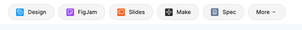{ width="60%" }

2. **기대 결과**: 빈 Design 파일이 열립니다. 왼쪽에는 AI 채팅 패널이, 가운데에는 빈 캔버스가, 오른쪽에는 Design·Prototype 탭이 보입니다. 이 실습에서 AI 채팅 패널은 쓰지 않습니다.

    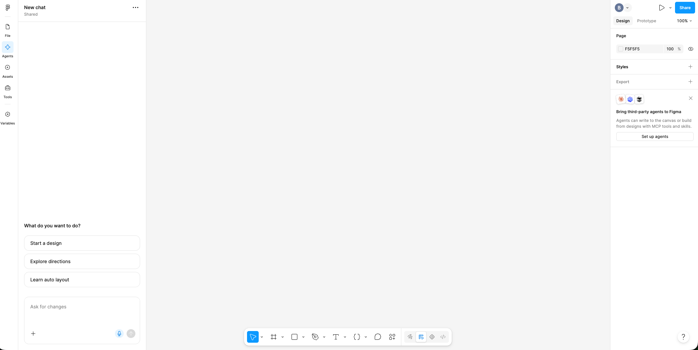{ width="100%" }

3. **확인 방법**: 왼쪽 위 파일 이름이 `Untitled`이고 캔버스가 비어 있으며, 하단 툴바에 이동·프레임·도형·펜·텍스트 도구가 보이면 정상입니다.

### 2. 파일 이름 바꾸기

1. **작업**:
    1. 왼쪽 사이드바에서 **File** 탭을 엽니다.
    2. 맨 위의 파일 이름 **Untitled**를 클릭하면 이름을 입력할 수 있는 상태가 됩니다.
    3. 기존 글자를 지우고 `Design System Practice - Sample`을 입력한 뒤 **Enter**를 누릅니다.
2. **기대 결과**: 왼쪽 위 제목이 새 이름으로 바뀝니다.

    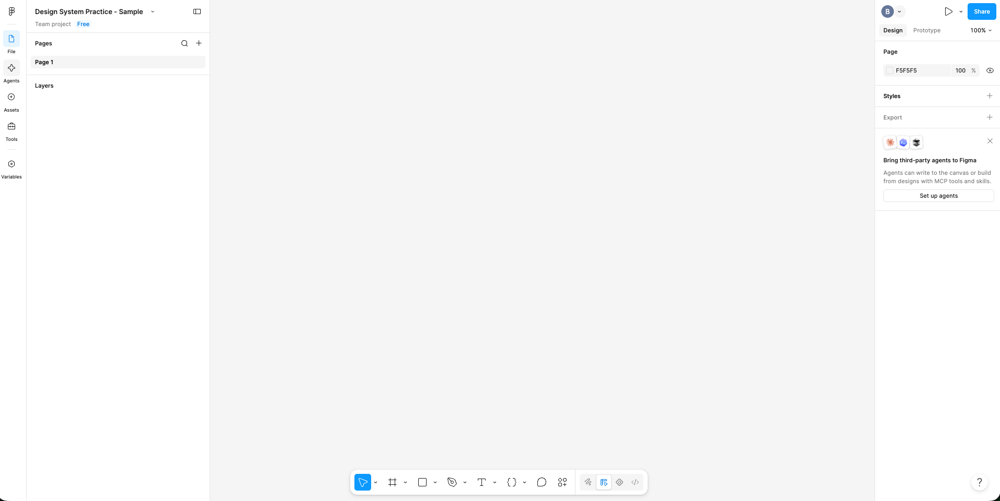{ width="100%" }

3. **확인 방법**: 제목 아래에 `Team project`와 `Free` 표시가 보이면 Free 플랜 파일로 만들어진 것입니다.

### 3. 페이지 만들기

1. **작업**:
    1. 왼쪽 사이드바의 **File** 탭을 열면 Pages 목록이 나옵니다. 목록이 접혀 있으면 **Pages** 제목을 눌러 펼칩니다.
    2. `Page 1`을 더블클릭해 이름을 `Cover`로 바꾸고 **Enter**를 누릅니다.
    3. Pages 옆 **+** 버튼으로 `Components`, `Examples` 페이지를 추가합니다.
2. **기대 결과**: Pages 목록에 `Cover`, `Components`, `Examples`가 순서대로 보입니다.

    { width="100%" }

3. **확인 방법**: 각 페이지를 눌러 이동할 수 있고, 세 페이지 모두 빈 캔버스면 정상입니다.

### 4. Button 프레임 만들기

1. **작업**:
    1. 왼쪽 사이드바의 Pages 목록에서 `Components` 페이지를 엽니다.
    2. 키보드에서 **F**를 누릅니다. 마우스 커서가 프레임을 그릴 수 있는 상태로 바뀝니다.
    3. 캔버스를 드래그해 사각형을 그립니다.
    4. 오른쪽 패널의 Layout 영역에서 **W** `120`, **H** `40`으로 크기를 맞춥니다.
    5. Layers에서 프레임 이름(`Frame 1` 등)을 더블클릭해 `Button`으로 바꾸고 **Enter**를 누릅니다.
2. **기대 결과**: Layers에 `Button` 프레임이 생기고, 캔버스에 120 × 40 크기의 흰색 사각형이 보입니다.

    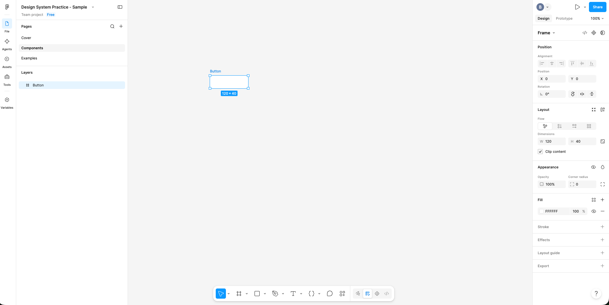{ width="100%" }

3. **확인 방법**: 프레임을 선택했을 때 오른쪽 패널 제목이 `Frame`이고 W 120, H 40, Fill `FFFFFF`로 표시되면 정상입니다.

### 5. Button 채우기 색을 HEX로 직접 입력하기

1. **작업**:
    1. `Button` 프레임을 선택합니다.
    2. 오른쪽 패널의 Fill 항목에서 `FFFFFF` 값을 클릭하고 `3B82F6`을 입력한 뒤 **Enter**를 누릅니다.
    3. 변수나 스타일은 연결하지 않고 HEX 값을 직접 입력합니다.
2. **기대 결과**: 사각형이 파란색으로 바뀝니다.

    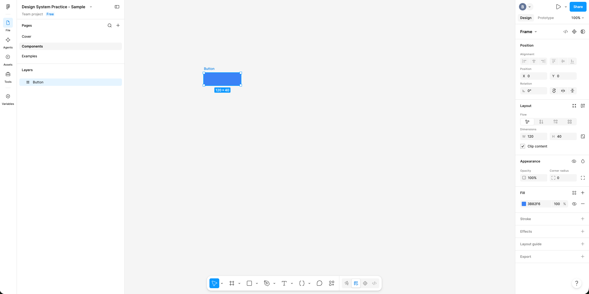{ width="100%" }

3. **확인 방법**: Fill 항목에 `3B82F6`이 표시되고, 변수·스타일 아이콘이 연결되어 있지 않으면 정상입니다.

### 6. 모서리 반경을 어중간한 값으로 넣기

1. **작업**:
    1. `Button` 프레임을 선택합니다.
    2. 오른쪽 패널의 Appearance 영역에서 **Corner radius** 칸을 클릭하고 `6`을 입력한 뒤 **Enter**를 누릅니다.
    3. `4`나 `8`이 아닌 어중간한 값을 일부러 씁니다.
2. **기대 결과**: 사각형 모서리가 둥글게 바뀝니다.

    { width="100%" }

3. **확인 방법**: Corner radius 칸에 `6`이 표시되면 정상입니다.

### 7. Button 텍스트 넣기

1. **작업**:
    1. **T**를 누르고 프레임 안을 클릭해 `Button`을 입력한 뒤 **Esc**를 눌러 입력을 마칩니다.
    2. 텍스트 레이어를 선택한 상태에서 오른쪽 Typography의 **Regular** 드롭다운(크기 `14` 왼쪽)을 엽니다.
    3. **Medium**을 고릅니다.
    4. 글자 크기는 `14`로 둡니다. 글자 색은 기본이 검정이므로, 오른쪽 패널의 Fill 값을 클릭해 `FFFFFF`로 바꿉니다.
    5. 텍스트 스타일은 연결하지 않습니다.
2. **기대 결과**: Layers에서 `Button` 프레임 아래에 `Button` 텍스트 레이어가 생기고, 파란 사각형 안에 흰 글자가 보입니다.

    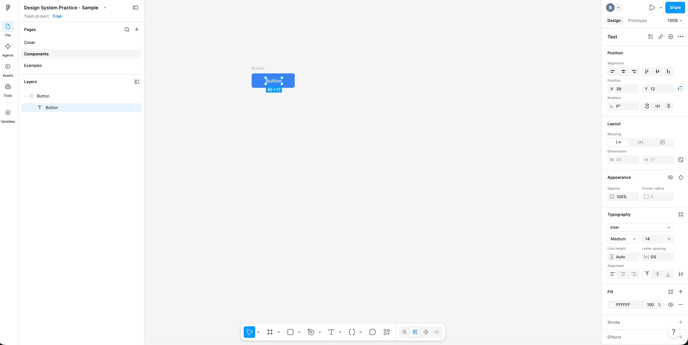{ width="100%" }

3. **확인 방법**: Layers에서 `Button` 아래에 들여쓰기된 텍스트 레이어가 보이면 텍스트가 프레임 안에 들어간 것입니다. 텍스트를 선택했을 때 Typography에 `Inter`, `Medium`, `14`가 표시되고 Fill이 `FFFFFF`면 정상입니다.

### 8. Auto layout과 패딩 지정하기

1. **작업**:
    1. Layers에서 `Button`을 선택하고 **Shift + A**를 **한 번만** 누릅니다. Auto layout이 이미 켜져 있으면 다시 누르지 않습니다.
    2. 오른쪽 패널의 Auto layout 영역에서 Padding 칸 두 개에 세로 `10`, 가로 `12`를 입력합니다. 변수는 연결하지 않습니다.
    3. Alignment는 점 9개로 된 3×3 격자입니다. 정중앙 점을 클릭해 가운데 정렬로 맞춥니다.
    4. Layers에서 `Button`을 펼쳐 안에 텍스트 레이어만 있는지 확인합니다.
2. **기대 결과**: 프레임 크기가 내용에 맞게 줄어들어(Hug: 안쪽 내용 크기에 맞춰 자동으로 조절되는 크기 설정) `65 × 41` 정도가 되고, 글자 둘레에 여백이 생깁니다.

    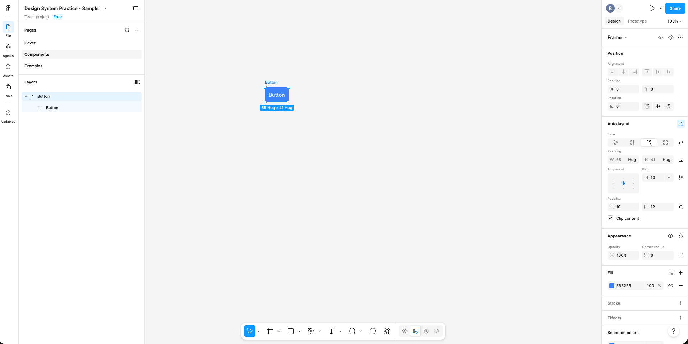{ width="100%" }

3. **확인 방법**: 오른쪽 패널에서 Padding이 `10`·`12`, Alignment가 가운데, Corner radius가 `6`, Fill이 `3B82F6`이면 정상입니다.

### 9. Button을 컴포넌트로 변환하기

1. **작업**:
    1. Layers에서 `Button` 프레임을 선택합니다.
    2. **Cmd + Option + K**를 누릅니다. 상단 툴바의 **Create component** 버튼을 눌러도 됩니다.
    3. 변수와 스타일은 연결하지 않습니다.
2. **기대 결과**: Layers의 `Button` 아이콘이 보라색 컴포넌트 모양으로 바뀌고, 캔버스의 이름 라벨도 보라색으로 표시됩니다. 오른쪽 패널 제목은 `Button`이며 Properties 항목이 생깁니다.

    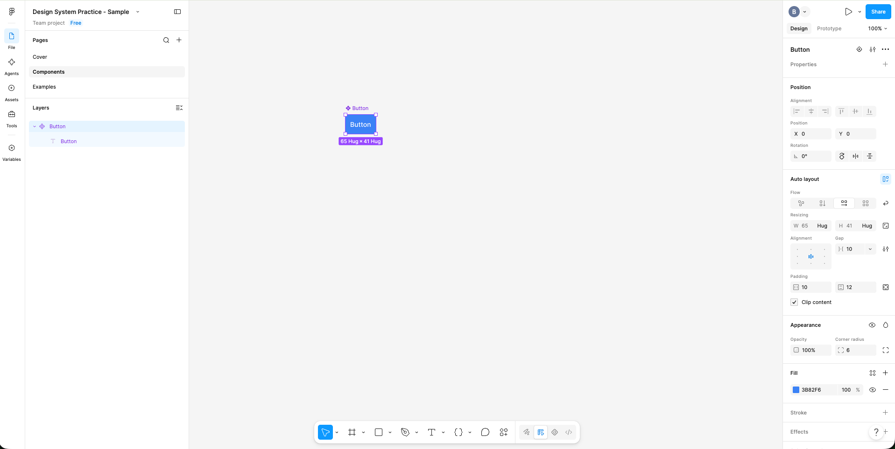{ width="100%" }

3. **확인 방법**: 크기 `65 × 41`, Padding `10`·`12`, Corner radius `6`, Fill `3B82F6`이 그대로 유지되어 있으면 정상입니다.

### 10. Input 프레임과 테두리 만들기

1. **작업**:
    1. `Components` 페이지에서 `Button` 오른쪽 빈 곳에 **F**로 프레임을 그립니다.
    2. 오른쪽 패널의 Layout 영역에서 **W** `240`, **H** `40`으로 크기를 맞추고 레이어 이름을 `Input`으로 바꿉니다.
    3. 오른쪽 패널의 Stroke 항목 옆 **+** 를 눌러 선을 추가합니다.
    4. Stroke 색 값을 클릭해 `D1D5DB`, 두께(Weight) 칸에 `1`을 입력합니다. Position 드롭다운은 `Inside`로 둡니다. 변수는 연결하지 않습니다.
2. **기대 결과**: 흰색 사각형에 회색 테두리가 생깁니다.

    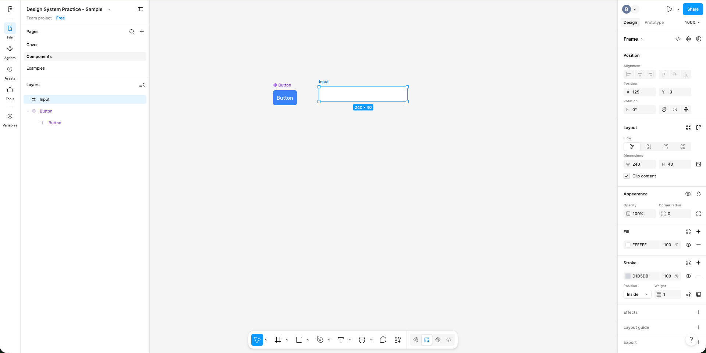{ width="100%" }

3. **확인 방법**: Stroke에 `D1D5DB`, `Inside`, 두께 `1`이 표시되고 크기가 `240 × 40`이면 정상입니다.

### 11. Input 모서리 반경과 placeholder 텍스트 넣기

1. **작업**:
    1. `Input` 프레임을 선택하고 Appearance의 **Corner radius**에 `7`을 입력합니다. Button의 `6`과 일부러 다르게 둔 값입니다.
    2. **T**를 누르고 프레임 안을 클릭해 `Placeholder`를 입력합니다.
    3. 텍스트 레이어의 Typography를 `Inter`, `Regular`, `14`로 둡니다.
    4. 텍스트 Fill을 `9CA3AF`로 바꿉니다. 텍스트 스타일과 변수는 연결하지 않습니다.
2. **기대 결과**: Layers에서 `Input` 프레임 아래에 `Placeholder` 텍스트 레이어가 생기고, 사각형 안에 옅은 회색 글자가 보입니다.

    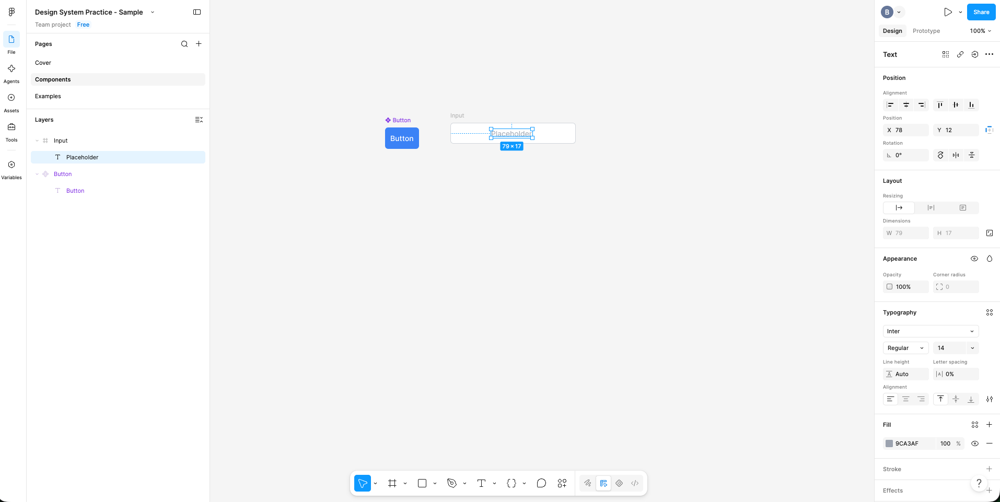{ width="100%" }

3. **확인 방법**: 텍스트를 선택했을 때 Typography에 `Inter`, `Regular`, `14`가 표시되고 Fill이 `9CA3AF`면 정상입니다.

### 12. Input에 Auto layout과 패딩 지정하기

1. **작업**:
    1. Layers에서 `Input`을 선택하고 **Shift + A**를 **한 번만** 누릅니다.
    2. Padding을 세로 `10`, 가로 `13`으로 직접 입력합니다. 변수는 연결하지 않습니다.
    3. Alignment 3×3 격자에서 세로 가운데 줄의 왼쪽 점(왼쪽 변 가운데)을 클릭해 왼쪽 정렬로 맞춥니다.
    4. Auto layout을 켜면 크기가 내용에 맞게 줄어듭니다(Hug). Resizing의 **W**와 **H**를 모두 **Fixed**로 바꿉니다.
        1. **W**의 `Hug`를 눌러 **Fixed**로 시작하는 항목(`Fixed width` 등)을 고르고 `240`을 입력합니다.
        2. **H**의 `Hug`를 눌러 **Fixed**로 시작하는 항목(`Fixed height` 등)을 고르고 `40`을 입력합니다.
        3. 두 값을 고정하면 Resizing 항목 이름이 Dimensions로 바뀌고 값 오른쪽에 드롭다운이 표시됩니다.
2. **기대 결과**: `Input` 크기가 `240 × 40`으로 유지되고, `Placeholder` 텍스트가 왼쪽 가운데에 놓입니다.

    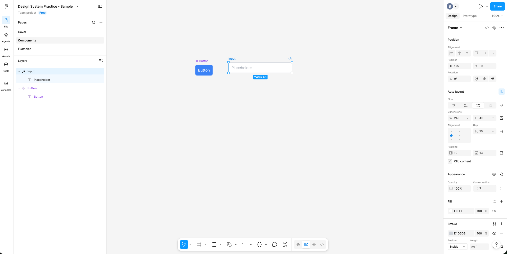{ width="100%" }

3. **확인 방법**: 오른쪽 패널에서 Dimensions가 `240`·`40`, Padding이 `10`·`13`, Corner radius가 `7`, Fill이 `FFFFFF`, Stroke가 `D1D5DB`(`Inside`, `1`)이면 정상입니다.

### 13. Input을 컴포넌트로 변환하기

1. **작업**:
    1. Layers에서 `Input` 프레임을 선택합니다.
    2. **Cmd + Option + K**를 누릅니다.
    3. 변수와 스타일은 연결하지 않습니다.
2. **기대 결과**: Layers의 `Input` 아이콘과 캔버스 라벨이 보라색 컴포넌트 모양으로 바뀝니다.

    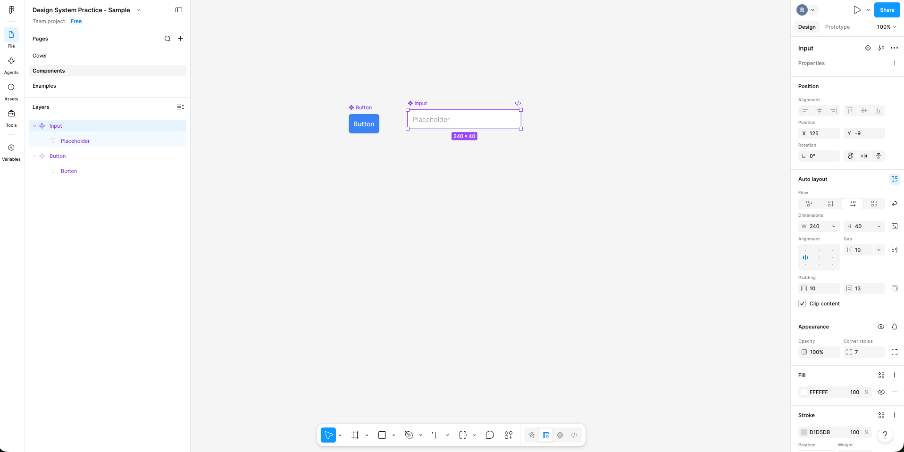{ width="100%" }

3. **확인 방법**: Properties 영역이 표시되고, 크기 `240 × 40`, Padding `10`·`13`, Corner radius `7`이 그대로면 정상입니다.

### 14. Input 상태 Variant 만들기

1. **작업**:
    1. `Input` 컴포넌트를 선택하고 오른쪽 패널 Properties 영역의 **+** 에서 **Variant**를 추가합니다.
    2. Property 이름은 `State`로 둡니다. 첫 Variant의 값은 Figma가 `Default`로 자동 지정하므로, 이후 `focus`·`error`와 맞추려고 소문자 `default`로 고칩니다.
    3. 이번에는 오른쪽 패널이 아니라 캔버스에서, 컴포넌트 세트(점선 박스) 아래의 보라색 **+** 버튼을 클릭해 Variant를 하나 더 만듭니다.
    4. 새 Variant를 선택하고 Properties의 `State` 값을 `focus`로 바꿉니다.
    5. 같은 방법으로 **+** 를 한 번 더 눌러 값을 `error`로 지정합니다.
2. **기대 결과**: 점선 박스 안에 `Placeholder` 입력창 세 개가 세로로 놓이고, Layers의 `Input` 아래에 `error`, `focus`, `default` 세 Variant가 보입니다.

    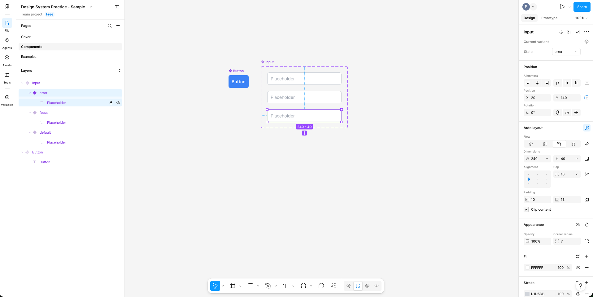{ width="100%" }

3. **확인 방법**: Variant를 선택했을 때 Properties에 `State`와 현재 값이 표시되고, 세 값이 모두 소문자이면 정상입니다.

### 15. focus 상태 스타일 지정하기

1. **작업**:
    1. Layers에서 `Input` 아래의 `focus` Variant를 선택합니다. 컴포넌트 세트(`Input`)가 아니라 그 안의 `focus`를 골라야 합니다.
    2. 오른쪽 패널의 Stroke 색을 `3B82F6`으로 바꿉니다. Position은 `Inside`, Weight는 `1`로 둡니다.
    3. 변수는 연결하지 않습니다.
2. **기대 결과**: focus Variant의 테두리만 파란색으로 바뀝니다.

    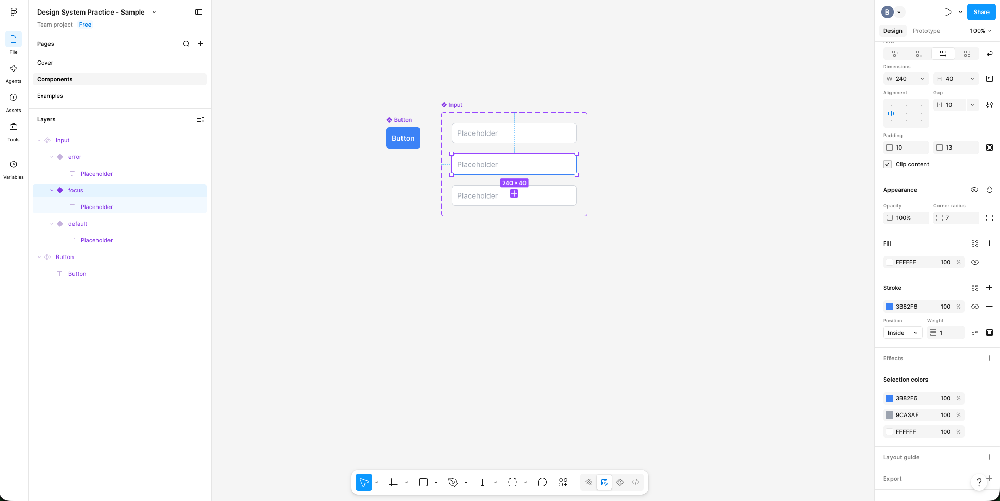{ width="100%" }

3. **확인 방법**: `focus`를 선택했을 때 Stroke가 `3B82F6`, Weight가 `1`이고, 나머지 Variant의 테두리는 그대로이면 정상입니다.

### 16. error 상태 스타일 지정하기

1. **작업**:
    1. Layers에서 `Input` 아래의 `error` Variant를 선택합니다. 컴포넌트 세트(`Input`)가 아니라 그 안의 `error`를 골라야 합니다.
    2. Stroke 색을 `EF4444`로 바꿉니다. Position은 `Inside`, Weight는 `1`로 둡니다.
    3. 변수는 연결하지 않습니다.
2. **기대 결과**: error Variant의 테두리만 빨간색으로 바뀝니다.

    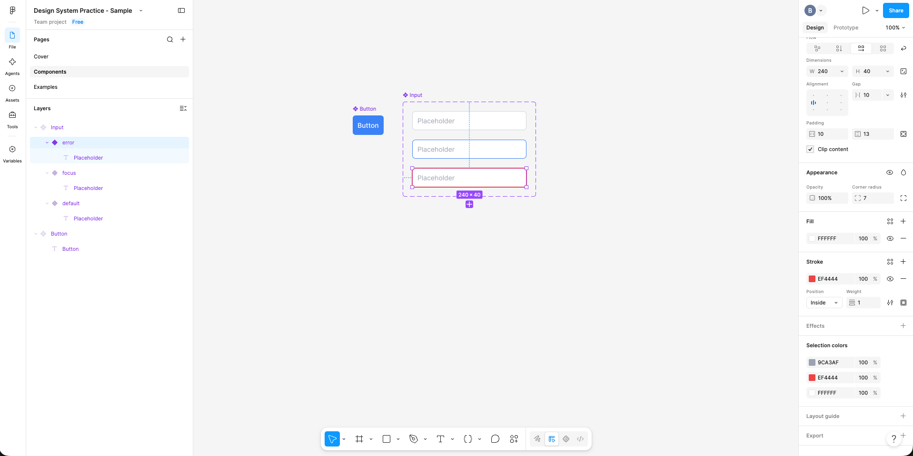{ width="100%" }

3. **확인 방법**: `error`를 선택했을 때 Stroke가 `EF4444`이고, 세 Variant의 테두리가 각각 회색(default), 파란색(focus), 빨간색(error)이면 정상입니다.

### 17. Card 프레임과 Auto layout 만들기

Card는 제목과 본문 텍스트를 세로로 쌓는 카드입니다. 이 단계에서는 빈 틀(프레임)만 만들고, 텍스트는 18단계에서 넣습니다. 아래 값은 모두 숫자와 색을 직접 입력하며, Variables(변수)는 연결하지 않습니다.

1. **작업**:
    1. `Components` 페이지에서 `Input` 컴포넌트 세트 오른쪽 빈 곳에 **F**를 누르고 드래그해 프레임을 그립니다. 크기는 대략 `280 × 120`이면 됩니다.
    2. Layers에서 프레임 이름을 더블클릭해 `Card`로 바꿉니다.
    3. `Card`를 선택한 채 **Shift + A**를 **한 번만** 눌러 Auto layout을 켭니다. (두 번 누르면 꺼지거나 중첩됩니다.)
    4. 오른쪽 Properties의 **Auto layout** 영역을 아래처럼 지정합니다. 각 칸을 클릭해 숫자를 입력하고 **Enter**를 누릅니다.
        - **Flow(방향)**: Auto layout 영역의 **Flow** 줄에는 아이콘 네 개가 있습니다. 처음에는 세 번째(가로 방향) 아이콘이 선택되어 있으므로, **두 번째 아이콘**(아래 화살표 `↓`와 막대 모양, 세로 방향)을 클릭합니다. 그러면 안에 넣는 요소가 위에서 아래로 쌓입니다. 아이콘 모양이 다르면 아이콘에 마우스를 올려 나타나는 설명에 세로(Vertical) 방향이 적힌 것을 고릅니다.
        - **Gap**: `8`을 입력합니다. 제목과 본문 사이 간격입니다.
        - **Padding**: 두 칸(좌우, 상하) 모두 `16`을 입력합니다. 카드 테두리와 내용 사이 여백입니다. 처음 값은 둘 다 `10`입니다.
    5. 크기는 Auto layout 영역 안의 **Resizing** 줄에서 지정합니다. (Auto layout을 켜면 Dimensions 대신 Resizing으로 표시됩니다.) **W**의 `Hug`를 눌러 **Fixed**로 시작하는 항목(`Fixed width` 등)을 고르고 `280`을 입력합니다. **H**는 `Hug`로 그대로 둡니다. 내용 높이에 맞게 자동으로 늘어납니다.
    6. **Fill**은 `FFFFFF`로 지정합니다.
    7. **Stroke**의 **+** 를 눌러 색 `E5E7EB`, Position `Inside`, Weight `1`로 지정합니다.
    8. **Corner radius**에 `12`를 입력합니다.
2. **기대 결과**: 흰 배경에 옅은 회색 테두리와 둥근 모서리가 있는 세로 Auto layout 프레임이 생깁니다.

    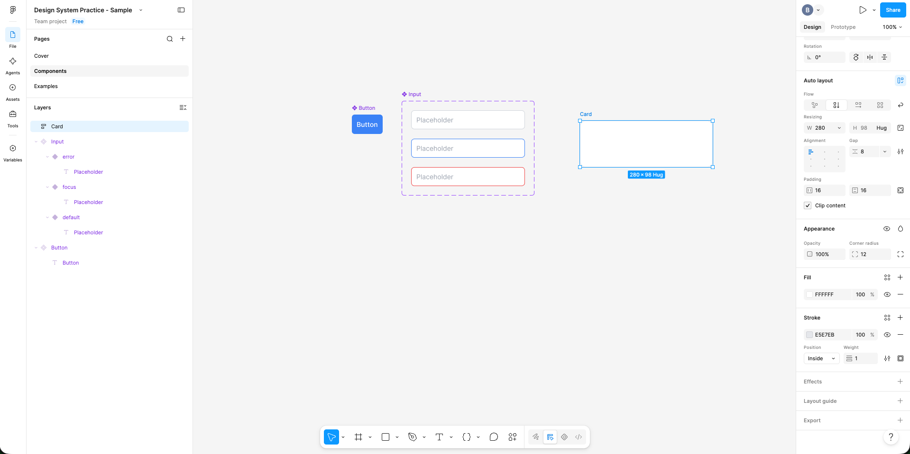{ width="100%" }

3. **확인 방법**: `Card`를 선택했을 때 Properties의 Flow에서 두 번째 아이콘(세로)이 선택되어 있고, Gap `8`, Padding `16`, Fill `FFFFFF`, Stroke `E5E7EB`가 표시되고, Layers의 `Card` 아이콘에 Auto layout 표시가 있으면 정상입니다.

### 18. Card 텍스트 넣기와 컴포넌트 변환

1. **작업**:
    1. **T**를 누르고 `Card` 프레임 안을 클릭해 제목 텍스트 `Card title`을 입력합니다. 글꼴은 `Inter`, `Medium`, `16`으로 지정합니다.
    2. 같은 방법으로 본문 텍스트 `Card description`을 입력하고 `Inter`, `Regular`, `14`로 지정합니다. 두 텍스트가 `Card` 안에서 위아래로 쌓입니다.
    3. Layers에서 `Card` 프레임을 선택하고 **Cmd + Option + K**를 눌러 컴포넌트로 변환합니다.
    4. 변수와 스타일은 연결하지 않습니다.
2. **기대 결과**: `Card` 아이콘과 캔버스 이름 라벨이 보라색 컴포넌트 모양으로 바뀌고, 안에 제목과 본문 텍스트가 있습니다. 높이는 내용에 맞춰 `Hug`로 정해집니다. 위아래 Padding `16` × 2, Gap `8`, 두 텍스트의 줄 높이 합 `38`을 더해 `78`이 됩니다.

    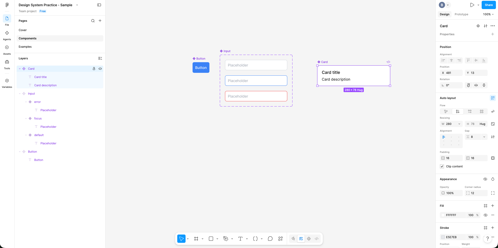{ width="100%" }

3. **확인 방법**: Layers에서 `Card` 아래에 `Card title`, `Card description` 두 텍스트 레이어가 보이고, Properties 항목이 생기며, 크기가 `280 × 78 Hug`이면 정상입니다. 17단계의 Gap `8`, Padding `16`, Corner radius `12`는 그대로 유지됩니다.

### 19. Examples 페이지 만들기

1. **작업**:
    1. 왼쪽 사이드바 Pages에서 3단계에서 만든 `Examples` 페이지를 엽니다.
    2. 왼쪽 맨 끝 아이콘 줄에서 **Assets**를 열고, `Button`, `Input`, `Card`를 캔버스로 하나씩 끌어다 놓습니다. `Input`은 `Components`에서 컴포넌트 세트를 복사하지 말고 Assets에서 놓아야 `default` 인스턴스 하나만 놓입니다. 세트를 복사하면 원본이 하나 더 생깁니다.
    3. 세 인스턴스를 세로로 한 줄에 쌓아 배치합니다. 각 인스턴스를 선택하고 오른쪽 패널 위쪽 Position 영역의 **X**, **Y** 칸에 아래 값을 입력합니다.

        | 인스턴스 | X | Y |
        | --- | --- | --- |
        | `Button` | 100 | 100 |
        | `Input` | 100 | 200 |
        | `Card` | 100 | `200` + `Input` 높이 + `40` |

        `Input` 높이를 모르면 Input을 선택해 Properties의 H 값을 확인합니다. 예를 들어 H가 `80`이면 `Card`의 Y는 `320`입니다. 이 문서의 `Input`은 높이가 `40`이므로 `Card`의 Y는 `280`입니다.
2. **기대 결과**: `Examples` 페이지에 세 컴포넌트의 인스턴스가 세로로 놓입니다. `Input`은 `Placeholder` 입력창 하나만 보입니다.

    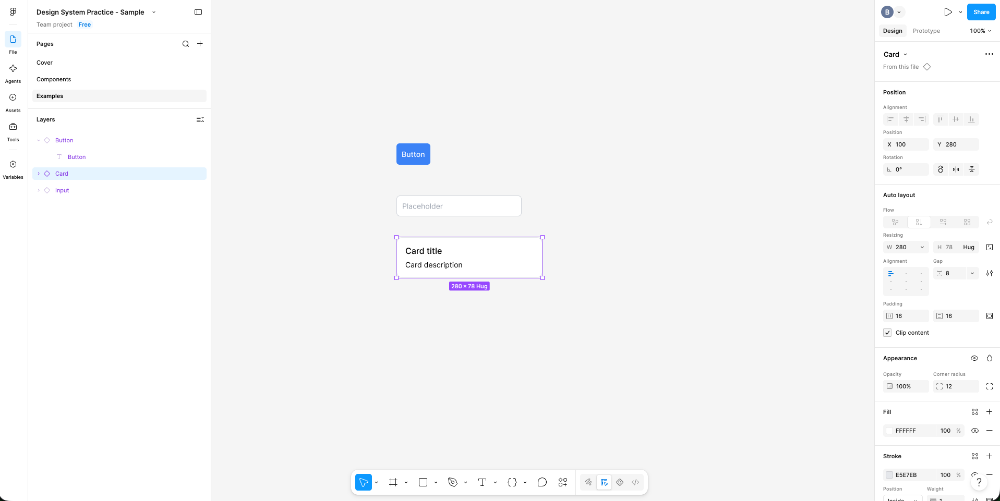{ width="100%" }

3. **확인 방법**: Layers에서 `Button`, `Input`, `Card`의 아이콘이 모두 속이 빈 ◇(인스턴스)이면 정상입니다. `Input`이 ❖ 아이콘이고 `error`, `focus`, `default`가 안에 보이면 세트를 복사한 것이므로 삭제하고 Assets에서 다시 놓습니다. `Card`를 선택하면 Properties에 `From this file`이 보이고, 위치가 `X 100, Y 280`, 크기가 `280 × 78 Hug`입니다.

### 20. Cover 페이지 만들기

1. **작업**:
    1. Pages에서 3단계에서 만든 `Cover` 페이지를 엽니다.
    2. 키보드 **T**를 누르고 캔버스 빈 곳을 클릭해 `Design System Practice - Sample`을 입력한 뒤 **Esc**를 누릅니다. Properties의 Typography에서 글꼴을 Inter Medium, 크기를 `32`로 맞추고, 오른쪽 패널 위쪽 Position 영역의 **X**, **Y** 칸에 `X 100, Y 100`을 입력합니다.
    3. 다시 **T**를 누르고 제목 아래 빈 곳을 클릭해 한 줄 설명(`디자인 시스템 실습용 샘플 파일입니다.`)을 입력한 뒤 **Esc**를 누릅니다. 글꼴을 Inter Regular, 크기를 `16`으로 맞추고, 오른쪽 패널 위쪽 Position 영역의 **X**, **Y** 칸에 `X 100, Y 150`을 입력합니다.
2. **기대 결과**: `Cover` 페이지에 제목과 한 줄 설명이 위아래로 놓이고, 페이지 순서는 `Cover`, `Components`, `Examples`입니다.

    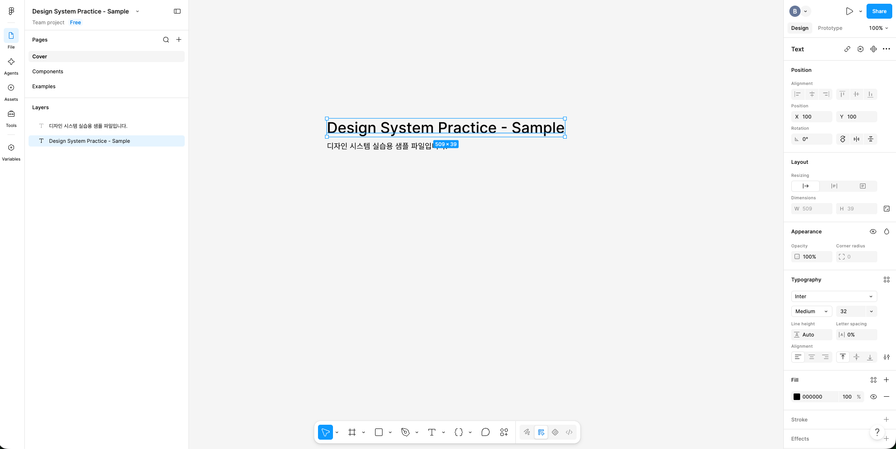{ width="100%" }

3. **확인 방법**: Layers에 텍스트 레이어 두 개가 보이고, 제목을 선택하면 Typography가 `Inter` `Medium` `32`, 위치가 `X 100, Y 100`입니다. Pages 목록의 순서와 이름이 위 표와 같으면 정상입니다.

---

## 다음 단계

[환경 체크리스트](environment.md)로 작업 환경을 확인합니다.
