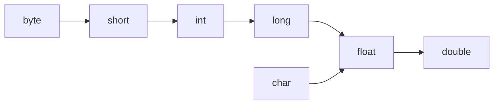

---
hide:
  - navigation
---

# 타입 캐스팅

[← Java로 돌아가기](index.md)

!!! tip "초보자를 위한 안내"
    처음에는 작은 타입이 큰 타입으로 자동 변환된다는 점과, 큰 타입을 작은 타입으로 바꿀 때는 `(int)`처럼 직접 적어야 한다는 점만 익히면 충분합니다. 값이 잘리는 세부 규칙은 이런 것이 있다는 정도만 훑어보고, 필요할 때 다시 찾아보면 훨씬 쉽게 이해됩니다.

타입 캐스팅은 하나의 타입을 다른 타입으로 변환하는 것이며, 이 문서에서는 **묵시적 변환(widening)**, **명시적 변환(narrowing)**, 문자열과 숫자 사이의 변환을 다룹니다.

---

## 1. 타입 캐스팅이란

Java는 정적 타입 언어이므로 변수의 타입이 고정되어 있습니다. 다른 타입의 값을 넣으려면 값을 해당 타입으로 변환해야 하며, 이 변환 방향에 따라 두 가지로 나뉩니다.

| 용어 | 설명 |
|---|---|
| 묵시적 변환 (Widening) | 작은 타입에서 큰 타입으로 자동 변환 |
| 명시적 변환 (Narrowing) | 큰 타입에서 작은 타입으로 직접 명시해 변환 |
| 캐스트 연산자 | 변환할 타입을 `()` 안에 명시해 강제로 형변환하는 연산자 |

- 타입별 크기와 범위는 [타입](type.md)에서 다룹니다.

---

## 2. 묵시적 변환 (Widening)

작은 타입에서 큰 타입으로 자동 변환됩니다. 데이터 손실이 없으므로 별도 문법 없이 컴파일러가 처리합니다.



```java
public class WideningExample {
    public static void main(String[] args) {
        int intValue = 100;
        long longValue = intValue;      // 자동 변환
        double doubleValue = intValue;  // 자동 변환

        System.out.println(longValue);
        System.out.println(doubleValue);
    }
}
```

```text
100
100.0
```

- 화살표 방향(작은 타입 → 큰 타입)으로만 자동 변환되며, 반대 방향은 캐스트 연산자가 필요합니다.

### char와 int

`char`는 문자 코드(유니코드 숫자값)를 담고 있어 `int`로 자동 변환됩니다. 반대로 `int`를 `char`로 바꾸려면 캐스트가 필요합니다.

```java
public class CharIntExample {
    public static void main(String[] args) {
        char c = 'A';
        int code = c;        // char → int 자동 변환
        int next = c + 1;    // 연산 결과는 int
        char nextChar = (char) next;  // int → char는 캐스트 필요

        System.out.println(code);
        System.out.println(next);
        System.out.println(nextChar);
    }
}
```

```text
65
66
B
```

### 정밀도 손실

`long`이나 `int`에서 `float`로의 변환은 자동으로 허용되지만, `float`의 유효 자릿수가 약 7자리라 큰 정수는 값이 근사치로 바뀔 수 있습니다.

```java
long big = 123456789L;
float f = big;
System.out.println(f);
```

```text
1.23456792E8
```

- 자동 변환이라도 정수를 실수로 바꿀 때는 정확한 값이 유지되지 않을 수 있습니다.
- 정확한 값이 필요하면 `double`을 사용합니다.

### 연산 중 자동 승격

`byte`, `short`, `char`는 산술 연산에서 `int`로 승격된 뒤 계산되므로 결과도 `int`입니다. 피연산자 중 더 큰 타입이 있으면 그 타입에 맞춰 승격됩니다.

```java
public class PromotionExample {
    public static void main(String[] args) {
        byte a = 10, b = 20;
        int sum = a + b;  // byte + byte = int

        System.out.println(sum);
        System.out.println(5 / 2);
        System.out.println(5 / 2.0);
    }
}
```

```text
30
2
2.5
```

- 정수끼리의 나눗셈은 소수점 이하가 버려지고, 한쪽이 실수면 실수 나눗셈이 됩니다.

#### 승격된 결과를 작은 타입에 넣는 경우

```java
byte a = 10;
byte b = 20;
byte sum = a + b;
```

```text
Main.java:5: error: incompatible types: possible lossy conversion from int to byte
        byte sum = a + b;
                     ^
```

- 컴파일 오류 메시지의 세부 표시는 `javac` 버전에 따라 다를 수 있습니다.
- `byte sum = (byte) (a + b);`처럼 캐스트하거나 `int` 변수로 받으면 해결됩니다.

### 나눗셈과 캐스트 위치

정수끼리 나눈 뒤에 캐스트하면 이미 소수점이 버려진 값이 변환됩니다. 실수 나눗셈을 하려면 나누기 **전에** 피연산자 하나를 캐스트해야 합니다.

```java
public class DivisionCastExample {
    public static void main(String[] args) {
        int p = 7;
        int q = 2;

        System.out.println(p / q);
        System.out.println((double) (p / q));
        System.out.println((double) p / q);
    }
}
```

```text
3
3.0
3.5
```

| 식 | 계산 순서 |
|---|---|
| `(double) (p / q)` | `7 / 2 = 3`(`int`)을 계산한 뒤 `3.0`으로 변환 |
| `(double) p / q` | `7`을 `7.0`으로 먼저 변환한 뒤 `double / int`를 `double`로 계산 |

- 캐스트 연산자는 나눗셈보다 우선순위가 높아 `(double) p / q`에서는 `p`에만 적용됩니다. [연산자](operator.md)에서 자세히 다룹니다.

### 숫자 문자와 정수

`'7'`처럼 숫자 모양의 `char`는 숫자 7이 아니라 문자 코드(55)입니다. 숫자값을 얻으려면 `'0'`을 빼고, 반대로 숫자를 문자로 바꾸려면 `'0'`을 더한 뒤 `(char)`로 캐스트합니다.

```java
public class CharDigitExample {
    public static void main(String[] args) {
        char c = '7';

        System.out.println(c + 1);
        System.out.println(c - '0');
        System.out.println((char) (c + 1));
        System.out.println((char) (3 + '0'));
    }
}
```

```text
56
7
8
3
```

- `c + 1`은 `int` 연산이므로 문자 `'8'`이 아니라 코드값 `56`이 출력됩니다.
- 문자열 `"7"`을 숫자로 바꾸는 방법은 4절에서 다룹니다.

---

## 3. 명시적 변환 (Narrowing)

큰 타입에서 작은 타입으로 변환할 때는 데이터 손실 가능성이 있으므로 **캐스트 연산자**를 사용해 변환할 타입을 직접 명시해야 합니다. 대상 타입의 허용 범위를 벗어나면 초과분이 잘려나가 예상과 다른 값이 나올 수 있습니다.

```java
public class NarrowingExample {
    public static void main(String[] args) {
        double doubleValue = 9.99;
        int intValue = (int) doubleValue;  // (int): double → int로 변환, 소수점 이하 버림

        int big = 300;
        byte byteValue = (byte) big;  // (byte): int → byte로 변환, byte 범위(-128~127) 초과로 값이 잘림

        System.out.println(intValue);
        System.out.println(byteValue);
    }
}
```

```text
9
44
```

- 소수점 이하는 반올림이 아니라 버려집니다.
- `byte` 범위를 넘는 `300`은 상위 비트가 잘려 `44`가 됩니다.

### 소수점 버림

`double`을 `int`로 캐스트하면 양수·음수 모두 0 방향으로 소수점 이하가 버려집니다. 반올림이 필요하면 `Math.round`를 사용합니다.

```java
public class TruncateExample {
    public static void main(String[] args) {
        System.out.println((int) 9.99);
        System.out.println((int) -9.99);
        System.out.println(Math.round(9.99));
        System.out.println((int) Math.round(9.5));
    }
}
```

```text
9
-9
10
10
```

| 용어 | 설명 |
|---|---|
| 버림 | 소수점 이하를 제거하며 0에 가까운 정수가 됨 |
| `Math.round` | 소수점 첫째 자리에서 반올림해 `long`을 반환하는 메서드 |

- `Math.round`는 `long`을 반환하므로 `int`에 담으려면 다시 `(int)` 캐스트가 필요합니다.

### 오버플로

대상 타입의 범위를 벗어난 값을 캐스트하면 오류 없이 상위 비트가 잘려 전혀 다른 값이 됩니다. 캐스트 없이도 `int` 연산 결과가 범위를 넘으면 같은 현상이 일어납니다.

```java
public class OverflowExample {
    public static void main(String[] args) {
        int max = Integer.MAX_VALUE;

        System.out.println((short) max);
        System.out.println((int) 3000000000L);
        System.out.println(max + 1);
    }
}
```

```text
-1
-1294967296
-2147483648
```

| 용어 | 설명 |
|---|---|
| 오버플로 (Overflow) | 값이 타입이 표현할 수 있는 범위를 넘어 반대쪽 끝으로 되돌아가는 현상 |

- 예외가 발생하지 않으므로 값의 범위를 직접 확인해야 합니다.
- 각 타입의 범위는 [타입](type.md)에서 다룹니다.

### 캐스트 연산자를 빼먹은 경우

큰 타입의 값을 작은 타입 변수에 캐스트 없이 넣으면 컴파일 오류가 발생합니다.

```java
double doubleValue = 9.99;
int intValue = doubleValue;
```

```text
Main.java:4: error: incompatible types: possible lossy conversion from double to int
        int intValue = doubleValue;
                       ^
```

- 컴파일 오류 메시지의 세부 표시는 `javac` 버전에 따라 다를 수 있습니다.
- `int intValue = (int) doubleValue;`처럼 캐스트 연산자를 명시하면 해결됩니다.

### 문자열을 캐스트하는 경우

기본 타입과 `String`은 서로 캐스트할 수 없습니다.

```java
String s = "123";
int n = (int) s;
```

```text
Main.java:4: error: incompatible types: String cannot be converted to int
        int n = (int) s;
                      ^
```

- 컴파일 오류 메시지의 세부 표시는 `javac` 버전에 따라 다를 수 있습니다.
- 문자열과 숫자 사이의 변환은 아래 4절의 메서드를 사용합니다.

---

## 4. 문자열과 숫자 변환

문자열과 숫자 사이의 변환은 캐스트가 아니라 래퍼 클래스(`Integer`, `Double` 등)와 `String`의 메서드로 처리합니다.

| 용어 | 설명 |
|---|---|
| 래퍼 클래스 | 기본 타입을 객체로 감싼 클래스(`int` → `Integer`, `double` → `Double`) |
| `parseInt` | 문자열을 `int` 기본 타입으로 변환하는 메서드 |
| `valueOf` | 문자열이나 값을 래퍼 객체(또는 `String`)로 변환하는 메서드 |

### 숫자를 문자열로

```java
public class ToStringExample {
    public static void main(String[] args) {
        String s = String.valueOf(123);
        String joined = s + 1;

        System.out.println(joined);
    }
}
```

```text
1231
```

- 문자열에 `+`를 쓰면 숫자가 문자열로 바뀌어 이어 붙습니다. [연산자](operator.md)에서 자세히 다룹니다.

### 문자열을 숫자로

```java
public class ParseExample {
    public static void main(String[] args) {
        int n = Integer.parseInt("123");
        double d = Double.parseDouble("3.14");
        Integer boxed = Integer.valueOf("77");

        System.out.println(n + 1);
        System.out.println(d);
        System.out.println(boxed);
    }
}
```

```text
124
3.14
77
```

- `parseInt`는 기본 타입 `int`를, `valueOf`는 래퍼 객체 `Integer`를 반환합니다.

### 오토박싱과 언박싱

기본 타입과 래퍼 객체 사이는 컴파일러가 자동으로 변환합니다.

```java
public class BoxingExample {
    public static void main(String[] args) {
        Integer auto = 10;      // 오토박싱: int → Integer
        int unboxed = auto;     // 언박싱: Integer → int

        System.out.println(auto + 5);
        System.out.println(unboxed);
    }
}
```

```text
15
10
```

- 래퍼 객체는 참조 타입이라 `null`을 담을 수 있으며, `null`을 언박싱하면 `NullPointerException`이 발생합니다. 참조 타입과 `null`은 [타입](type.md)에서 다룹니다.

### 래퍼 객체의 비교

래퍼 객체끼리 `==`로 비교하면 값이 아니라 객체가 같은지 비교합니다. `Integer`는 -128~127 범위의 값을 미리 만들어 공유하기 때문에 범위 안에서는 `true`, 밖에서는 `false`가 나올 수 있습니다. 값 비교에는 `equals()`를 사용합니다.

```java
public class WrapperCompareExample {
    public static void main(String[] args) {
        Integer x = 127;
        Integer y = 127;
        Integer m = 128;
        Integer n = 128;

        System.out.println(x == y);
        System.out.println(m == n);
        System.out.println(m.equals(n));
    }
}
```

```text
true
false
true
```

- 래퍼 객체의 `==` 결과는 값의 범위에 따라 달라지므로 값 비교에 사용하지 않습니다.
- 문자열의 `==`와 `equals()` 차이는 [String 클래스](string.md)에서 다룹니다.

### null 언박싱 오류

`null`인 래퍼 객체를 기본 타입으로 언박싱하면 런타임 예외가 발생합니다.

```java
Integer z = null;
int w = z;
```

```text
Exception in thread "main" java.lang.NullPointerException: Cannot invoke "java.lang.Integer.intValue()" because "z" is null
	at Main.main(Main.java:5)
```

- 오류 메시지는 JDK 버전과 컴파일 옵션에 따라 다를 수 있습니다.

### 숫자로 바꿀 수 없는 문자열

```java
public class Main {
    public static void main(String[] args) {
        Integer n = Integer.parseInt("abc");
    }
}
```

```text
Exception in thread "main" java.lang.NumberFormatException: For input string: "abc"
	at java.base/java.lang.NumberFormatException.forInputString(NumberFormatException.java:67)
```

- 환경에 따라 스택 트레이스의 줄 번호나 경로 표기가 다를 수 있습니다.
- `"3.14"`처럼 소수점이 있는 문자열을 `parseInt`에 넣어도 같은 예외가 발생합니다. `Double.parseDouble`을 사용합니다.
- 사용자 입력을 변환할 때는 [입력](input.md)에서 다룹니다.

### 변환 실패의 종류

`parseInt`는 문자열 전체가 숫자 형식이어야 하며, 다음 경우에 모두 `NumberFormatException`이 발생합니다.

| 입력 | 예외 메시지 | 원인 |
|---|---|---|
| `""` | `For input string: ""` | 빈 문자열 |
| `" 12 "` | `For input string: " 12 "` | 앞뒤 공백 포함 |
| `"3.14"` | `For input string: "3.14"` | 소수점 포함 |
| `"12abc"` | `For input string: "12abc"` | 숫자가 아닌 문자 포함 |
| `"2147483648"` | `For input string: "2147483648"` | `int` 범위 초과 |
| `null` | `Cannot parse null string` | `null` 전달 |

- `Double.parseDouble`도 숫자 형식이 아니면 `NumberFormatException`을 던집니다. 단, 앞뒤 공백은 허용합니다.
- 앞뒤 공백은 `trim()`으로 제거한 뒤 변환합니다. [String 클래스](string.md)에서 다룹니다.
- `-5`, `+5`처럼 부호가 붙은 정수는 변환됩니다.
- 예외 메시지는 JDK 버전에 따라 다를 수 있습니다. 예외의 처리 방법은 [예외 처리](exception.md)에서 자세히 다룹니다.

### 호환되지 않는 객체 캐스트

기본 타입과 `String`뿐 아니라 서로 관련 없는 클래스 사이도 캐스트할 수 없습니다.

```java
Integer i = 1;
String s = (String) i;
```

```text
Main.java:4: error: incompatible types: Integer cannot be converted to String
        String s = (String) i;
                            ^
```

- 컴파일 오류 메시지의 세부 표시는 `javac` 버전에 따라 다를 수 있습니다.
- 객체 사이의 캐스트는 [상속](inheritance.md)에서 자세히 다룹니다.
