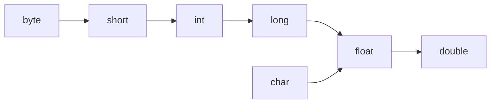

---
hide:
  - navigation
---

# 타입 캐스팅

[← Java로 돌아가기](index.md)

!!! tip "초보자를 위한 안내"
    처음에는 작은 타입이 큰 타입으로 자동 변환된다는 점과, 큰 타입을 작은 타입으로 바꿀 때는 `(int)`처럼 직접 적어야 한다는 점만 익히면 충분합니다. 값이 잘리는 세부 규칙은 이런 것이 있다는 정도만 훑어보고, 필요할 때 다시 찾아보면 훨씬 쉽게 이해됩니다.

타입 캐스팅은 하나의 타입을 다른 타입으로 변환하는 것이며, 이 문서에서는 **묵시적 변환(widening)**과 **명시적 변환(narrowing)**을 다룹니다.

---

## 1. 타입 캐스팅이란

Java는 정적 타입 언어이므로 변수의 타입이 고정되어 있습니다. 다른 타입의 값을 넣으려면 값을 해당 타입으로 변환해야 하며, 이 변환 방향에 따라 두 가지로 나뉩니다.

| 용어 | 설명 |
|---|---|
| 묵시적 변환 (Widening) | 작은 타입에서 큰 타입으로 자동 변환 |
| 명시적 변환 (Narrowing) | 큰 타입에서 작은 타입으로 직접 명시해 변환 |
| 캐스트 연산자 | 변환할 타입을 `()` 안에 명시해 강제로 형변환하는 연산자 |

- 타입별 크기와 범위는 [타입](type.md)에서 다룹니다.

---

## 2. 묵시적 변환 (Widening)

작은 타입에서 큰 타입으로 자동 변환됩니다. 데이터 손실이 없으므로 별도 문법 없이 컴파일러가 처리합니다.



```java
public class WideningExample {
    public static void main(String[] args) {
        int intValue = 100;
        long longValue = intValue;      // 자동 변환
        double doubleValue = intValue;  // 자동 변환

        System.out.println(longValue);
        System.out.println(doubleValue);
    }
}
```

```text
100
100.0
```

- 화살표 방향(작은 타입 → 큰 타입)으로만 자동 변환되며, 반대 방향은 캐스트 연산자가 필요합니다.

---

## 3. 명시적 변환 (Narrowing)

큰 타입에서 작은 타입으로 변환할 때는 데이터 손실 가능성이 있으므로 **캐스트 연산자**를 사용해 변환할 타입을 직접 명시해야 합니다. 대상 타입의 허용 범위를 벗어나면 초과분이 잘려나가 예상과 다른 값이 나올 수 있습니다.

```java
public class NarrowingExample {
    public static void main(String[] args) {
        double doubleValue = 9.99;
        int intValue = (int) doubleValue;  // (int): double → int로 변환, 소수점 이하 버림

        int big = 300;
        byte byteValue = (byte) big;  // (byte): int → byte로 변환, byte 범위(-128~127) 초과로 값이 잘림

        System.out.println(intValue);
        System.out.println(byteValue);
    }
}
```

```text
9
44
```

- 소수점 이하는 반올림이 아니라 버려집니다.
- `byte` 범위를 넘는 `300`은 상위 비트가 잘려 `44`가 됩니다.

### 캐스트 연산자를 빼먹은 경우

큰 타입의 값을 작은 타입 변수에 캐스트 없이 넣으면 컴파일 오류가 발생합니다.

```java
double doubleValue = 9.99;
int intValue = doubleValue;
```

```text
Main.java:4: error: incompatible types: possible lossy conversion from double to int
        int intValue = doubleValue;
                       ^
```

- 컴파일 오류 메시지의 세부 표시는 `javac` 버전에 따라 다를 수 있습니다.
- `int intValue = (int) doubleValue;`처럼 캐스트 연산자를 명시하면 해결됩니다.
- 문자열과 숫자 사이의 변환은 캐스트가 아니라 `Integer.parseInt` 같은 메서드를 사용하며, 변환할 수 없는 문자열이면 `NumberFormatException`이 발생합니다. [입력](input.md)에서 자세히 다룹니다.
