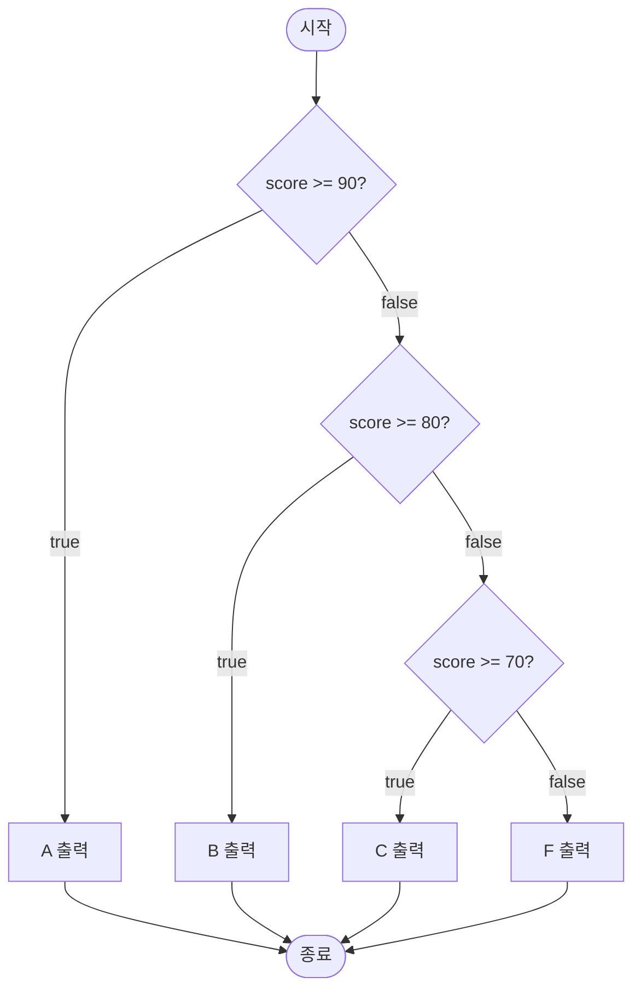
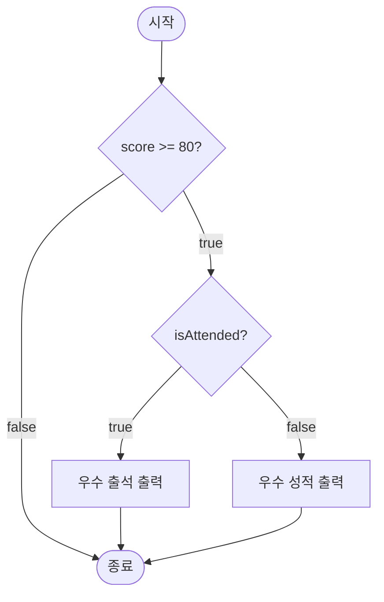

---
hide:
  - navigation
---

# 조건문

[← Java로 돌아가기](index.md)

!!! tip "초보자를 위한 안내"
    처음에는 `if`/`else if`/`else`로 조건에 따라 코드를 나누는 방법과, 조건식을 소괄호(`()`)로 감싸고 실행할 코드를 중괄호(`{}`)로 묶는 규칙만 익히면 충분합니다. `switch`의 fall-through와 화살표 문법은 이런 것이 있다는 정도만 훑어보고, 필요할 때 다시 찾아보거나 다른 문서를 학습한 뒤에 다시 읽으면 훨씬 쉽게 이해됩니다.

조건문은 조건식의 결과에 따라 실행할 코드 블록을 선택하는 문법이며, 이 문서에서는 `if`/`else if`/`else`, `switch`, `switch` 표현식을 다룹니다.

---

## 1. 조건문이란

프로그램은 기본적으로 위에서 아래로 한 줄씩 실행되지만, 조건문을 사용하면 조건에 따라 일부 코드만 실행하거나 건너뛸 수 있습니다. 조건식은 `true` 또는 `false`로 평가되며, Java는 실행할 블록을 중괄호(`{}`)로 구분합니다.

```java
public class IfBasicExample {
    public static void main(String[] args) {
        int age = 20;

        if (age >= 19) {
            System.out.println("성인");
        }

        System.out.println("종료");
    }
}
```

```text
성인
종료
```

| 용어 | 설명 |
|---|---|
| 조건문 | 조건식의 결과에 따라 실행할 코드를 선택하는 문장 |
| 조건식 | `true` 또는 `false`로 평가되는 식 (`age >= 19`) |
| 블록 | 중괄호(`{}`)로 묶인 코드 묶음 |

- 조건식에는 [연산자](operator.md)의 비교 연산자와 논리 연산자를 사용합니다.
- `if` 블록은 조건이 `true`일 때만 실행되며, `if` 블록 밖의 `System.out.println("종료")`는 조건과 관계없이 항상 실행됩니다.

### 조건문 오류

조건식이 `boolean`이 아니거나 소괄호를 빼먹으면 컴파일 오류가 발생합니다.

```java
int age = 20;
if (age) {
    System.out.println("성인");
}
```

```text
Main.java:4: error: incompatible types: int cannot be converted to boolean
        if (age) {
            ^
```

| 상황 | 컴파일 오류 |
|---|---|
| 조건식이 `boolean`이 아님 | `incompatible types: int cannot be converted to boolean` |
| 조건식을 소괄호로 감싸지 않음 | `'(' expected` |
| 조건식에 `==` 대신 `=`를 사용 | `incompatible types: int cannot be converted to boolean` |

- 컴파일 오류 메시지의 세부 표시는 `javac` 버전에 따라 다를 수 있습니다.
- 블록이 한 줄이면 중괄호를 생략할 수 있지만, 이후 코드를 추가할 때 실수하기 쉬우므로 항상 중괄호를 쓰는 것이 좋습니다.

---

## 2. if / else if / else

조건이 `true`인 블록을 순서대로 찾아 실행하고, 나머지는 건너뜁니다.

| 형태 | 의미 |
|------|------|
| `if (조건)` | 조건이 `true`이면 블록을 실행합니다. |
| `else if (조건)` | 위 조건이 `false`이고 이 조건이 `true`이면 실행합니다. |
| `else` | 위의 모든 조건이 `false`이면 실행합니다. |

`else if`와 `else`는 필요할 때만 붙이며, 생략할 수 있습니다.

| 용어 | 설명 |
|---|---|
| 분기 | 조건에 따라 실행 흐름이 나뉘는 것 |
| `else if` | "위 조건이 아니고 이 조건이면"을 뜻하는 추가 조건 |



```java
public class IfExample {
    public static void main(String[] args) {
        int score = 75;

        if (score >= 90) {
            System.out.println("A");
        } else if (score >= 80) {
            System.out.println("B");
        } else if (score >= 70) {
            System.out.println("C");
        } else {
            System.out.println("F");
        }
    }
}
```

```text
C
```

- `else if`는 여러 개 쓸 수 있고, 조건을 위에서부터 평가해 처음 `true`인 블록 하나만 실행합니다.
- `else`는 항상 마지막에 한 번만 올 수 있습니다.

### 중첩 if

`if` 블록 안에 다시 `if`를 작성하는 것을 중첩 `if`라고 합니다.



```java
public class NestedIfExample {
    public static void main(String[] args) {
        int score = 85;
        boolean isAttended = true;

        if (score >= 80) {
            if (isAttended) {
                System.out.println("우수 출석");
            } else {
                System.out.println("우수 성적");
            }
        }
    }
}
```

```text
우수 출석
```

- 중첩이 깊어지면 읽기 어려우므로, `&&` 같은 [논리 연산자](operator.md)로 조건을 합칠 수 있는지 먼저 확인합니다.

---

## 3. switch

하나의 값을 여러 `case`와 비교하여 일치하는 블록을 실행합니다.

| 형태 | 의미 |
|------|------|
| `case 값:` | 값이 일치하면 이 블록부터 실행합니다. |
| `break` | 현재 `case` 블록을 끝내고 `switch`를 빠져나옵니다. |
| `default:` | 일치하는 `case`가 없을 때 실행합니다. |


```java
public class SwitchExample {
    public static void main(String[] args) {
        int day = 3;

        switch (day) {
            case 1:
                System.out.println("월요일");
                break;
            case 2:
                System.out.println("화요일");
                break;
            case 3:
                System.out.println("수요일");
                break;
            default:
                System.out.println("그 외");
        }
    }
}
```

```text
수요일
```

- `default`는 생략할 수 있지만, 일치하는 `case`가 없을 때의 동작을 지정하려면 마지막에 둡니다.
- `switch`에는 `int`, `char`, `String`, `enum` 등을 사용할 수 있으며 `boolean`, `double`은 사용할 수 없습니다.

| 용어 | 설명 |
|---|---|
| fall-through | `break`가 없어 일치한 `case` 이후의 `case` 블록까지 계속 실행되는 현상 |

### fall-through
`break`를 생략하면 다음 `case`까지 실행이 계속됩니다. 이를 활용하면 여러 값을 하나의 블록으로 처리할 수 있습니다.


```java
public class FallThroughExample {
    public static void main(String[] args) {
        int day = 2;

        switch (day) {
            case 1:
            case 2:
            case 3:
            case 4:
            case 5:
                System.out.println("평일");
                break;
            case 6:
            case 7:
                System.out.println("주말");
                break;
        }
    }
}
```

```text
평일
```

- 일치한 `case`부터 `break`를 만날 때까지 아래 `case`가 이어서 실행됩니다.

### break를 빼먹은 경우

`break`를 빼먹으면 컴파일 오류는 발생하지 않지만, 의도하지 않은 `case`까지 실행됩니다.

```java
int day = 1;

switch (day) {
    case 1:
        System.out.println("월요일");
    case 2:
        System.out.println("화요일");
        break;
    default:
        System.out.println("그 외");
}
```

```text
월요일
화요일
```

### switch 오류

같은 값의 `case`를 중복하면 컴파일 오류가 발생합니다.

```java
switch (day) {
    case 1:
        System.out.println("월요일");
        break;
    case 1:
        System.out.println("화요일");
        break;
}
```

```text
Main.java:8: error: duplicate case label
            case 1:
                 ^
```

- 컴파일 오류 메시지의 세부 표시는 `javac` 버전에 따라 다를 수 있습니다.

---

## 4. switch 표현식 (화살표 문법)

Java 14부터는 `case 값 -> 코드` 형태의 화살표 문법으로 `break` 없이 fall-through 없는 `switch`를 작성할 수 있습니다.

| 형태 | 의미 |
|------|------|
| `case 값 -> 코드` | 값이 일치하면 해당 코드만 실행하고 자동으로 종료됩니다(fall-through 없음). |
| `yield 값` | 블록 형태에서 switch 표현식의 결과값을 반환합니다. |

```java
public class SwitchArrowExample {
    public static void main(String[] args) {
        int day = 3;

        String result = switch (day) {
            case 1, 2, 3, 4, 5 -> "평일";
            case 6, 7 -> "주말";
            default -> "알 수 없음";
        };

        System.out.println(result);
    }
}
```

```text
평일
```

- `break`나 fall-through를 신경 쓰지 않아도 되므로, Java 14 이상에서는 화살표 문법이 더 안전합니다.
- `switch` 표현식은 모든 경우를 처리해야 하며, `default`가 없고 일치하는 `case`도 없으면 컴파일 오류가 발생합니다.
