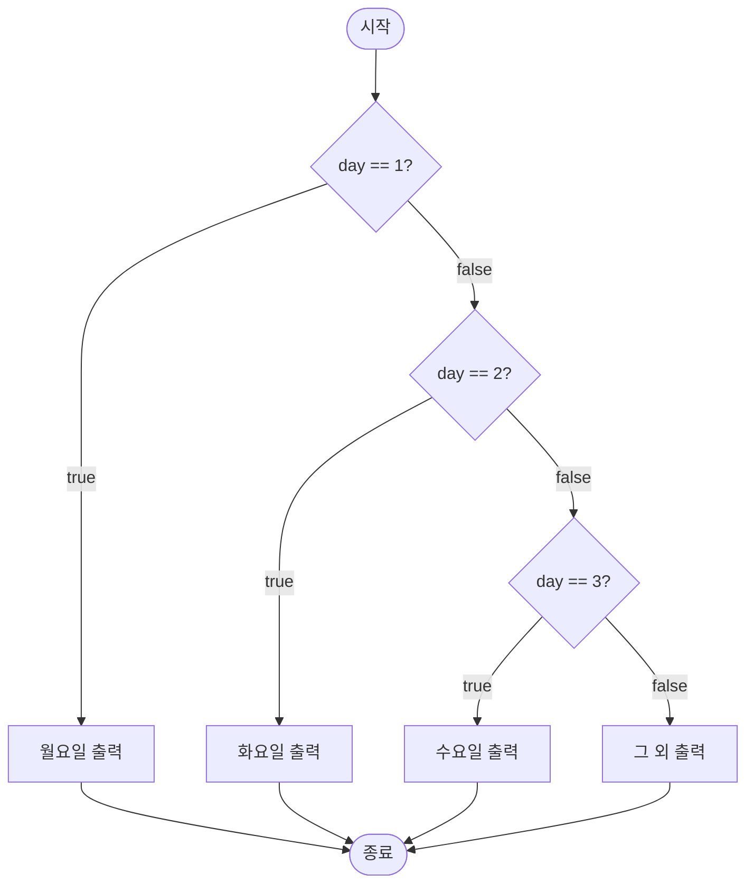
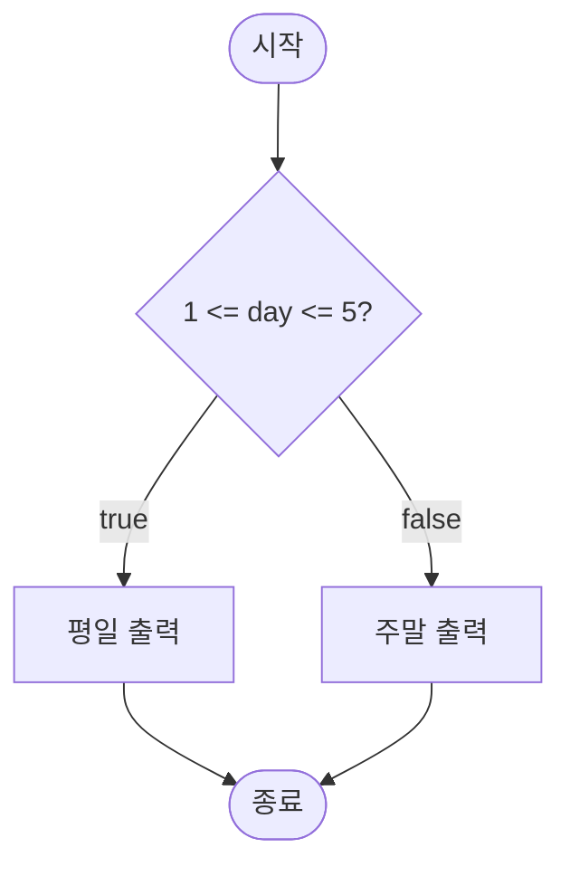

---
hide:
  - navigation
---

# 조건문

[← Java로 돌아가기](index.md)

!!! tip "초보자를 위한 안내"
    처음에는 `if`/`else if`/`else`로 조건에 따라 코드를 나누는 방법과, 조건식을 소괄호(`()`)로 감싸고 실행할 코드를 중괄호(`{}`)로 묶는 규칙만 익히면 충분합니다. `switch`의 fall-through, 화살표 문법, `yield`는 이런 것이 있다는 정도만 훑어보고, 필요할 때 다시 찾아보거나 다른 문서를 학습한 뒤에 다시 읽으면 훨씬 쉽게 이해됩니다.

조건문은 조건식의 결과에 따라 실행할 코드 블록을 선택하는 문법이며, 이 문서에서는 `if`/`else if`/`else`, `switch`, `switch` 표현식, 삼항 연산자와의 선택 기준을 다룹니다.

---

## 1. 조건문이란

프로그램은 기본적으로 위에서 아래로 한 줄씩 실행되지만, 조건문을 사용하면 조건에 따라 일부 코드만 실행하거나 건너뛸 수 있습니다. 조건식은 `true` 또는 `false`로 평가되며, Java는 실행할 블록을 중괄호(`{}`)로 구분합니다.

```java
public class IfBasicExample {
    public static void main(String[] args) {
        int age = 20;

        if (age >= 19) {
            System.out.println("성인");
        }

        System.out.println("종료");
    }
}
```

```text
성인
종료
```

| 용어 | 설명 |
|---|---|
| 조건문 | 조건식의 결과에 따라 실행할 코드를 선택하는 문장 |
| 조건식 | `true` 또는 `false`로 평가되는 식 (`age >= 19`) |
| 블록 | 중괄호(`{}`)로 묶인 코드 묶음 |

- 조건식에는 [연산자](operator.md)의 비교 연산자와 논리 연산자를 사용합니다.
- `if` 블록은 조건이 `true`일 때만 실행되며, `if` 블록 밖의 `System.out.println("종료")`는 조건과 관계없이 항상 실행됩니다.

### 조건식에는 boolean만 사용

Java의 조건식은 `boolean`이어야 합니다. `0`이나 `1` 같은 숫자를 조건으로 쓸 수 없습니다.

```java
if (1) {
    System.out.println("참");
}
```

```text
Main.java:3: error: incompatible types: int cannot be converted to boolean
        if (1) {
            ^
```

- 변수 `age`를 조건으로 쓰는 `if (age)`도 같은 오류가 발생합니다. `age > 0`처럼 비교 결과로 `boolean`을 만들어야 합니다.
- 컴파일 오류 메시지의 세부 표시는 `javac` 버전에 따라 다를 수 있습니다.

### 조건문 오류

조건식을 소괄호로 감싸지 않으면 컴파일 오류가 발생합니다.

```java
int age = 20;
if age >= 19 {
    System.out.println("성인");
}
```

```text
Main.java:4: error: '(' expected
        if age >= 19 {
          ^
```

| 상황 | 컴파일 오류 |
|---|---|
| 조건식이 `boolean`이 아님 | `incompatible types: int cannot be converted to boolean` |
| 조건식을 소괄호로 감싸지 않음 | `'(' expected` |
| 조건식에 `==` 대신 `=`를 사용 | `incompatible types: int cannot be converted to boolean` |

- 소괄호를 빼먹으면 `')' expected` 오류가 함께 출력됩니다.
- 컴파일 오류 메시지의 세부 표시는 `javac` 버전에 따라 다를 수 있습니다.

---

## 2. if / else if / else

조건이 `true`인 블록을 순서대로 찾아 실행하고, 나머지는 건너뜁니다.

| 형태 | 의미 |
|------|------|
| `if (조건)` | 조건이 `true`이면 블록을 실행합니다. |
| `else if (조건)` | 위 조건이 `false`이고 이 조건이 `true`이면 실행합니다. |
| `else` | 위의 모든 조건이 `false`이면 실행합니다. |

`else if`와 `else`는 필요할 때만 붙이며, 생략할 수 있습니다.

| 용어 | 설명 |
|---|---|
| 분기 | 조건에 따라 실행 흐름이 나뉘는 것 |
| `else if` | "위 조건이 아니고 이 조건이면"을 뜻하는 추가 조건 |


```java
public class IfExample {
    public static void main(String[] args) {
        int score = 75;

        if (score >= 90) {
            System.out.println("A");
        } else if (score >= 80) {
            System.out.println("B");
        } else if (score >= 70) {
            System.out.println("C");
        } else {
            System.out.println("F");
        }
    }
}
```

```text
C
```

- `else if`는 여러 개 쓸 수 있고, 조건을 위에서부터 평가해 처음 `true`인 블록 하나만 실행합니다.
- `else`는 항상 마지막에 한 번만 올 수 있습니다.

### else if와 연속된 if의 차이

`else if`로 이어진 조건문은 하나가 실행되면 나머지를 건너뛰지만, `if`를 따로 나열하면 각 조건을 모두 검사합니다.

```java
public class ElseIfVsIfExample {
    public static void main(String[] args) {
        int score = 95;

        if (score >= 90) {
            System.out.println("A");
        } else if (score >= 80) {
            System.out.println("B");
        } else if (score >= 70) {
            System.out.println("C");
        }

        System.out.println("--");

        if (score >= 90) {
            System.out.println("A");
        }
        if (score >= 80) {
            System.out.println("B");
        }
        if (score >= 70) {
            System.out.println("C");
        }
    }
}
```

```text
A
--
A
B
C
```

- 둘 중 하나만 실행되어야 하는 경우(등급 구분)에는 `else if`를, 각각 독립적으로 확인해야 하는 경우에는 `if`를 나열합니다.

### 범위 조건

점수 구간처럼 범위로 나눌 때는 조건의 순서가 결과를 바꿉니다. 처음 `true`인 블록만 실행되므로, 범위가 좁은 조건을 위에 둡니다.

```java
public class RangeConditionExample {
    public static void main(String[] args) {
        int score = 95;

        if (score >= 60) {
            System.out.println("D 이상");
        } else if (score >= 90) {
            System.out.println("A");
        }

        if (score >= 0 && score <= 100) {
            System.out.println("유효한 점수");
        }
    }
}
```

```text
D 이상
유효한 점수
```

- 첫 번째 `if`는 `95`도 `score >= 60`에 해당해 `else if (score >= 90)`에 도달하지 못합니다. `score >= 90`을 먼저 검사해야 합니다.
- 두 구간의 사이에 있는지는 `0 <= score <= 100`이 아니라 `&&`로 두 조건을 연결해 확인합니다.

### 범위를 연속 비교로 쓴 경우

수학처럼 `0 <= score <= 100`으로 쓰면 컴파일 오류가 발생합니다. `0 <= score`가 `boolean`이 되어 `100`과 비교할 수 없기 때문입니다.

```java
int score = 95;
if (0 <= score <= 100) {
    System.out.println("유효한 점수");
}
```

```text
Main.java:4: error: bad operand types for binary operator '<='
        if (0 <= score <= 100) {
                       ^
  first type:  boolean
  second type: int
```

- 컴파일 오류 메시지의 세부 표시는 `javac` 버전에 따라 다를 수 있습니다.

### 중첩 if

`if` 블록 안에 다시 `if`를 작성하는 것을 중첩 `if`라고 합니다.


```java
public class NestedIfExample {
    public static void main(String[] args) {
        int score = 85;
        boolean isAttended = true;

        if (score >= 80) {
            if (isAttended) {
                System.out.println("우수 출석");
            } else {
                System.out.println("우수 성적");
            }
        }
    }
}
```

```text
우수 출석
```

- 중첩이 깊어지면 읽기 어려우므로, `&&` 같은 [논리 연산자](operator.md)로 조건을 합칠 수 있는지 먼저 확인합니다.

### 중괄호를 생략한 경우

블록이 한 문장이면 중괄호를 생략할 수 있지만, 그러면 `if`에 속하는 문장은 바로 다음 한 줄뿐입니다. 들여쓰기를 맞춰도 실행 범위는 달라지지 않습니다.

```java
int score = 50;

if (score >= 60)
    System.out.println("합격");
    System.out.println("축하합니다");
```

```text
축하합니다
```

- `"축하합니다"`는 `if` 밖의 문장이어서 조건과 관계없이 실행됩니다. 오류가 나지 않아 찾기 어려운 실수이므로 항상 중괄호를 씁니다.

### else 오류

`else`는 바로 앞의 `if`와만 짝을 이룹니다. 이미 `else`로 끝난 조건문 뒤에 `else`를 또 쓰면 컴파일 오류가 발생합니다.

```java
if (a > 5) {
    System.out.println("크다");
} else {
    System.out.println("작다");
} else {
    System.out.println("?");
}
```

```text
Main.java:10: error: 'else' without 'if'
        else {
        ^
```

- 컴파일 오류 메시지의 세부 표시는 `javac` 버전에 따라 다를 수 있습니다.

---

## 3. switch

하나의 값을 여러 `case`와 비교하여 일치하는 블록을 실행합니다.

| 형태 | 의미 |
|------|------|
| `case 값:` | 값이 일치하면 이 블록부터 실행합니다. |
| `break` | 현재 `case` 블록을 끝내고 `switch`를 빠져나옵니다. |
| `default:` | 일치하는 `case`가 없을 때 실행합니다. |



```java
public class SwitchExample {
    public static void main(String[] args) {
        int day = 3;

        switch (day) {
            case 1:
                System.out.println("월요일");
                break;
            case 2:
                System.out.println("화요일");
                break;
            case 3:
                System.out.println("수요일");
                break;
            default:
                System.out.println("그 외");
        }
    }
}
```

```text
수요일
```

- `default`는 생략할 수 있지만, 일치하는 `case`가 없을 때의 동작을 지정하려면 마지막에 둡니다.
- `switch`에는 `int`, `char`, `String`, `enum` 등을 사용할 수 있으며 `boolean`, `double`, `long`은 사용할 수 없습니다.

| 용어 | 설명 |
|---|---|
| fall-through | `break`가 없어 일치한 `case` 이후의 `case` 블록까지 계속 실행되는 현상 |

### String과 enum

`switch`는 정수뿐 아니라 문자열과 `enum`도 비교할 수 있습니다. `enum`의 `case`에는 상수 이름만 씁니다.

```java
public class SwitchTypeExample {
    enum Level { LOW, MID, HIGH }

    public static void main(String[] args) {
        String command = "stop";
        switch (command) {
            case "go":
                System.out.println("출발");
                break;
            case "stop":
                System.out.println("정지");
                break;
            default:
                System.out.println("알 수 없음");
        }

        Level level = Level.MID;
        switch (level) {
            case LOW:
                System.out.println("낮음");
                break;
            case MID:
                System.out.println("중간");
                break;
            case HIGH:
                System.out.println("높음");
                break;
        }
    }
}
```

```text
정지
중간
```

| 용어 | 설명 |
|---|---|
| `enum` | 정해진 상수들의 집합을 정의하는 타입 (`LOW`, `MID`, `HIGH`) |

- 문자열은 내용이 같으면 일치로 판단합니다(`equals()` 기준).
- `enum`의 상세한 사용법은 이 문서의 범위를 벗어나므로, 여기서는 `switch`의 비교 대상으로 쓸 수 있다는 점만 확인합니다.

### fall-through
`break`를 생략하면 다음 `case`까지 실행이 계속됩니다. 이를 활용하면 여러 값을 하나의 블록으로 처리할 수 있습니다.



```java
public class FallThroughExample {
    public static void main(String[] args) {
        int day = 2;

        switch (day) {
            case 1:
            case 2:
            case 3:
            case 4:
            case 5:
                System.out.println("평일");
                break;
            case 6:
            case 7:
                System.out.println("주말");
                break;
        }
    }
}
```

```text
평일
```

- 일치한 `case`부터 `break`를 만날 때까지 아래 `case`가 이어서 실행됩니다.

### break를 빼먹은 경우

`break`를 빼먹으면 컴파일 오류는 발생하지 않지만, 의도하지 않은 `case`까지 실행됩니다.

```java
int day = 1;

switch (day) {
    case 1:
        System.out.println("월요일");
    case 2:
        System.out.println("화요일");
        break;
    default:
        System.out.println("그 외");
}
```

```text
월요일
화요일
```

### switch 오류

같은 값의 `case`를 중복하면 컴파일 오류가 발생합니다.

```java
switch (day) {
    case 1:
        System.out.println("월요일");
        break;
    case 1:
        System.out.println("화요일");
        break;
}
```

```text
Main.java:8: error: duplicate case label
            case 1:
                 ^
```

`switch` 값과 `case`의 타입이 맞지 않아도 컴파일 오류가 발생합니다.

```java
int n = 1;
switch (n) {
    case "1":
        System.out.println("문자열");
        break;
}
```

```text
Main.java:5: error: incompatible types: String cannot be converted to int
            case "1":
                 ^
```

- 컴파일 오류 메시지의 세부 표시는 `javac` 버전에 따라 다를 수 있습니다.

### null을 switch에 사용한 경우

`switch`에 `String`이나 `enum` 변수를 넘길 때 값이 `null`이면 런타임 예외가 발생합니다.

```java
String command = null;
switch (command) {
    case "go":
        System.out.println("출발");
        break;
    default:
        System.out.println("그 외");
}
```

```text
Exception in thread "main" java.lang.NullPointerException: Cannot invoke "String.hashCode()" because "<local2>" is null
	at Main.main(Main.java:4)
```

- `default`가 있어도 `null`은 처리되지 않으므로, `switch` 전에 `null`인지 확인합니다.
- 오류 메시지와 `<local2>` 같은 변수 표기는 Java 버전과 컴파일 옵션에 따라 다를 수 있습니다.

---

## 4. switch 표현식 (화살표 문법)

Java 14부터는 `case 값 -> 코드` 형태의 화살표 문법으로 `break` 없이 fall-through 없는 `switch`를 작성할 수 있습니다. `switch`가 값을 반환하는 식으로도 쓰여서 이를 `switch` 표현식이라 합니다.

| 형태 | 의미 |
|------|------|
| `case 값 -> 코드` | 값이 일치하면 해당 코드만 실행하고 자동으로 종료됩니다(fall-through 없음). |
| `case 값1, 값2 ->` | 쉼표로 여러 값을 한 번에 처리합니다. |
| `yield 값` | 블록 형태에서 switch 표현식의 결과값을 반환합니다. |

```java
public class SwitchArrowExample {
    public static void main(String[] args) {
        int day = 3;

        String result = switch (day) {
            case 1, 2, 3, 4, 5 -> "평일";
            case 6, 7 -> "주말";
            default -> "알 수 없음";
        };

        System.out.println(result);
    }
}
```

```text
평일
```

- `break`나 fall-through를 신경 쓰지 않아도 되므로, Java 14 이상에서는 화살표 문법이 더 안전합니다.
- 표현식으로 쓸 때는 끝에 세미콜론(`;`)을 붙입니다.

### yield로 값 반환

`case` 안에서 여러 문장을 실행해야 하면 중괄호로 블록을 만들고 `yield`로 결과를 반환합니다. 화살표 대신 콜론(`:`)을 쓰는 형태에서도 `yield`를 사용합니다.

```java
public class YieldExample {
    public static void main(String[] args) {
        int score = 85;

        String msg = switch (score / 10) {
            case 10, 9 -> "최상";
            case 8 -> {
                String text = "상";
                yield text + "위권";
            }
            default -> "보통";
        };
        System.out.println(msg);

        int day = 2;
        String name = switch (day) {
            case 1:
                yield "월";
            case 2:
                yield "화";
            default:
                yield "기타";
        };
        System.out.println(name);
    }
}
```

```text
상위권
화
```

| 용어 | 설명 |
|---|---|
| `yield` | switch 표현식의 블록에서 결과값을 반환하는 키워드 (`return`은 메서드를 끝내므로 쓸 수 없음) |

- 블록을 쓰지 않고 값 하나만 반환하는 경우에는 `yield` 없이 `-> 값`으로 씁니다.

### enum과 모든 경우 처리

`switch` 표현식은 가능한 모든 값에 결과가 있어야 합니다. `enum`의 상수를 빠짐없이 나열하면 `default`를 생략할 수 있습니다.

```java
public class SwitchEnumExample {
    enum Level { LOW, MID, HIGH }

    public static void main(String[] args) {
        Level level = Level.HIGH;
        int point = switch (level) {
            case LOW -> 1;
            case MID -> 2;
            case HIGH -> 3;
        };
        System.out.println(point);
    }
}
```

```text
3
```

- 상수를 하나 빼먹거나 `int` 같은 값에 `default`가 없으면 컴파일 오류가 발생합니다.

### switch 표현식 오류

처리하지 않는 경우가 있으면 컴파일 오류가 발생합니다.

```java
int day = 3;
String name = switch (day) {
    case 1 -> "월";
    case 2 -> "화";
};
```

```text
Main.java:4: error: the switch expression does not cover all possible input values
        String name = switch (day) {
                      ^
```

- `enum`에서 상수를 빠뜨린 경우에도 같은 메시지가 출력됩니다.
- 컴파일 오류 메시지의 세부 표시는 `javac` 버전에 따라 다를 수 있습니다.

### 화살표 문법의 switch 문

화살표 문법은 값을 반환하지 않는 `switch` 문에도 사용할 수 있습니다. 이때는 모든 경우를 처리하지 않아도 됩니다.

```java
int day = 2;
switch (day) {
    case 1 -> System.out.println("월요일");
    case 2 -> System.out.println("화요일");
    default -> System.out.println("그 외");
}
```

```text
화요일
```

- 일치한 `case` 하나만 실행되므로 `break`가 필요 없습니다.

---

## 5. 삼항 연산자와 조건문

값을 하나 고르는 단순한 분기는 삼항 연산자(`조건 ? A : B`)로 짧게 쓸 수 있습니다. 삼항 연산자의 기본 문법은 [연산자](operator.md)에서 다룹니다.

```java
public class TernaryExample {
    public static void main(String[] args) {
        int max = 3 > 5 ? 3 : 5;
        System.out.println(max);

        int score = 75;
        String grade = score >= 90 ? "A" : score >= 80 ? "B" : score >= 70 ? "C" : "F";
        System.out.println(grade);
    }
}
```

```text
5
C
```

| 용어 | 설명 |
|---|---|
| 중첩 삼항 연산자 | 삼항 연산자의 `:` 뒤에 다시 삼항 연산자를 쓰는 형태 |

- 삼항 연산자는 `else if`처럼 위에서부터 평가해 처음 `true`인 값을 선택합니다.
- 중첩이 두 단계를 넘으면 읽기 어려우므로 `if`/`else if`를 사용합니다.
- 삼항 연산자는 값을 반환하는 식이므로 문장을 실행해야 하는 분기에는 쓸 수 없습니다.

### 결과 타입이 바뀌는 경우

두 값의 타입이 다르면 더 넓은 타입으로 맞춰집니다.

```java
System.out.println(true ? 1 : 2.0);

Object o = true ? 1 : "a";
System.out.println(o);
```

```text
1.0
1
```

- `true ? 1 : 2.0`은 `1`이 선택되지만 `2.0`(`double`)에 맞춰져 `1.0`이 출력됩니다.
- 숫자와 문자열처럼 공통 숫자 타입이 없으면 변환 없이 선택한 값이 그대로 나옵니다.
