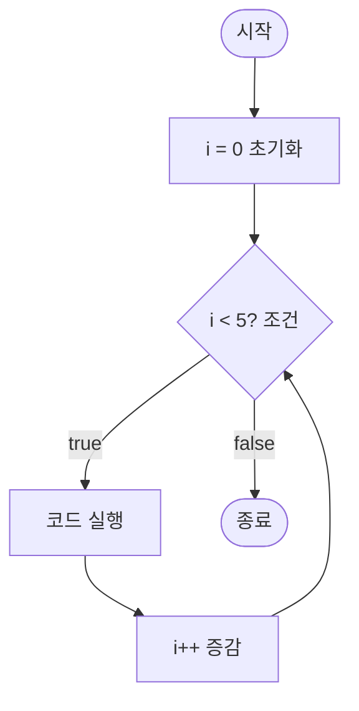
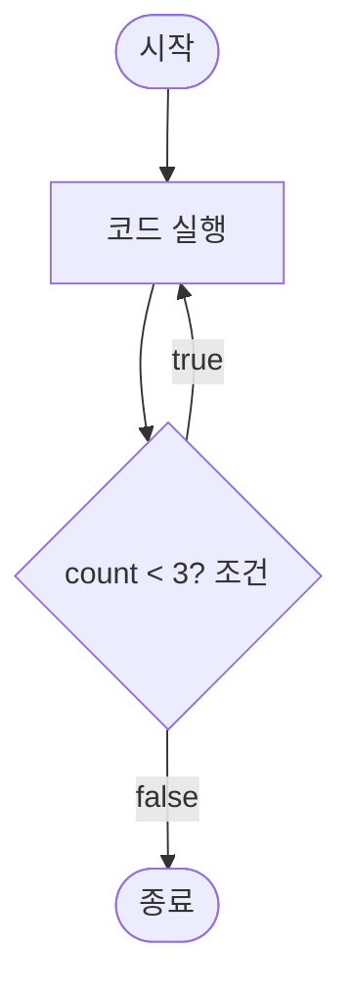
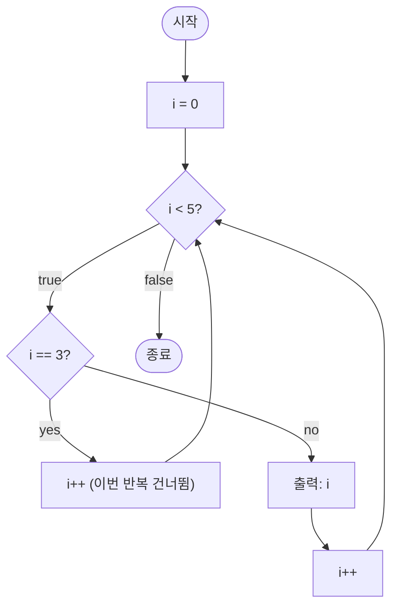

---
hide:
  - navigation
---

# 반복문

[← Java로 돌아가기](index.md)

!!! tip "초보자를 위한 안내"
    처음에는 반복 횟수가 정해진 `for`와, 조건이 `true`인 동안 반복하는 `while`만 익히면 충분합니다. `do-while`과 `break`/`continue`는 이런 것이 있다는 정도만 훑어보고, 필요할 때 다시 찾아보거나 [배열](array.md)을 학습한 뒤에 다시 읽으면 훨씬 쉽게 이해됩니다.

반복문은 조건이 만족되는 동안 코드 블록을 반복 실행하는 문법이며, 이 문서에서는 `for`, `while`, `do-while`과 반복 흐름을 제어하는 `break`, `continue`를 다룹니다.

---

## 1. 반복문이란

같은 작업을 여러 번 해야 할 때 코드를 복사하는 대신 반복문을 사용하면, 조건이 만족되는 동안 블록을 되풀이해 실행할 수 있습니다.

```java
public class RepeatExample {
    public static void main(String[] args) {
        for (int i = 1; i <= 3; i++) {
            System.out.println("안녕");
        }
    }
}
```

```text
안녕
안녕
안녕
```

| 용어 | 설명 |
|---|---|
| 반복문 | 조건이 만족되는 동안 코드 블록을 반복 실행하는 문장 |
| 반복 | 블록을 한 번 실행하는 단위 |
| `for` | 반복 횟수가 정해진 경우 사용 |
| `while` | 조건이 `true`인 동안 반복 |
| `do-while` | 블록을 최소 1회 실행한 뒤 조건 검사 |

- 반복 조건에는 [연산자](operator.md)의 비교 연산자를 사용하며, 흐름 분기는 [조건문](conditional.md)과 함께 자주 쓰입니다.

### 반복문 오류

조건이 영원히 `false`가 되지 않으면 무한 반복에 빠지고, `for` 헤더의 구분자를 빼먹으면 컴파일 오류가 발생합니다.

```java
for (int i = 0; i < 5, i++) {
    System.out.println(i);
}
```

```text
Main.java:3: error: ';' expected
        for (int i = 0; i < 5, i++) {
                             ^
```

| 상황 | 결과 |
|---|---|
| `for` 헤더에서 `;` 대신 `,`를 사용함 | 컴파일 오류 `';' expected` |
| 반복 중 조건에 쓰는 변수를 갱신하지 않음 | 무한 반복 (오류 없이 계속 실행됨) |
| `for` 안에서 선언한 변수를 반복문 밖에서 사용함 | 컴파일 오류 `cannot find symbol` |

- 컴파일 오류 메시지의 세부 표시는 `javac` 버전에 따라 다를 수 있습니다.
- 무한 반복에 빠지면 터미널에서 `Ctrl+C`로 프로그램을 중단합니다.

---

## 2. for

반복 횟수가 정해진 경우에 사용합니다. `for` 뒤 괄호 안에 초기화·조건·증감식을 한 줄로 작성합니다.

| 용어 | 의미 |
|-----------|------|
| 초기화 | 반복 시작 전 한 번만 실행합니다. (예: `int i = 0`) |
| 조건 | 매 반복 전에 확인하며, `false`가 되면 반복을 멈춥니다. (예: `i < 5`) |
| 증감식 | 매 반복이 끝난 뒤 실행됩니다. (예: `i++`) |



```java
public class ForExample {
    public static void main(String[] args) {
        for (int i = 0; i < 5; i++) {
            System.out.println(i);
        }
    }
}
```

```text
0
1
2
3
4
```

- 배열이나 컬렉션의 모든 원소를 순회할 때 인덱스 없이 간결하게 작성할 수 있는 **향상된 for(for-each)** 문법도 있습니다. [배열](array.md)에서 자세히 다룹니다.

---

## 3. while

조건이 `true`인 동안 반복합니다. 반복 횟수를 사전에 알 수 없을 때 사용합니다.

| 용어 | 의미 |
|-----------|------|
| 조건 | 매 반복 전에 확인하며, `false`가 되면 반복을 멈춥니다. (예: `count < 3`) |


```java
public class WhileExample {
    public static void main(String[] args) {
        int count = 0;
        while (count < 3) {
            System.out.println(count);
            count++;
        }
    }
}
```

```text
0
1
2
```

---

## 4. do-while

`while`과 달리 조건을 블록 실행 **후**에 검사하므로, 조건이 처음부터 `false`여도 최소 1회는 실행됩니다.



```java
public class DoWhileExample {
    public static void main(String[] args) {
        int count = 0;
        do {
            System.out.println(count);
            count++;
        } while (count < 3);
    }
}
```

```text
0
1
2
```

---

## 5. break와 continue

반복문 실행 중 흐름을 제어합니다.

| 키워드 | 동작 |
|--------|------|
| `break` | 반복문 전체를 즉시 종료합니다. |
| `continue` | 이번 반복의 남은 코드를 건너뛰고 다음 반복으로 이동합니다. |

### break

`i`가 3이 되는 순간 반복문을 종료합니다.


```java
public class BreakExample {
    public static void main(String[] args) {
        for (int i = 0; i < 5; i++) {
            if (i == 3) break;
            System.out.println(i);
        }
    }
}
```

```text
0
1
2
```

- `break`는 가장 가까운 반복문 하나만 종료합니다.

### continue

`i`가 3일 때만 건너뛰고 나머지는 출력합니다.



```java
public class ContinueExample {
    public static void main(String[] args) {
        for (int i = 0; i < 5; i++) {
            if (i == 3) continue;
            System.out.println(i);
        }
    }
}
```

```text
0
1
2
4
```

- `continue`를 `while`에서 사용할 때는 증감 코드가 건너뛰어지지 않도록 위치를 확인해야 하며, 그렇지 않으면 무한 반복에 빠질 수 있습니다.
