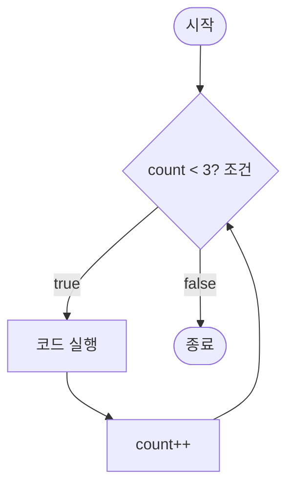
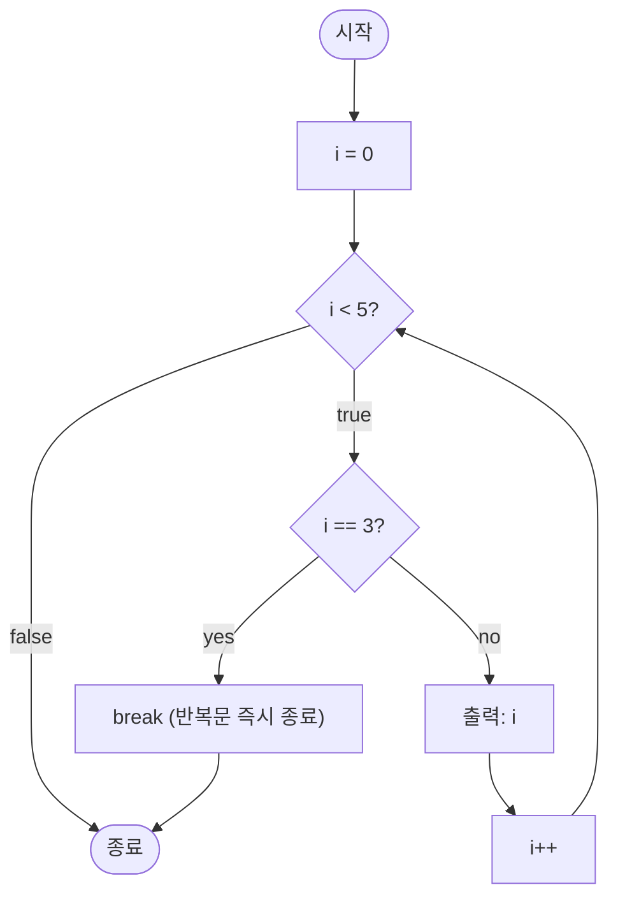

---
hide:
  - navigation
---

# 반복문

[← Java로 돌아가기](index.md)

!!! tip "초보자를 위한 안내"
    처음에는 반복 횟수가 정해진 `for`와, 조건이 `true`인 동안 반복하는 `while`만 익히면 충분합니다. `do-while`, `break`/`continue`, 레이블, `for-each`는 이런 것이 있다는 정도만 훑어보고, 필요할 때 다시 찾아보거나 [배열](array.md)을 학습한 뒤에 다시 읽으면 훨씬 쉽게 이해됩니다.

반복문은 조건이 만족되는 동안 코드 블록을 반복 실행하는 문법이며, 이 문서에서는 `for`, `while`, `do-while`, 향상된 `for`(for-each)와 반복 흐름을 제어하는 `break`, `continue`, 레이블을 다룹니다.

---

## 1. 반복문이란

같은 작업을 여러 번 해야 할 때 코드를 복사하는 대신 반복문을 사용하면, 조건이 만족되는 동안 블록을 되풀이해 실행할 수 있습니다.

```java
public class RepeatExample {
    public static void main(String[] args) {
        for (int i = 1; i <= 3; i++) {
            System.out.println("안녕");
        }
    }
}
```

```text
안녕
안녕
안녕
```

| 용어 | 설명 |
|---|---|
| 반복문 | 조건이 만족되는 동안 코드 블록을 반복 실행하는 문장 |
| 반복 | 블록을 한 번 실행하는 단위 |
| `for` | 반복 횟수가 정해진 경우 사용 |
| `while` | 조건이 `true`인 동안 반복 |
| `do-while` | 블록을 최소 1회 실행한 뒤 조건 검사 |

- 반복 조건에는 [연산자](operator.md)의 비교 연산자를 사용하며, 흐름 분기는 [조건문](conditional.md)과 함께 자주 쓰입니다.

### 반복문 오류

조건이 영원히 `false`가 되지 않으면 무한 반복에 빠지고, `for` 헤더의 구분자를 빼먹으면 컴파일 오류가 발생합니다.

```java
for (int i = 0; i < 5, i++) {
    System.out.println(i);
}
```

```text
Main.java:3: error: ';' expected
        for (int i = 0; i < 5, i++) {
                             ^
```

| 상황 | 결과 |
|---|---|
| `for` 헤더에서 `;` 대신 `,`를 사용함 | 컴파일 오류 `';' expected` |
| 반복 중 조건에 쓰는 변수를 갱신하지 않음 | 무한 반복 (오류 없이 계속 실행됨) |
| `for` 안에서 선언한 변수를 반복문 밖에서 사용함 | 컴파일 오류 `cannot find symbol` |
| 반복 조건을 `<=`로 써서 배열 범위를 넘음 | 런타임 예외 `ArrayIndexOutOfBoundsException` |

- 컴파일 오류 메시지의 세부 표시는 `javac` 버전에 따라 다를 수 있습니다.
- 무한 반복에 빠지면 터미널에서 `Ctrl+C`로 프로그램을 중단합니다.

---

## 2. for

반복 횟수가 정해진 경우에 사용합니다. `for` 뒤 괄호 안에 초기화·조건·증감식을 한 줄로 작성합니다.

| 용어 | 의미 |
|-----------|------|
| 초기화 | 반복 시작 전 한 번만 실행합니다. (예: `int i = 0`) |
| 조건 | 매 반복 전에 확인하며, `false`가 되면 반복을 멈춥니다. (예: `i < 5`) |
| 증감식 | 매 반복이 끝난 뒤 실행됩니다. (예: `i++`) |


```java
public class ForExample {
    public static void main(String[] args) {
        for (int i = 0; i < 5; i++) {
            System.out.println(i);
        }
    }
}
```

```text
0
1
2
3
4
```

- 배열이나 컬렉션의 모든 원소를 순회할 때 인덱스 없이 간결하게 작성할 수 있는 **향상된 for(for-each)** 문법도 있으며, 이 문서의 [for-each](#6-for-each)에서 다룹니다.

### 반복 변수의 범위

`for` 헤더에서 선언한 변수는 그 `for`문 안에서만 사용할 수 있습니다. 반복이 끝난 뒤 값을 쓰려면 변수를 `for` 밖에서 선언합니다.

```java
public class LoopScopeExample {
    public static void main(String[] args) {
        int i;
        for (i = 0; i < 3; i++) {
        }
        System.out.println(i);

        for (int j = 0; j < 2; j++) {
            System.out.println("j=" + j);
        }
        for (int j = 10; j < 12; j++) {
            System.out.println("j=" + j);
        }
    }
}
```

```text
3
j=0
j=1
j=10
j=11
```

- 반복이 끝난 뒤 `i`는 조건이 `false`가 된 값(`3`)을 가지고 있습니다.
- `for`가 끝나면 `j`가 사라지므로 같은 이름 `j`를 다른 `for`에서 다시 선언할 수 있습니다.

### 반복 변수를 밖에서 사용한 경우

`for` 안에서 선언한 변수를 반복문 밖에서 쓰면 컴파일 오류가 발생합니다.

```java
for (int i = 0; i < 3; i++) {
    System.out.println(i);
}
System.out.println(i);
```

```text
Main.java:6: error: cannot find symbol
        System.out.println(i);
                           ^
  symbol:   variable i
  location: class Main
```

- 컴파일 오류 메시지의 세부 표시는 `javac` 버전에 따라 다를 수 있습니다.

### 값 누적

반복문 밖에서 변수를 하나 만들어 두고 반복할 때마다 값을 더하거나 곱해 결과를 쌓을 수 있습니다. 누적 변수는 반드시 반복문 밖에서 초기화합니다.

```java
public class AccumulateExample {
    public static void main(String[] args) {
        int sum = 0;
        for (int i = 1; i <= 10; i++) {
            sum += i;
        }
        System.out.println(sum);

        long factorial = 1;
        for (int i = 1; i <= 5; i++) {
            factorial *= i;
        }
        System.out.println(factorial);
    }
}
```

```text
55
120
```

| 용어 | 설명 |
|---|---|
| 누적 변수 | 반복하면서 값을 더하거나 곱해 결과를 쌓는 변수 (`sum`, `factorial`) |

- 합계는 `0`, 곱은 `1`로 시작합니다. 곱을 `0`으로 시작하면 결과는 항상 `0`입니다.
- 반복문 안에서 `int sum = 0;`을 선언하면 매 반복마다 `0`으로 초기화되어 값이 쌓이지 않습니다.

### 조건과 함께 사용

`for` 안에 `if`를 넣으면 조건을 만족하는 값만 골라 처리할 수 있습니다.

```java
int evenSum = 0;
int count = 0;
for (int i = 1; i <= 10; i++) {
    if (i % 2 == 0) {
        evenSum += i;
        count++;
    }
}
System.out.println(evenSum + " " + count);
```

```text
30 5
```

- 1~10의 짝수(2, 4, 6, 8, 10)의 합이 `30`이고 개수가 `5`입니다.

### 증감 방식

증감식을 바꾸면 거꾸로 세거나 일정한 간격으로 건너뛸 수 있고, 쉼표(`,`)로 변수를 둘 이상 선언할 수도 있습니다.

```java
public class StepExample {
    public static void main(String[] args) {
        for (int i = 3; i >= 1; i--) {
            System.out.println(i);
        }
        for (int i = 0; i <= 10; i += 5) {
            System.out.println(i);
        }
        for (int i = 0, j = 4; i < j; i++, j--) {
            System.out.println(i + " " + j);
        }
    }
}
```

```text
3
2
1
0
5
10
0 4
1 3
```

- 거꾸로 세는 `for`는 조건을 `i >= 1`처럼 반대 방향 비교로 바꿉니다.
- `i += 5`로 증가량을 지정하면 5씩 건너뜁니다.
- `i`는 늘리고 `j`는 줄이는 식으로 두 변수를 함께 사용할 수 있습니다.

### 중첩 for

`for` 안에 `for`를 넣으면 안쪽 반복이 바깥 반복 한 번마다 처음부터 끝까지 실행됩니다. 구구단이나 표 형태의 출력에 사용합니다.

```java
public class NestedForExample {
    public static void main(String[] args) {
        for (int i = 1; i <= 3; i++) {
            for (int j = 1; j <= 3; j++) {
                System.out.print(i * j + " ");
            }
            System.out.println();
        }

        for (int i = 1; i <= 4; i++) {
            for (int j = 1; j <= i; j++) {
                System.out.print("*");
            }
            System.out.println();
        }
    }
}
```

```text
1 2 3 
2 4 6 
3 6 9 
*
**
***
****
```

- 바깥 반복이 줄(`i`), 안쪽 반복이 한 줄 안의 칸(`j`)입니다.
- `println()`을 안쪽 `for` 밖, 바깥 `for` 안에 두어 한 줄이 끝날 때마다 줄을 바꿉니다.
- 안쪽 반복의 조건에 바깥 변수를 쓰면(`j <= i`) 줄마다 칸 수가 늘어납니다.

### 반복 범위가 어긋난 경우

조건을 `<`가 아니라 `<=`로 쓰면 배열의 길이를 넘어 접근해 런타임 예외가 발생합니다.

```java
int[] numbers = {10, 20, 30};
for (int i = 0; i <= numbers.length; i++) {
    System.out.println(numbers[i]);
}
```

```text
10
20
30
Exception in thread "main" java.lang.ArrayIndexOutOfBoundsException: Index 3 out of bounds for length 3
	at Main.main(Main.java:5)
```

- 인덱스는 `0`~`length - 1`이므로 조건은 `i < numbers.length`로 씁니다.
- 반복 횟수가 하나 많거나 적은 이런 실수를 off-by-one 오류라고 합니다.
- 오류 메시지의 세부 표시는 Java 버전에 따라 다를 수 있습니다.

### for 뒤의 세미콜론

`for (...)` 바로 뒤에 `;`을 붙이면 반복 대상이 빈 문장이 되어, 아래의 중괄호나 문장은 반복되지 않고 한 번만 실행됩니다. 컴파일 오류가 나지 않아 찾기 어렵습니다.

```java
for (int i = 0; i < 3; i++);
System.out.println("끝");
```

```text
끝
```

---

## 3. while

조건이 `true`인 동안 반복합니다. 반복 횟수를 사전에 알 수 없을 때 사용합니다.

| 용어 | 의미 |
|-----------|------|
| 조건 | 매 반복 전에 확인하며, `false`가 되면 반복을 멈춥니다. (예: `count < 3`) |



```java
public class WhileExample {
    public static void main(String[] args) {
        int count = 0;
        while (count < 3) {
            System.out.println(count);
            count++;
        }
    }
}
```

```text
0
1
2
```

### 무한 루프와 break

조건을 `true`로 두면 끝나지 않는 반복(무한 루프)이 됩니다. 반복 안에서 `break`로 빠져나오는 조건을 두면, 반복 횟수를 모르는 상황에서 유용합니다.

```java
public class InfiniteLoopExample {
    public static void main(String[] args) {
        int n = 1;
        while (true) {
            n *= 2;
            if (n > 50) {
                break;
            }
        }
        System.out.println(n);

        int count = 0;
        for (;;) {
            count++;
            if (count == 3) break;
        }
        System.out.println(count);
    }
}
```

```text
64
3
```

| 용어 | 설명 |
|---|---|
| 무한 루프 | 종료 조건이 없어 끝나지 않는 반복 |

- `for (;;)`처럼 `for`의 조건을 비우면 조건이 항상 `true`인 무한 루프입니다.
- 무한 루프 안에는 반드시 `break`나 `return`처럼 반복을 끝낼 수 있는 경로를 둡니다.

---

## 4. do-while

`while`과 달리 조건을 블록 실행 **후**에 검사하므로, 조건이 처음부터 `false`여도 최소 1회는 실행됩니다.


```java
public class DoWhileExample {
    public static void main(String[] args) {
        int count = 0;
        do {
            System.out.println(count);
            count++;
        } while (count < 3);
    }
}
```

```text
0
1
2
```

### while과의 차이

조건이 처음부터 `false`일 때 두 반복문의 동작이 달라집니다.

```java
public class WhileVsDoWhileExample {
    public static void main(String[] args) {
        int a = 5;

        while (a < 3) {
            System.out.println("while");
        }

        do {
            System.out.println("do-while");
        } while (a < 3);
    }
}
```

```text
do-while
```

- `while`은 조건이 `false`라서 한 번도 실행되지 않고, `do-while`은 한 번 실행한 뒤 조건을 검사합니다.
- 입력을 받은 뒤 올바른 값인지 확인하며 다시 입력받는 것처럼, 일단 한 번은 실행해야 하는 경우에 사용합니다.
- `while (조건);`처럼 `do-while`의 끝에는 세미콜론(`;`)이 필요합니다.

---

## 5. break와 continue

반복문 실행 중 흐름을 제어합니다.

| 키워드 | 동작 |
|--------|------|
| `break` | 반복문 전체를 즉시 종료합니다. |
| `continue` | 이번 반복의 남은 코드를 건너뛰고 다음 반복으로 이동합니다. |

### break

`i`가 3이 되는 순간 반복문을 종료합니다.



```java
public class BreakExample {
    public static void main(String[] args) {
        for (int i = 0; i < 5; i++) {
            if (i == 3) break;
            System.out.println(i);
        }
    }
}
```

```text
0
1
2
```

- `break`는 가장 가까운 반복문 하나만 종료합니다.

### continue

`i`가 3일 때만 건너뛰고 나머지는 출력합니다.


```java
public class ContinueExample {
    public static void main(String[] args) {
        for (int i = 0; i < 5; i++) {
            if (i == 3) continue;
            System.out.println(i);
        }
    }
}
```

```text
0
1
2
4
```

- `continue`를 `while`에서 사용할 때는 증감 코드가 건너뛰어지지 않도록 위치를 확인해야 하며, 그렇지 않으면 무한 반복에 빠질 수 있습니다.

### while의 continue

`while`에서는 `continue`가 증감 코드를 건너뛰지 않도록, 증감을 `continue`보다 앞에 둡니다.

```java
int i = 0;
while (i < 5) {
    i++;
    if (i % 2 == 0) continue;
    System.out.println(i);
}
```

```text
1
3
5
```

- `i++`를 `continue` 뒤에 두면 `i`가 짝수일 때 증가하지 못하고 같은 값으로 계속 돌아와 무한 반복이 됩니다.

### 중첩 반복문의 break

`break`는 자신이 속한 가장 안쪽 반복문만 빠져나옵니다. 바깥 반복문은 계속 실행됩니다.

```java
for (int i = 1; i <= 3; i++) {
    for (int j = 1; j <= 3; j++) {
        if (j == 2) break;
        System.out.println(i + "," + j);
    }
}
```

```text
1,1
2,1
3,1
```

- `j == 2`일 때 안쪽 `for`만 끝나고, 바깥 `for`의 `i`는 계속 증가합니다.

### 레이블 break와 continue

바깥 반복문까지 한 번에 벗어나거나 건너뛰려면 반복문 앞에 이름(레이블)을 붙이고 `break 레이블`, `continue 레이블`을 사용합니다.

```java
public class LabelExample {
    public static void main(String[] args) {
        outer:
        for (int i = 1; i <= 3; i++) {
            for (int j = 1; j <= 3; j++) {
                if (i * j == 4) {
                    break outer;
                }
                System.out.println(i + "," + j);
            }
        }

        System.out.println("--");

        outer2:
        for (int i = 1; i <= 3; i++) {
            for (int j = 1; j <= 3; j++) {
                if (j == 2) continue outer2;
                System.out.println(i + "," + j);
            }
        }
    }
}
```

```text
1,1
1,2
1,3
2,1
--
1,1
2,1
3,1
```

| 용어 | 설명 |
|---|---|
| 레이블 | 반복문 앞에 `이름:` 형태로 붙이는 이름 (`outer:`) |
| `break 레이블` | 레이블이 붙은 반복문 전체를 종료 |
| `continue 레이블` | 레이블이 붙은 반복문의 다음 반복으로 이동 |

- `i * j == 4`가 되는 `i = 2`, `j = 2`에서 `break outer`가 두 반복문을 모두 끝냅니다.
- `continue outer2`는 안쪽 반복을 중단하고 바깥 반복의 다음 `i`로 넘어갑니다.
- 레이블은 코드를 읽기 어렵게 만들 수 있으므로 꼭 필요할 때만 사용합니다.

### 레이블 오류

존재하지 않는 레이블을 쓰면 컴파일 오류가 발생합니다.

```java
for (int i = 0; i < 3; i++) {
    break outer;
}
```

```text
Main.java:4: error: undefined label: outer
            break outer;
            ^
```

- 컴파일 오류 메시지의 세부 표시는 `javac` 버전에 따라 다를 수 있습니다.

---

## 6. for-each

배열이나 컬렉션의 원소를 처음부터 끝까지 하나씩 꺼내 처리할 때 인덱스 없이 간결하게 쓸 수 있는 반복문입니다. `for (타입 변수 : 배열)` 형태로 작성합니다.

```java
public class ForEachExample {
    public static void main(String[] args) {
        int[] scores = {90, 80, 70};
        int total = 0;
        for (int s : scores) {
            total += s;
        }
        System.out.println(total / scores.length);

        for (char c : "abc".toCharArray()) {
            System.out.print(c + "-");
        }
        System.out.println();
    }
}
```

```text
80
a-b-c-
```

| 용어 | 설명 |
|---|---|
| for-each | 배열·컬렉션의 원소를 처음부터 끝까지 하나씩 꺼내는 반복문 |

- `s`에는 매 반복마다 배열의 원소가 하나씩 복사되어 들어옵니다.
- 인덱스가 필요하거나 원소를 수정해야 하면 일반 `for`를 사용합니다. 원소를 복사해 꺼내는 성질은 [배열](array.md)에서 자세히 다룹니다.